# Unified Service Scheduler

**A booking tool for a car dealership's service department.** A customer picks a day and a time and books a service. The garage books a car in only when a **service bay and a qualified technician are both free for the whole job**. Three kinds of people use it: **customers** book and manage their own appointments, **garage staff** watch the day and book for customers who phone in, and **garage managers** adjust bookings, opening hours and technician shifts.

This is my submission for a technical assessment, Scenario A, "Unified Service Scheduler". It is a React and TypeScript app. There is no real server: the backend is **mocked inside the browser**, behind a written API contract, so a real backend can take its place later.

**Try it now: [unified-service-scheduler.vercel.app](https://unified-service-scheduler.vercel.app)**. No sign-in is needed. Use **Viewing as** at the top of the page to switch between the three roles.


## What you can do

### Customer: book, cancel, reschedule

Pick a dealership, a car and a service. Pick a day and a start time. Choose to wait, drop the car off, or borrow a courtesy car. Confirm. Later, look at **My appointments** and move or cancel a booking.

|                                                              Book (desktop)                                                               |                                              If someone was faster                                              |                                               My appointments                                               |                                         Book (phone)                                          |
| :---------------------------------------------------------------------------------------------------------------------------------------: | :-------------------------------------------------------------------------------------------------------------: | :---------------------------------------------------------------------------------------------------------: | :-------------------------------------------------------------------------------------------: |
| 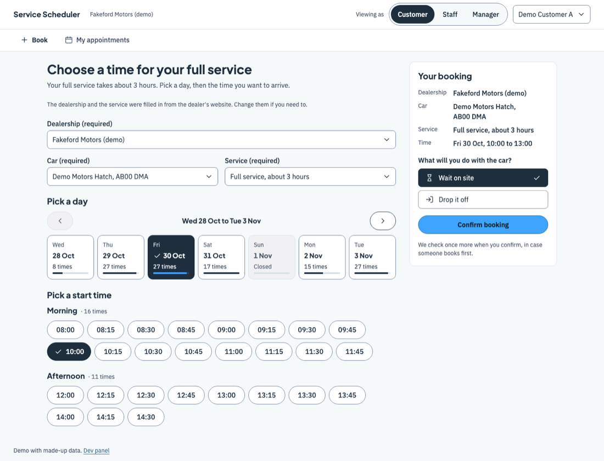 | 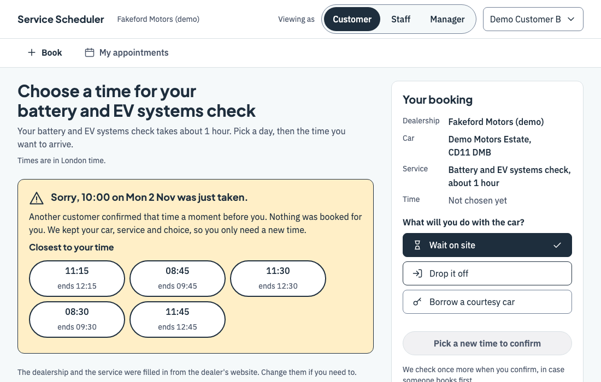 | 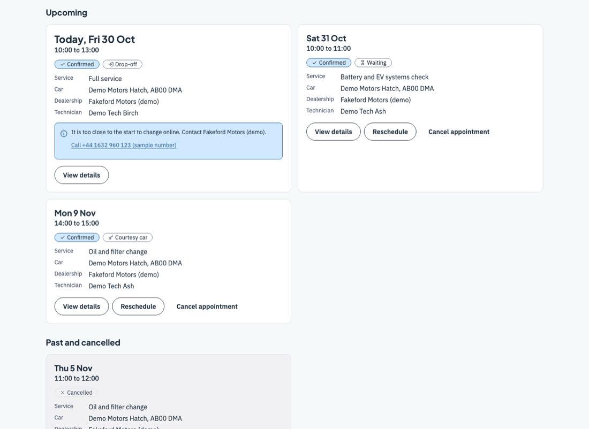 | 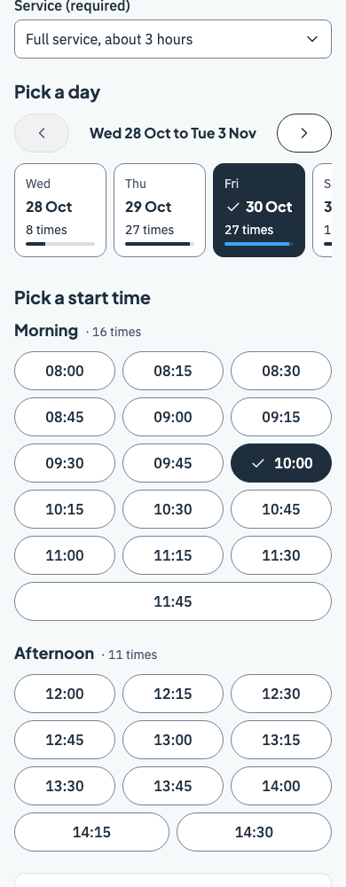 |
|                                      Choose a service, a day and a time. The summary stays in view.                                       |                       The time was taken a moment ago: an apology and the closest times.                        |                                       Reschedule or cancel from here.                                       |                             The same page on a 390 px wide phone.                             |

### Staff: see the day, book for a customer

Staff see each technician's day on a timeline. Free gaps are dashed: tap one to book for a customer, new or existing. Staff work at one dealership only.

|                                                 Schedule (desktop)                                                 |                                           Schedule (phone)                                           |
| :----------------------------------------------------------------------------------------------------------------: | :--------------------------------------------------------------------------------------------------: |
| 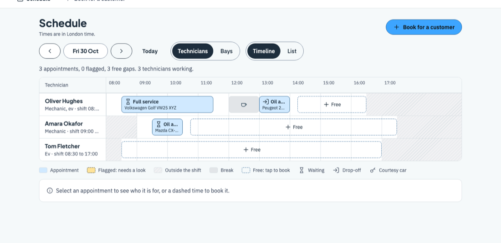 | 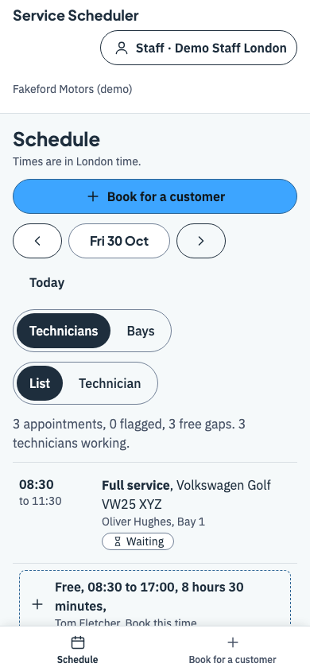 |
|                        Bookings, breaks, shifts and free gaps, one row for each technician.                        |                               On a phone the timeline becomes a list.                                |

### Manager: adjust, flag, message

The manager can do all of the above, and also adjust a booking (new time, technician or bay), change opening hours and technician shifts, and read the outbox. When a change leaves a booking outside the hours or the shift, the booking is **not deleted**: it appears in a **Flagged** list for the manager to move or cancel.

|                                                        Flagged list                                                         |                                                 Outbox                                                  |                                          Dev panel                                          |
| :-------------------------------------------------------------------------------------------------------------------------: | :-----------------------------------------------------------------------------------------------------: | :-----------------------------------------------------------------------------------------: |
| 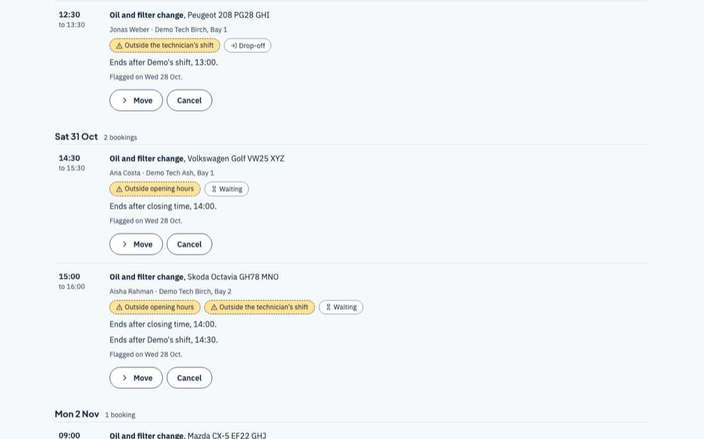 | 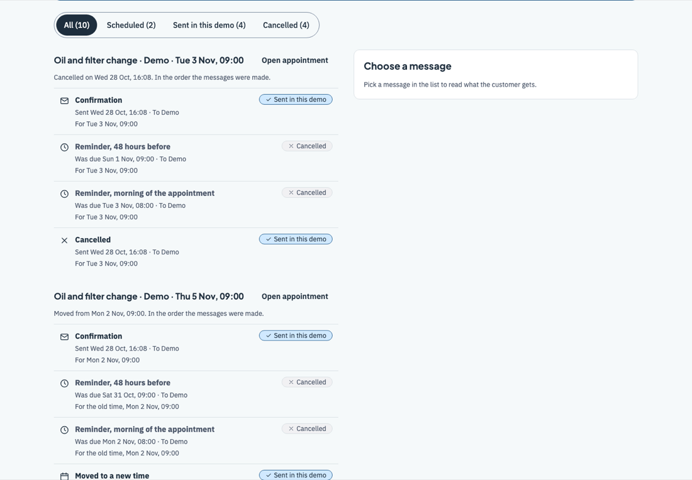 | 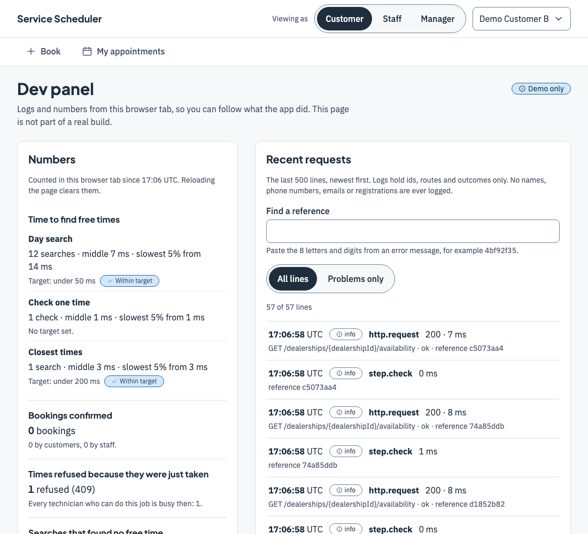 |
|                                  Each flagged booking says why, and offers Move or Cancel.                                  |          The confirmations and reminders a real system would send. Nothing leaves the browser.          |         Logs and numbers from the demo, for anyone who wants to see what happened.          |

On a phone, the same manager screens fit a narrow page:

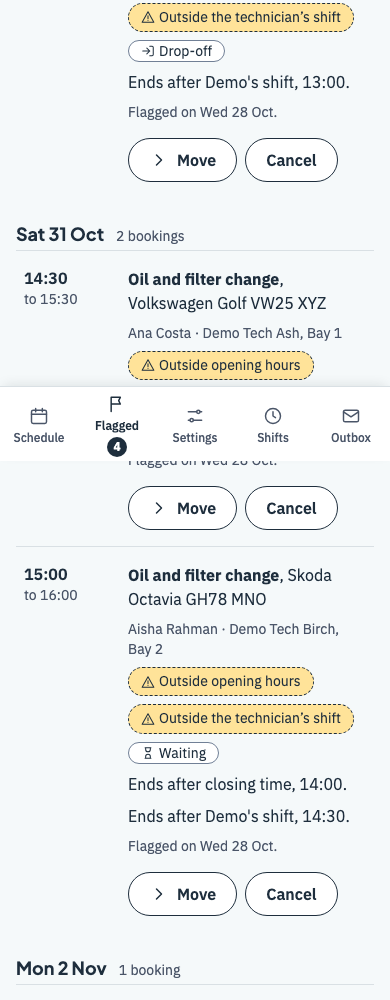 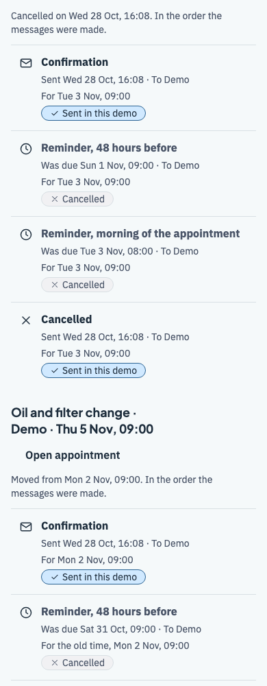 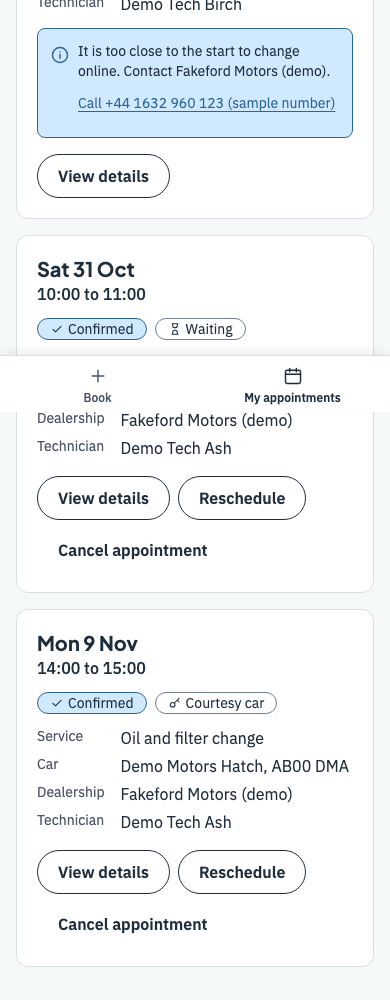

## Why it is interesting

- **The first Confirm wins.** Two people pressing Confirm for the same last time get one booking. The other person gets an apology and the closest free times. The page also warns you early if the time you chose has been taken while you were filling in the form.
- **Time zones and clock changes.** Times are always shown in the dealership's own clock (London and Saigon in the demo), and the page tells you when your browser is in another zone. The tests cover the days when the clocks change.
- **Shifts, breaks and lead time.** A technician's shift, leave and the rest break after each job decide which times can be offered. There is a minimum notice before a booking, and a limit on how far ahead one can be made.
- **Flags when hours change.** Shortening a day or changing a shift never deletes a booking. It flags the ones that no longer fit.
- **Reminders in the outbox.** Every booking creates a confirmation, a reminder 48 hours before and a reminder on the morning of the appointment, ready to read in the manager's outbox.
- **Built for everyone.** Pages pass automated WCAG AA accessibility checks (axe-core) at phone and desktop widths, for every role.
- **You can see what it does.** A dev panel shows a log line for every request, timings and counts, with no names or phone numbers in them.
- **Ready for a real backend.** The screens talk to one typed API client. A build setting points it at a real server instead of the mock, and the repository holds a PostgreSQL schema that lets the database itself refuse an overlapping booking.

The two-tab race, side by side. Both customers press Confirm at the same moment. One gets the booking, the other gets the apology:

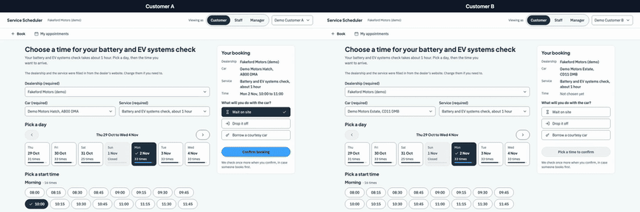

## What's inside

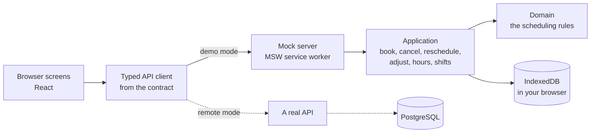

Solid lines are what runs today. Dotted lines are the design for a real backend: the same contract, a real server and a PostgreSQL database.

### Folder map

```
src/
  domain/          the scheduling rules: plain TypeScript, no browser, no framework, no clock
  application/     the booking commands and queries, and role checks
  infrastructure/  storage (in memory and IndexedDB), the sample data, logs and metrics
  api/             the API contract (OpenAPI), the mock server and the typed client
  ui/              the React screens; they reach everything else only through the API client
  config/          reads the two settings below
  styles/          design tokens and fonts
tests/             contract, end-to-end and script tests
docs/
  system-design.md   the System Design Document
  postgres/          the real backend's database schema, with its checks
  ai-collaboration/  how the work was run: process, roles, log, cost, requirements and decisions
  images/            the pictures in this file
```

**The import rule:** a folder may import only from the layers below it (`domain` imports nothing from the others, and `ui` never imports `domain` or `infrastructure`). The linter fails the build if this is broken.

### Tech stack

| Tool                                | Why                                                                                           |
| ----------------------------------- | --------------------------------------------------------------------------------------------- |
| React, TypeScript, Vite             | A fast app to build, with types that keep the scheduling rules honest.                        |
| Tailwind CSS                        | One file of design tokens keeps colours and spacing the same everywhere.                      |
| MSW (Mock Service Worker)           | The mock answers the app's real network calls, so the screens do not know it is a mock.       |
| OpenAPI contract, openapi-fetch     | One written contract; the client types and the tests both come from it, so they cannot drift. |
| Dexie on IndexedDB                  | Bookings survive a reload, and "check again, then write" is all or nothing.                   |
| Temporal (polyfill)                 | The clearest way to get clock changes and time zones right.                                   |
| React Router, TanStack Query        | Deep links, and one setting each for "refresh after a booking" and "never retry a write".     |
| React Hook Form, Zod                | Describe each field once; the form keeps what you typed after a refused booking.              |
| Vitest, Testing Library, fast-check | Fast tests for the rules, the screens, and random schedules.                                  |
| Playwright, axe-core                | Real-browser tests, the two-tab race, and the accessibility checks.                           |
| ESLint, Prettier, Spectral          | One command checks the code, the folder rules and the API contract.                           |
| PostgreSQL (design only)            | Exclusion constraints let the database refuse an overlapping booking.                         |

## Run it yourself

You need **Node 22** (the repository pins 22.17.1 in `.nvmrc`) and npm. Run these from the repository's folder:

```sh
npm ci                      # install exactly what package-lock.json says
npm run dev                 # start the app at http://localhost:5173 (stop it with Ctrl+C)
npm run build               # check the generated API code, build into dist/, check the built page
npm run preview             # serve the built page, as a real host would
```

Open the address that `npm run dev` prints. **Reload once after you pull or build a new version:** the mock runs as a service worker, and a browser can keep the old one until the page is reloaded.

### Settings

| Variable            | Values             | Default | What it does                                                                                                                                                                                                                |
| ------------------- | ------------------ | ------- | --------------------------------------------------------------------------------------------------------------------------------------------------------------------------------------------------------------------------- |
| `VITE_API_MODE`     | `mock` or `remote` | `mock`  | `mock` starts the mock server in the browser, with demo users, sample data and the dev panel. `remote` sends every call to a real backend and leaves all of that out of the build (`npm run check:remote-build` proves it). |
| `VITE_API_BASE_URL` | an address         | `/api`  | Where the API answers. In `remote` mode it must start with `https://` (or `http://localhost` for local work) and hold no user name or password.                                                                             |

### Demo users

There is no password: this is a demo. Pick who you are with **Viewing as** at the top (on a phone, the button at the top opens the same choice). Your choice is kept in your browser.

| User                | Role     | Dealership |
| ------------------- | -------- | ---------- |
| Demo Customer A     | customer | none       |
| Demo Customer B     | customer | none       |
| Demo Staff London   | staff    | London     |
| Demo Manager London | manager  | London     |
| Demo Staff Saigon   | staff    | Saigon     |
| Demo Manager Saigon | manager  | Saigon     |

All people, cars and contact details in the sample data are made up.

### Five things to try, in this order

1. **Book a time.** As Demo Customer A, pick a dealership, a car and a service, then a day and a time, and confirm.
2. **See it on the staff schedule.** Switch to Demo Staff London. Your booking is on its technician's row. Tap a free gap to book for a customer.
3. **Cancel and reschedule.** Switch back to Demo Customer A and open **My appointments**. Move a booking or cancel it.
4. **Adjust and flag.** Switch to Demo Manager London. Adjust a booking on the schedule. Then shorten a day's opening hours under **Settings**, or change a technician's shift under **Shifts**. Bookings that no longer fit show up under **Flagged**.
5. **Read the outbox.** As the manager, open **Outbox** to see the confirmations and reminders.

To see the race yourself, open the app in two tabs as Demo Customer A and Demo Customer B, choose the same time in both, and press Confirm in each.

### Start again

Your bookings live in your browser (IndexedDB), so they survive a reload. To go back to the sample data, open the **Dev panel** (the link at the bottom of every page, or `/dev`) and press **Reset demo data**. Other browsers are not touched.

## Tests

The scheduling rules are plain TypeScript with no React and no browser, so they are tested fast and on their own. In plain words, the tests check:

- two people confirming the same last time: exactly one wins and the other is offered other times;
- times that touch but do not overlap (a job ending at 10:00 does not clash with one starting at 10:00);
- technician shifts, leave and the rest break after each job;
- opening hours and single-day changes;
- clock changes, in the dealership's own time zone, with the tests also run on a machine set to two other time zones;
- that every page each role can open passes the accessibility checks, at phone and desktop width;
- that no name, phone number or email ends up in a log line.

The numbers come from the [Results](docs/system-design.md#results) of the System Design Document: **more than 1300 unit, component and contract tests**, and **about 380 end-to-end tests** in Chromium, all passing. Coverage of the scheduling rules is above 99% of lines.

```sh
npm run lint                # ESLint, Prettier and a lint of the API contract
npm run typecheck           # TypeScript, no output files
npm test                    # all unit, component and contract tests
npm run test:tz             # the tests that draw no screens, in UTC and in Pacific/Kiritimati
npm run test:coverage       # all tests, with a coverage report in coverage/
npx playwright install chromium   # once, to get the browser
npm run e2e                 # end-to-end tests in Chromium, against the built app (about 380 tests)
npm run check:deps          # every runtime library is on the approved list
npm run check:remote-build  # a build for a real backend holds no demo-only code
npm run check:public-docs   # this README and docs/ai-collaboration hold no secrets, local paths or reference codes
```

To run only the scheduling rules: `npx vitest run src/domain src/application`. `npm run e2e:other` runs the end-to-end tests in Firefox and WebKit too; see [Known limits](#known-limits). GitHub Actions runs all of these on every push and pull request.

## AI Collaboration Narrative

I used AI agents for most of the typing and kept the decisions, the checking and the corrections for myself. The files named here are copies in [`docs/ai-collaboration/`](docs/ai-collaboration/index.md).

### How I guided the AI

- **A process, not a chat.** The work ran through a small process called VTC Lite ([the process](docs/ai-collaboration/claude/skills/vtc-lite/SKILL.md)). Every message I sent was saved word for word in a private work repository, then turned into requirements with acceptance criteria and decisions with reasons, and committed. Each piece of work was a ticket with acceptance criteria, built on its own branch and opened as a pull request.
- **Roles.** Different agents did different jobs, each with its own instructions: a [researcher](docs/ai-collaboration/claude/agents/researcher.md), an [architect](docs/ai-collaboration/claude/agents/architect.md), a [designer](docs/ai-collaboration/claude/agents/designer.md), a [planner](docs/ai-collaboration/claude/agents/planner.md), an [engineer](docs/ai-collaboration/claude/agents/engineer.md) (the only one that writes product code), a [reviewer](docs/ai-collaboration/claude/agents/reviewer.md) and a [security reviewer](docs/ai-collaboration/claude/agents/security.md). The reviewer and the security reviewer start with no memory of the builder's work.
- **Ask, do not decide alone.** I told the AI that anything needing confirmation (a product rule, a new library, a design choice, a trade-off with no clear winner) must be asked, not decided. An agent that reaches such a point writes a question with the options and a recommendation, and waits for me. Every answer was recorded with its reason.
- **Build order.** The core first: the scheduling rules and their tests, then customer booking, the staff schedule, cancel and reschedule, the manager screens, and last courtesy cars and the reminder outbox. Every screen was approved on a clickable prototype before it was coded.

### How I checked and improved what it gave me

Each example says what I asked, what came back, how I checked it, and whether I kept, changed or dropped it. The first five are from my [AI collaboration log](docs/ai-collaboration/context/ai-collaboration-log.md); the last three come from the screen phase.

1. **Who uses the app (2026-10-28).** I described the problem: customers book, staff check the schedule, the manager adjusts it. The AI wrote the requirements but had assumed only a service advisor uses the app. I read them against the brief and told it that was wrong. **Changed** by me: three kinds of user.
2. **One garage (2026-10-28).** I asked for technician shifts and opening hours. The AI had assumed one garage with fixed hours. **Changed** by me: several dealerships, hours each one sets, and a change for a single day.
3. **New customers (2026-10-28).** I asked that staff can book for a customer. The AI first allowed existing customers only. **Changed** by me: new customers too.
4. **Claims marked unverified, then proven (2026-10-28).** In the architecture the AI marked two database claims it could not prove. I had them tested on a real PostgreSQL 17 database before relying on them: the database refuses an overlapping booking, and the uuid columns work with the overlap rule. 20 of 20 checks passed. **Kept**, now proven ([the pull request](https://github.com/thienba/unified-service-scheduler/pull/1)).
5. **A security review that found what the builder missed (2026-10-28).** The API contract and mock were checked by a separate security agent after the builder and the code reviewer. It found a broken URL escape that crashed the mock with a server error, and an "https only" check for a real backend that a tricky address could fool. **Changed**: both fixed with tests before the pull request was merged ([the pull request](https://github.com/thienba/unified-service-scheduler/pull/10)).
6. **The manager books for a customer (2026-10-28, prototype review).** The approved design gave "Book for a customer" to staff only. I said the manager must be able to book too, for example when a customer phones in. The AI then asked where the button goes, and I took its recommendation. **Changed** by me: a "Book for a customer" button on the schedule ([built here](https://github.com/thienba/unified-service-scheduler/pull/22), checked by an end-to-end scenario in [this pull request](https://github.com/thienba/unified-service-scheduler/pull/27)).
7. **A staff member at two dealerships (2026-10-29).** While building the staff booking screens, the AI found that a staff user linked to two dealerships booked at the wrong one from a free gap. The AI offered three fixes, each keeping that user. I read them and chose none: each staff member works at one dealership only. **Changed** by me: the two-site user removed ([the pull request](https://github.com/thienba/unified-service-scheduler/pull/25)).
8. **Holding a time (2026-10-29).** I asked whether a time can be held while the customer fills in the form. The AI wrote three options with their costs: no hold, a 5-minute hold, or no hold with an early warning. I weighed the costs and took the early warning. **Kept** the recommendation; the hold is written down as a considered extension ([the pull request](https://github.com/thienba/unified-service-scheduler/pull/29)).

### How I made sure the final quality was good

- **Tests written from the acceptance criteria.** Each ticket lists acceptance criteria, and the engineer writes a test for each one and first checks that it fails for the reason the ticket names ([engineer instructions](docs/ai-collaboration/claude/agents/engineer.md)). The end-to-end demo scenarios follow the requirements one by one. The numbers are in [Tests](#tests).
- **A reviewer in a fresh context for every ticket.** It checks the diff against the criteria with no memory of the build ([reviewer instructions](docs/ai-collaboration/claude/agents/reviewer.md)). It found a real bug the builder had only worked around: the browser database closed a read early after a few lookups; a new test now fails without the fix ([the pull request](https://github.com/thienba/unified-service-scheduler/pull/7)). On the staff booking screens, the first review asked for changes, a fix round added a test for each finding, and a second fresh review passed.
- **Evidence in every pull request.** Screenshots of every state at phone and desktop width, test and coverage screenshots, and videos. For example the screens in [this pull request](https://github.com/thienba/unified-service-scheduler/pull/16), and the two-tab race video in [this one](https://github.com/thienba/unified-service-scheduler/pull/27).
- **Claims marked unverified until a test settles them.** The research and the architecture marked every claim they could not check. Example 4 shows two that a test settled; the rest are listed in the System Design Document under [Claims marked unverified](docs/system-design.md#claims-marked-unverified).
- **The cost log.** Every run's tokens and price are written down ([cost log](docs/ai-collaboration/cost.md)). On 2026-10-29, after its last row, the total was **566,550,105 tokens, about 213.46 USD** at API prices, over 8 runs.

## Documents

- [System Design Document](docs/system-design.md): the design, the flows, the security notes, the results and the assumptions.
- [AI collaboration files](docs/ai-collaboration/index.md): the process, the agent roles, the log, the cost, and the requirements and decisions behind the work.
- [PostgreSQL schema](docs/postgres/schema.sql) and [its checks](docs/postgres/check.sql): the database a real backend would use.
- [The API contract](src/api/contract/openapi.yaml): every call the app makes, written first.

## Known limits

- **It is a demo with a mock server.** The "server" runs in your own browser, so the role and dealership checks show the rules and make them testable, but they protect nothing: anyone can change the role or edit the stored data. The [security section](docs/system-design.md#security-and-privacy) of the System Design Document says what a real backend must do instead.
- **One car can have two appointments at the same time.** Nothing checks the car, only the bay, the technician and the courtesy car. It was left out for the deadline.
- **No time is held** while you fill in the form. The page checks your chosen time again every 30 seconds and warns you early if it was taken. A short hold is a considered extension.
- **Firefox and WebKit are only partly covered.** The full end-to-end run there is a warning-only job with known failures, mostly focus and visibility checks in WebKit. Only the race and the security-policy tests are claimed for those two browsers, and two browser messages are set aside in those tests.
- **Some claims are still unverified**, such as whether one Safari message also appears in real Safari. The list, with what is settled, is in the System Design Document under [Claims marked unverified](docs/system-design.md#claims-marked-unverified).
- **The live demo is deployed by hand.** It is not linked to the repository, so a push does not update it.
- **Sample data only.** All people, cars and numbers are made up.
