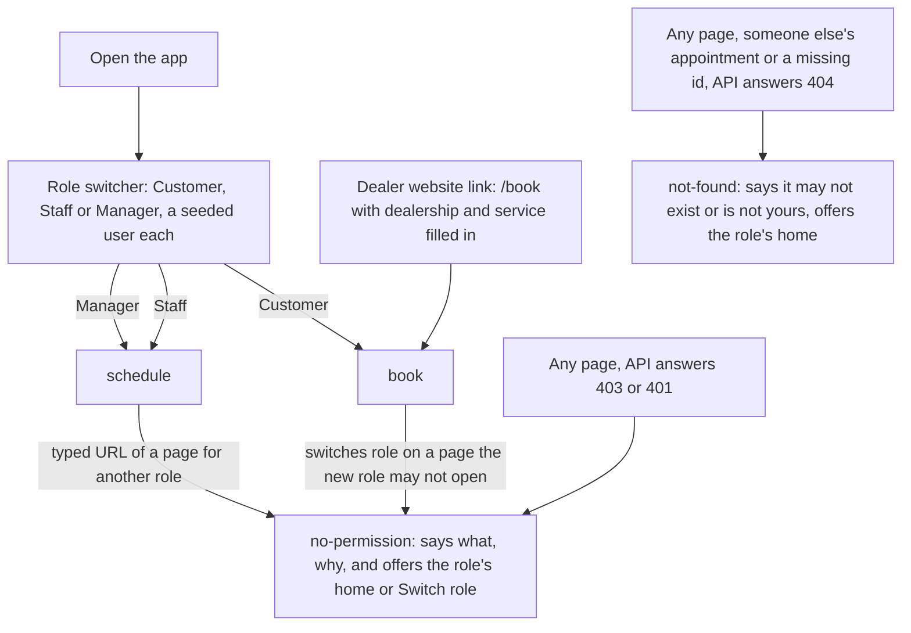
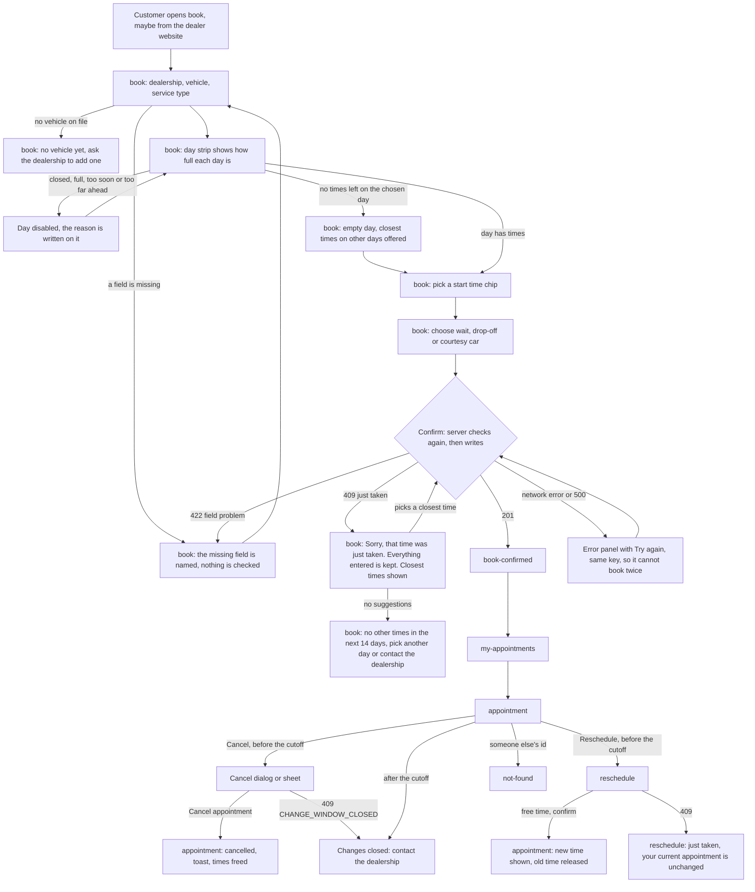
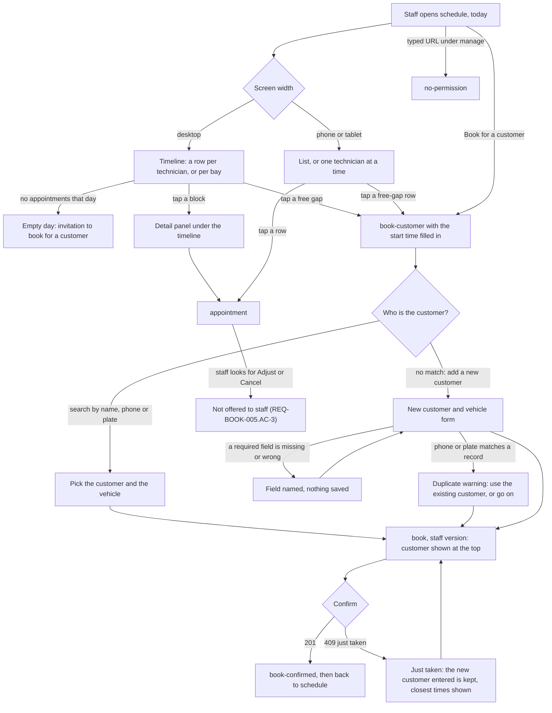
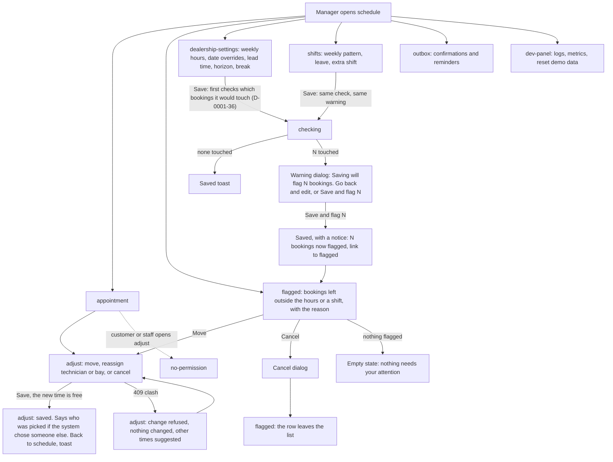

# Design: Unified Service Scheduler (B0b, the shared foundation)

Written 2026-10-28 by the designer role. This file is the single design contract for the product. B1, B2 and B3 design their flows on top of it; only B0 and B4 edit it (plan.md, Track B).

**B4 (stitch and check), 2026-10-28.** The three flows were checked against this file and stitched into one clickable prototype, `design/prototype.html` (the start page: pick a role, then every page and every state). Where B1, B2 and B3 proposed something new, B4 decided it; the changes are written into sections 2, 3, 4, 7, 8 and 9 below, and section 13 is the log (what was accepted, adapted or rejected, and why). Section 14 says where each screen is drawn.

**Inputs read:** overview.md (NFR-1..7), plan.md Track B, architecture.md (statuses, flags, error codes, the 409 with suggestions, endpoints), research.md Q6, `design/brand/*`, `design/directions.md`, `design/direction-a.html`, `design/direction-b.html`, D-0000-4, -10, -12, -14, -16, -17, -19, -21, and `0001-booking/` (REQ-BOOK-001..014, D-0001-1..16, the open Q-files).

**Files this step wrote:** this file; the shared tokens in `design/brand/` (`tokens.css`, `tokens.json`, `README.md`); the prototype `design/foundation.html`; two questions for the human, [D-0001-20](0001-booking/D-0001-20.md) and [D-0001-21](0001-booking/D-0001-21.md).

**Words (D-0000-14, D-0000-10).** The screens say Dealership, Service bay, Technician, Appointment, Customer, Vehicle, Service type. Plain everyday English in every label, error and empty state.

---

## 1. Open points that touch the design

| Point | What it changes in the design | Status |
|---|---|---|
| [D-0001-20](0001-booking/D-0001-20.md): does tapping a free gap fix the technician? | Only the words in the booking summary's Technician row ("Picked for you" or the technician's name). | Waiting for the human. B2 finishes the staff booking screen after the answer. |
| [D-0001-21](0001-booking/D-0001-21.md): where are free gaps worked out, and how short may one be? | Nothing visible. The timeline draws only the gaps the API returns. | Waiting for the human. |
| [D-0001-19](0001-booking/D-0001-19.md): can staff cancel or move an appointment? | Whether the appointment screen shows Cancel to staff. The design shows it to the customer (before the cutoff) and to the manager only, as REQ-BOOK-005.AC-3 and Q-0001-7 read. | Waiting for the human. |
| Routes | architecture.md fixes only `/book?dealership=…&service=…`. The routes in section 5 are proposed here from its endpoints and D-0000-19 (React Router). | The architect should copy the table into architecture.md. |
| Theme | One light theme. The brief for B0b said "light only unless you find a reason"; none was found (the human chose the light direction, D-0001-13). | Closed. |

Small choices made inside the design that are not worth a question, so B1–B3 can change them with a reason: the car choice (wait, drop-off, courtesy car) has **no default** and is named as a missing field if skipped (REQ-BOOK-001.AC-2 style), so nobody books "wait" without choosing it; demo role switching lives in the header and never on a page body.

---

## 2. Direction: A, Front desk, plus B's free gaps (D-0001-13)

Chosen by the human. Not taken from B: the dark theme, the month grid, the shift-usage column. Not taken from C: anything.

**What it refuses.** The category's look is a month calendar followed by a wall of identical blue buttons for the customer, and a rainbow calendar that draws only what is busy for staff. Its predictable opposite is a dark neon "mission control" board. This product uses neither.

### Direction contract

- **THESIS:** The day is the unit people decide on: the customer sees how full each day is before opening it, and staff see free time as plainly as booked time. It refuses the month calendar with a wall of identical time buttons, and the staff calendar that draws only what is busy.
- **OWN-WORLD:** The service reception desk. White and pale blue-grey counters, navy type. Signal-blue is a fill only for the one action on a screen and a pale tint for appointments. Yellow tint with an icon and words is the only "look at this" colour. Hatching means time that does not exist (off shift); a dashed outline means time that can be taken (a free gap). Flat panels with a 1px border: 12px panels, 8px blocks and fields, pill buttons and chips. A shadow only on what sits above the page (toast, dialog, sheet, phone bars). Plus Jakarta Sans for headings, IBM Plex Sans for everything else, tabular figures for times and plates.
- **STORY:** The customer sees which day suits, picks a start time, says what happens to the car, and confirms; if someone was first, they read a plain apology and press one of the closest times. Staff read the day by technician, see where there is room, and tap a gap to start a booking. The manager sees what needs attention first (flagged bookings), moves or adjusts it, and after editing hours or shifts sees exactly which bookings the edit touched.
- **FIRST VIEWPORT:**
  - Customer, desktop: page title "Choose a time for your full service" top left; below it the seven-day strip (weekday, date, "18 times", a thin fill bar; closed or full days greyed and labelled in words); then "Morning" and "Afternoon" groups of time chips. The booking summary is a 22rem panel on the right with the car choice and the Confirm button.
  - Customer, phone (360 px): title, a week stepper and the strip scrolling sideways inside its own row, the chips two or three across, the summary below, and a sticky bar at the bottom with the chosen time and Confirm. The bottom tabs are hidden on this page.
  - Staff, desktop: "Schedule" title, day stepper, Technicians/Bays switch, Timeline/List switch, "Book for a customer" at the top right; the facts line ("9 appointments, 1 flagged, 3 free gaps"); the timeline with 64px rows, a hatched off-shift area, break markers, a "now" line and dashed free gaps; a detail panel for the selected block.
  - Staff, phone: title, "Book for a customer" full width, day stepper, a List/Technician switch; the list in time order with free-gap rows between appointments; the bottom tabs.
  - Manager: Schedule as staff; Flagged opens with the flagged bookings first, each with its reason and a Move button; settings screens open on the current values with the number of bookings an edit would touch shown after saving.
- **FORM:** Reception desk, first of the seven candidate worlds listed in directions.md, with B's free gaps added by D-0001-13. Dealt: Restrained colour (white and `surface-page`, navy for selection, signal-blue for the action and the appointment tint, yellow for attention only); the pinned company pairing, Plus Jakarta Sans and IBM Plex Sans (both on the font blocklist; kept because the human asked for the company fonts, D-0000-4, and no other face could satisfy that); roomy density on a 12-column grid at desktop, one column on a phone; 12px/8px/pill radii, elevation 0 by default; quick ease-out motion (120–240 ms); signature moves: the day strip that shows how full each day is, and the dashed free gap that starts a booking.
- **FINISH:** unreviewed is unfinished; this screen is done when every state renders in both themes and Visual QA has judged the build against this contract. *(There is one theme, light; "both themes" is met by the one theme at phone and at desktop width. Visual QA judges every screen at 390 px and at 1280 px.)*

### Mode per screen

All working screens are **Operate**: the world lends type, palette, density and the two signature moves; controls and navigation are standard. `book-confirmed` and `outbox` are **Read**: the reader's question ("is it booked? what was sent?") leads, in a calm column of at most 65ch. Nothing is Persuade or Experience: the customer arrives from the dealer's own website (D-0000-16).

### Generic defaults this product avoids

| Default | What is used instead |
|---|---|
| Month calendar, then a grid of identical blue time buttons | Seven-day strip with a fullness bar and a count in words; chips grouped Morning/Afternoon; the selected chip is navy with a tick |
| Rainbow staff calendar drawing only busy time | One tint for appointments; hatching for off-shift; dashed outline for free time; yellow only for flags |
| Card grid of icon + heading + text | Flat bordered panels and rows; no nested cards |
| Hero numbers ("18 free slots!") | The count is a quiet word on the day ("18 times") |
| Modal for everything | A dialog only for cancel, discard, reset and the "this save will flag N bookings" warning (B4 added the last one: it protects a choice that touches many bookings); a bottom sheet on a phone; everything else is a page |
| Blue text and red text | Navy text; `text-link` for blue; `text-danger` for red; colour never alone |
| Floating action button, hamburger menu | Bottom tab bar on a phone; top tabs on desktop; primary action in the page |
| Eyebrow labels above headings, section numbers, gradient text, glass | None. The heading carries itself. |

---

## 3. Breakpoints and the phone/desktop rule (NFR-7)

Breakpoints are tokens (`design/brand/tokens.css`): **phone** below `sm` 640 px (designed from 360, nothing breaks at 320), **tablet** 640–1023, **desktop** from `lg` 1024. The base styles are the phone's; wider layouts add to them.

**Rules for every screen**

1. The page never scrolls sideways at 320 px and up, or at 200% zoom. Two inner scroll regions are allowed, each focusable with a label, and each stays inside its own box: the day strip on a phone, and the timeline on a desktop narrower than its day. Everything else wraps. Grid children get `min-width: 0`; names and addresses wrap anywhere; plates never wrap.
2. Touch targets are at least 44 × 44 px (`size-target`), including the gaps between them of at least 8px (`space-2`). Buttons, chips, fields, rows, tabs, the free gap. **One exception (B4, staff P9):** the options of a SegmentedControl sit 4px apart (`space-1`) inside their one pill. The pill is a single control with one border, each option is at least 44px high and wide, and a mis-tap lands on the neighbouring option of the same control, which is one tap to undo. **Second exception (D-0001-131):** the rows of an open list (Select, TimeField) and the days of a calendar sit edge to edge with no gap, like the rows of a ListRow (8.13). Each row is at least 44px high and the full width of the list, each day is at least 44 × 44px, and a mis-tap lands on the neighbour, which is one tap to undo. Every other pair of targets keeps 8px.
3. Tables become lists on a phone. A list row keeps what the screen is for visible: for appointments the time, service, vehicle, technician, bay, car choice and flag; for flagged bookings the reason and Move; never "tap to see".
4. Primary action stays in reach: on a phone, task screens (book, reschedule, adjust, book for a customer, settings forms) hide the bottom tabs and show a **sticky action bar** (primary button on the right, the chosen thing on the left). The bar sits above the browser's safe area.
5. Dialogs become **bottom sheets** below `sm`: full width, rounded top corners, max height 90% of the screen, content scrolls inside, close button at least 44px, actions stacked with the main action on top. **The open list of a Select or TimeField and the open calendar of a DatePicker do the same** (D-0001-131): popovers from `sm`, the same bottom sheet below it (8.27).
6. The staff timeline needs width. From `lg` it is the default; below `lg` the screen offers **List** (default) and **Technician** (one technician's day, hours running down the page). The bay toggle works in all three. The choice is kept in the URL (`?view=`).
7. Forms are one column on a phone and two columns from `sm` where fields pair naturally (first and last name are one field here, so mostly date + time, start + end).
8. Text never goes below `xs` (12px), only on badges and timeline sub-labels. Body is 16px on every width, so iOS does not zoom a focused field.

| Screen | Phone (< 640) | Tablet (640–1023) | Desktop (≥ 1024) |
|---|---|---|---|
| `book` | One column. Strip scrolls inside its row. Chips 2–3 across. Summary below the chips; sticky action bar; no tab bar. | One column, wider chips; summary below; sticky action bar. | Picker left, summary panel 22rem right (sticky). No action bar. |
| `book-confirmed` | One column; actions stacked. | Same, 65ch column. | 65ch column, actions in a row. |
| `my-appointments` | Appointment cards in one column; actions are buttons under each card. | Two columns. | Two columns; filter in the title row. |
| `appointment` | One column; actions in a sticky bar when there are any. | One column up to 767 px (B1: at 640 px a 22rem side column would leave 208 px for the facts); two columns (facts, actions) from `md` 768. | Two columns. |
| `reschedule` | As `book`, with a panel "Your current time stays until the new one is confirmed". | As `book`. | As `book`. |
| `book-customer` | Steps stacked; search result rows are full-width buttons; sticky Continue. | Search and result side by side from `md`. | Same. |
| `schedule` | List (default) or Technician view; free-gap rows; day stepper; tab bar. | List or Technician with a detail sheet. | Timeline (default), List, Bays; detail panel under the timeline. |
| `adjust` | Form stacked; the suggestions are full-width buttons; sticky Save. | Two columns. | Form left, "what changes" panel right. |
| `flagged` | Rows with reason + Move button each. | Same. | Same, wider. |
| `dealership-settings`, `shifts` | Weekday rows stacked (one weekday = one panel with its fields); sticky Save. | Two fields per row. | Weekday grid with columns. |
| `outbox` | Message rows: kind, recipient, when, state; tap opens a sheet with the text. | Same. | Two-pane list and message. |
| `dev-panel` | Metrics in a list; logs in a scrollable list, one line each, wrap. | Same. | Two columns. |

---

## 4. Flows

### 4.1 Entry, roles and permission

### 4.2 Customer (B1)

### 4.3 Staff (B2)

### 4.4 Manager (B3)

---

## 5. Screens

Routes are proposed here (see section 1). `?` marks a query value. Requirement ids are the ones the screen has to let a user do or see. **Owner** is the Track B designer who details the screen in their own file.

States every data screen has: `loading`, `empty` (when a list can be empty), `error`, `success`, `no-permission`. Others are named per screen.

| id | route | Who | Mode | States (besides the five) | Requirements | Owner |
|---|---|---|---|---|---|---|
| `home` | `/` | all | n/a | redirects: customer → `book`, staff and manager → `schedule` | REQ-BOOK-005.AC-3 (role home) | B4 |
| `book` | `/book?dealership&service&customerId&vehicleId` | customer; staff and manager (with a customer chosen) | Operate | `idle`, `time-chosen`, `validation` (missing field named), `no-vehicle`, `empty-day`, `closed-day`, `deep-link`, `confirming`, **`conflict`** (409 just taken, with suggestions), `conflict-empty` (no suggestions), `staff` (customer shown at top) | REQ-BOOK-001, 002, 003.AC-1, 007.AC-1, 007.AC-4 (closed days), 009.AC-1..5, 010.AC-1, 011.AC-1/2 | B1 (staff variant: B2) |
| `book-confirmed` | `/book/confirmed/:appointmentId` | all roles that booked | Read | `success`, `not-found` | REQ-BOOK-003.AC-1/2, 013.AC-1 (what will be sent), 010 | B1 |
| `my-appointments` | `/appointments` | customer | Operate | `upcoming`, `past-and-cancelled`, `empty` (invitation to book) | REQ-BOOK-003.AC-2, 012.AC-1 | B1 |
| `appointment` | `/appointments/:appointmentId` | owner, staff, manager | Operate | `confirmed`, `cancelled`, `flagged` (staff and manager), `change-closed` (after the cutoff), `cancel-dialog`, `cancelling`, `cancel-refused`, `not-found` | REQ-BOOK-003.AC-1, 004.AC-1, 010.AC-2, 012.AC-1/4/5 | B1 (manager actions: B3) |
| `reschedule` | `/appointments/:appointmentId/reschedule` | customer | Operate | as `book` plus `change-closed`; `conflict` says the current appointment is unchanged | REQ-BOOK-012.AC-2/3/4, 009 | B1 |
| `book-customer` | `/book/for-customer?start&technicianId` | staff, manager | Operate | `idle`, `searching`, `results`, `no-results` (invites "Add a new customer"), `new-customer`, `validation`, `duplicate-warning` | REQ-BOOK-014.AC-1/2/3/5 | B2 |
| `schedule` | `/schedule?date&dealership&rows=technicians\|bays&view=timeline\|list\|technician` | staff, manager | Operate | `timeline`, `list`, `technician`, `bays`, `empty-day`, `closed-day`, `selected` (detail panel) | REQ-BOOK-004.AC-1..6, 006.AC-4, 010.AC-2, 013.AC-2 (zone shown) | B2 |
| `adjust` | `/appointments/:appointmentId/adjust` | manager | Operate | `idle`, `checking`, **`clash`** (refused, suggestions, nothing changed), `saved`, `already-flagged` | REQ-BOOK-005.AC-1/2/3 | B3 |
| `flagged` | `/manage/flagged` | manager | Operate | `list`, `empty` ("nothing needs your attention") | REQ-BOOK-007 (flag after an hours cut), 008.AC-4, 005.AC-1 | B3 |
| `dealership-settings` | `/manage/dealership?dealership` | manager | Operate | `idle`, `dirty`, `validation`, `saving`, `saved`, `saved-with-flags` | REQ-BOOK-007.AC-1..5, 011.AC-1..5 | B3 |
| `shifts` | `/manage/shifts?technicianId&dealership` | manager | Operate | `idle`, `dirty`, `validation`, `saving`, `saved`, `saved-with-flags` | REQ-BOOK-006, 008.AC-1..4 | B3 |
| `outbox` | `/manage/outbox?dealership&appointmentId` | manager | Read | `list`, `message-open`, `empty` | REQ-BOOK-013.AC-1..5 | B3 |
| `dev-panel` | `/dev` | all (demo only) | Operate | `logs`, `metrics`, `reset-dialog`, `empty` | NFR-6 | B3 |
| `no-permission` | rendered in place on any route the role may not open (the URL stays) | all | Operate | one state, with the role's home and Switch role as actions | REQ-BOOK-005.AC-3, 008.AC-3, 012.AC-5, 014.AC-5 | B1 writes the shared copy |
| `not-found` | `*` and any 404 from the API | all | Operate | one state | REQ-BOOK-012.AC-5 | B1 writes the shared copy |

**Coverage check.** REQ-BOOK-001 `book` · 002 `book`, `reschedule`, `adjust` (the grid and the suggestions come from one check) · 003 `book-confirmed`, `my-appointments` · 004 `schedule` · 005 `adjust`, `flagged`, `appointment` · 006 `schedule` (shading), `shifts` · 007 `dealership-settings`, `book` (closed days) · 008 `shifts`, `flagged` · 009 `book`, `reschedule`, `adjust` (clash), `book-customer` flow · 010 `book`, `schedule`, `appointment` · 011 `dealership-settings`, `book` (disabled days) · 012 `my-appointments`, `appointment`, `reschedule` · 013 `outbox`, `book-confirmed` · 014 `book-customer`, `book` · NFR-4 tokens · NFR-6 `dev-panel` · NFR-7 section 3 and every screen's phone/desktop rule.

---

## 6. Screen contracts (key screens)

Each: **Mode** · **User and job** · **Eye finds first** · **Primary action** · **Density** · **Hierarchy** · **Interaction** · **Responsive priority** · **Avoids**. B1–B3 write the per-flow detail; these fix what must not change.

### `book` (and `reschedule`, and the staff version)
- **Mode:** Operate. **User and job:** a customer who wants their car serviced picks a day and a start time they can live with, and says what happens to the car. Staff do the same on a customer's behalf, on the phone to them.
- **Eye finds first:** the selected day in the strip, then the chip row of times. On a conflict: the apology heading.
- **Primary action:** Confirm booking (signal fill, one per screen). Disabled until a time is chosen, with the reason written ("Pick a time to confirm").
- **Density:** roomy; a chip row, not a table. **Hierarchy:** title → strip → time groups → summary. The summary repeats the choice in words so the customer can check it before confirming.
- **Interaction:** day strip and chips are two radio groups (arrow keys, one tab stop each). A time shows only when a bay **and** a qualified technician are free for the whole job; the page says "We check once more when you confirm." On Confirm the button shows "Confirming…" and ignores a second press; the same idempotency key is reused for a retry (AD-5).
- **The conflict (REQ-BOOK-009.AC-2):** the panel replaces nothing: the page keeps all choices; focus moves to the panel's heading; heading "Sorry, 10:00 on Fri 30 Oct was just taken"; two sentences (what happened, nothing was booked); then "Closest to your time" (up to five, nearest first, each with its end time), "Same time, another day" if any; the taken chip stays in the grid struck through and marked "Just taken". Confirm is disabled and says "Pick a new time to confirm". Reasons from the API (`TECHNICIAN_BUSY` and the rest) are never shown raw; section 9 gives the words.
- **Responsive priority:** the sticky action bar on a phone; the strip scrolls inside its row; the summary stays below the times on tablet.
- **Avoids:** a month calendar, a modal for the apology, identical blue buttons, clearing the form after an error.

### `book-confirmed`
- **Mode:** Read. **User and job:** a customer wants to know it worked, and what happens next.
- **Eye finds first:** "You are booked" with the date, start and end time. **Primary action:** View my appointments (secondary style); "Add another booking" is a quiet link. Staff see "Back to schedule".
- **Density:** one calm column, 65ch. **Hierarchy:** result → what (service, vehicle, dealership, technician, bay, car choice) → what happens next ("We'll send a confirmation and reminders. In this demo they appear in the outbox.").
- **Avoids:** confetti, a hero tick, a stats row. A small success tint panel with a tick icon is enough.

### `my-appointments`
- **Mode:** Operate. **Job:** find my next appointment, change or cancel it. **Eye finds first:** the next upcoming appointment (first in the list, date large). **Primary action:** View on each; "Book a service" in the title row.
- **Interaction:** upcoming first, then past and cancelled under a separate heading. Cancel and Reschedule are buttons inside each appointment card, and read "Contact the dealership to change this" after the cutoff (REQ-BOOK-012.AC-4).
- **Empty state:** "You have no appointments yet" with "Book a service" as the one action.

### `appointment`
- **Mode:** Operate. **Job:** see everything about one appointment and act on it. **Eye finds first:** date and time range, then the status badge. **Primary action:** depends on role and time: customer before the cutoff, Reschedule (secondary) and Cancel (danger, in a dialog); manager, Adjust (primary); staff, none.
- **Hierarchy:** time → status and flag badges → facts (vehicle with plate, service, dealership, technician, bay, car choice, customer name for staff and manager) → actions. A flagged appointment carries a yellow panel above the facts that says why in words and offers Move to the manager.

### `book-customer` (B2)
- **Mode:** Operate. **Job:** staff on the phone find who is calling, fast. **Eye finds first:** the one search field ("Name, phone or number plate"). **Primary action:** Continue with the picked customer and vehicle. **Second path:** "Add a new customer" always visible under the field.
- **Interaction:** results appear as the user types, as full-width rows (name, phone last 4 digits visible, vehicles); the duplicate warning is an Alert with "Use this customer" and "Continue with a new one"; nothing is stored until the booking is confirmed (Q-0001-23). **Contact details never show in a URL.**

### `schedule` (B2)
- **Mode:** Operate. **User and job:** a service advisor reads the day, sees who is where and where there is room, and books into a gap. **Eye finds first:** the flagged block (if any), then the gaps; the "now" line orients. **Primary action:** Book for a customer (top right, or a tap on a free gap).
- **Density:** the roomiest the product gets: 64px rows (`size-row`), about five technicians per desktop screen, then scroll vertically.
- **Hierarchy:** facts line → timeline (rail with technician name and skills + shift; lanes) → legend → detail panel of the selected block.
- **Interaction:** every block and gap is a button with a full label; Left/Right and Up/Down are not custom; Tab walks row by row. Selecting a block fills the detail panel (and moves focus nowhere). A free gap opens `book-customer` with the time (and, depending on D-0001-20, the technician) filled in. Day stepper changes the date in the URL.
- **Time axis:** from the earliest opening to the latest closing among the dealership's open dates that day; `size-hour` per hour; at least 30 minutes of free time to draw a gap (D-0001-21).
- **Shapes (meaning in more than colour):** appointment = tint + solid border + icon + text; flagged = yellow tint + **dashed** navy border + alert icon + "Flagged" in the label; off shift = hatching; break = grey block with a cup icon; free gap = **dashed** blue outline + plus icon + "1h 30m free"; now = coral line **with** a navy "Now 10:40" label.
- **Phone:** *List*: rows in time order with free-gap rows between; *Technician*: a technician stepper (previous, a select, next), hours down the left, blocks and gaps in one column at `size-hour` per hour. The legend is a collapsible "What the shapes mean" line.
- **Avoids:** a rainbow per service, drag and drop (not required, hard to do by keyboard), tiny blocks without text, a table squeezed onto a phone.

### `adjust` (B3)
- **Mode:** Operate. **Job:** the manager moves an appointment, or changes its technician or bay, knowing whether it fits. **Eye finds first:** the current time beside the proposed time. **Primary action:** Save change. **On a clash:** a danger-tint Alert "That change was not saved" that says why (words from section 9), keeps the form as it was, and lists the closest times as buttons that fill the form (not save it).

### `flagged`, `dealership-settings`, `shifts`, `outbox`, `dev-panel` (B3)
- **Mode:** Operate (`outbox`: Read). **`flagged`:** the list is the page; each row = time, customer, technician, **the reason in words** ("Ends after Bartholomew's shift, 13:00"), Move and Cancel. **Settings and shifts:** a form per weekday as rows, then date overrides and leave as a list with an Add button; after Save, a status line says how many bookings the change touched, with a link to `flagged`. **`outbox`:** a list of messages (kind, recipient first name only in the row, when, state: queued / cancelled / sent in this demo); open one to read it. **`dev-panel`:** logs and metrics as calm lists; the "Reset demo data" button opens a dialog; nothing here looks like a customer screen (a plain "Demo only" note in the title row).
- **Avoid:** dense admin tables on a phone, toggles without labels, saving on blur without telling.

---

## 7. Tokens

The one shared set is in `design/brand/tokens.css` (Tailwind v4 `@theme`) and `tokens.json` (DTCG); `design/brand/README.md` lists every token with its contrast ratio and the reason for each fix. Summary:

- **Colour (light only):** semantic tokens for surface (`page`, `default`, `sunken`, `selected`, `scrim`), text (`default`, `secondary`, `on-selected`, `on-primary`, `link`, `danger`, `success`), border (`subtle`, `strong`), primary (`default`, `hover`, `active`, `border`), status (`success`, `warning`, `danger`, `info`: fill, tint, tint-strong), focus (`ring`, `ring-on-dark`) and schedule parts (appointment, flag, free, off-shift, break, now).
- **The contrast fixes the earlier notes asked for:** signal-blue is never text (blue text is `text-link` `#2c6494`); the primary button is a signal fill with carbon text, edged with `primary-border`; `muted` becomes `border-strong` and is never text; brand error red is never text (`text-danger` `#ac3a3d`); "just taken" and "flagged" are a yellow tint with navy text, an icon and words.
- **Type:** Plus Jakarta Sans headings (700), IBM Plex Sans body (400/500/600), scale `xs` to `3xl`, line height 1.2 for headings and 1.5 for body, tabular figures for times, counts and plates, 65ch measure. Page title `3xl` desktop, `2xl` phone; panel title `xl`; group title `lg`. **B4 added:** `font-mono` (a system monospace stack, for data only: the dev panel's JSON block, never a label style) and `leading-snug` 1.3 (compact multi-line parts: two-line chips, the flag badge, a timeline block; the prototypes write 1.25 to 1.4 in these places, the build uses `leading-snug`).
- **Spacing:** 4px scale `space-1`..`space-16`. Tight inside a group (`space-2`–`space-3`), generous between groups (`space-6`–`space-8`), more above a heading than below it.
- **Sizes:** `size-target` 44px; `size-hour` 88px; `size-row` 64px; `size-rail` 192px; `size-side` 352px; `size-content` 1280px; `size-dialog` 512px; `size-form` 960px (B4: the widest settings form, so lines stay short); plus `size-chip`, `size-day`, `size-ruler` and the line widths `border-width` 1 / 2 / 3px (full list in the README). **Added by D-0001-131 (two sizes, no new colour, no new radius, shadow or motion):** `size-calendar` 21.25rem (340px: seven 44px days and 16px each side, the width of the calendar popover) and `size-listbox` 20.625rem (330px: seven and a half 44px rows, the tallest popover list; the half row shows that it scrolls). They are in `controls.html` today; they join `brand/tokens.css`, `tokens.json` and the README when the build ticket starts. Open lists reuse `shadow-raised` (elevation 1, which the token comment already names for a popover), the sheet reuses `shadow-card`, and the pale blue of an option or day under the pointer is `info-tint` (text 11:1, secondary text 6.0:1).
- **Radius:** 12 / 8 / pill (+ 4 for tiny parts). **Elevation:** 0 flat with border; 1 `shadow-raised` (toast); 2 `shadow-card` (dialog, sheet); `shadow-sticky` (phone bars).
- **Motion:** 120 / 150 / 240 ms, exponential ease-out. The one authored moment: the day-strip fill bars grow once, 240 ms, when a strip first appears or the dealership changes. Dialog and sheet slide in 240 ms. Everything else is a 120–150 ms colour change. Reduced motion turns all of it off.
- **Breakpoints:** `sm` 640, `md` 768, `lg` 1024, `xl` 1280.
- **Browser surfaces:** selection signal-blue + carbon text; caret navy; scrollbar slate on page; underline offset 0.2em; tabular numbers; focus ring 3px navy (signal-blue on dark), 2px offset, on every interactive element.

---

## 8. Components

Rules for all: each is built from the tokens only; each interactive part is at least 44 × 44 px and has a visible focus ring; every state below must render. State words: default, hover, focus, active (pressed), disabled, loading, error. "n/a" means the state does not exist for that component. The prototype `design/foundation.html` shows every component in each state. No component exists in the repository yet, so each one is new; **built from** names the smaller parts it reuses.

**Icons.** One authored SVG sprite, 24px grid, stroke 1.75, round caps, drawn at `size-icon` (20px), colour from the text. The set as drawn in the prototypes (B4): check, x, alert, info, plus, left, right, down (chevron), search, calendar, clock, hourglass (wait), login (drop-off), key (courtesy car), coffee (break), user, lock, flag, sliders (settings), mail (outbox), arc (the turning part of a busy button), refresh, copy. `minus`, `wrench` and `bay` were listed here earlier and no screen uses them, so they are not drawn; add them when a screen needs one. Rule: a **Try again** button carries `refresh`; `arc` only turns inside a button that is busy. No emoji, no glyph characters as icons.

### 8.1 AppShell
- **Parts:** skip link ("Skip to main content"), `Header` (brand text "Service Scheduler", `DealershipPicker`, `RoleSwitcher`), `PrimaryNav` (top tabs from `lg`, bottom `TabBar` below `lg`), `main` (max `size-content`, padding `space-4`/`space-6`/`space-8` by width), footer line ("Demo with made-up data", link to `dev-panel`). No company logo or wordmark (D-0000-4).
- **Props:** `role: customer | staff | manager`, `dealership`, `dealerships[]`, `currentRoute`, `mode: browse | task` (task hides the tab bar and shows the sticky action bar on a phone), `children`.
- **Nav items by role:** customer: Book, My appointments. Staff: Schedule, Book for a customer. Manager: Schedule, Flagged (with a count badge when above 0), Settings (opening hours and policies), Shifts, Outbox; five items still fit the phone tab bar at 72px each from 360 px. The current item has `aria-current="page"`: navy text, 3px navy underline (top tabs) or a filled icon and a navy label (tab bar). Badges for counts carry the number in words for screen readers.
- **States:** default; hover (item background `surface-sunken`); focus (ring); active (pressed: `surface-sunken`); disabled n/a; loading (the dealership name becomes a skeleton line); error (the role could not be read: header shows "Not signed in" and the page shows the 401 state).
- **Used by:** every screen. **Built from:** Button (icon), SegmentedControl, Badge.

### 8.2 RoleSwitcher (demo only; Q-0001-9 option A, replaced by sign-in in a real product)
- **Props:** `value: customer | staff | manager`, `users[]` (name per role), `onChange`.
- **Variants:** from `sm`: a three-item SegmentedControl with the label "Viewing as" in the header. Phone: one 44px button that shows the current role and name ("Staff · Priya Nair") and opens a bottom sheet with three radio rows (role, seeded user name, one-line description) and a link "Open dev panel".
- **Behaviour:** choosing a role sends the matching `X-Demo-User`, goes to that role's home, and shows a toast "Now viewing as Staff, Priya Nair". If the current page is not allowed for the new role, the page shows `no-permission`.
- **States:** default; hover; focus; active; selected (navy fill + tick); disabled n/a; loading (while the new user loads, the control shows "Switching…" and ignores presses).
- **Used by:** AppShell. **Built from:** SegmentedControl, Dialog (sheet), Button.

### 8.3 DealershipPicker
- **Props:** `dealerships[{id, name, timeZone}]`, `value`, `onChange`, `disabled`.
- **Variants:** staff and manager: a Select (8.28, `compact` variant) with the dealership name and city (long names truncate with an ellipsis and show in full in the open list); one dealership: plain text, no control. Customers choose the dealership as a field inside `book` (REQ-BOOK-001), and the header shows only its name.
- **States:** default; hover; focus; active; disabled (one dealership, shown as text); loading (skeleton); error ("Could not load dealerships. Try again.").
- **Behaviour:** changing it updates `?dealership=` and reloads the screen's data. If the time zone differs from the viewer's, the schedule title adds "Times are in Leeds time."
- **Used by:** AppShell, `book`, `schedule`, `dealership-settings`, `shifts`, `flagged`, `outbox`. **Built from:** Select (8.28).

### 8.4 SegmentedControl and DayStepper
- **SegmentedControl props:** `options[{value, label, icon?}]`, `value`, `label` (accessible group name), `size`. Pill container on `surface-page` with a 1px `border-strong`; selected = `surface-selected` + `text-on-selected`. A group of buttons with `aria-pressed` (switches); arrow keys are not required, every option is a tab stop. Each option at least 44px high.
- **DayStepper props:** `date`, `min`, `max`, `onChange`, `label`, `showToday`. Previous button, the date as a button that opens the Calendar popover of 8.29 (the `button` variant of the DatePicker; it was a native `date` input laid over the button, B2 P1, accepted by B4, replaced by D-0001-131), next button, and a quiet "Today" button beside the stepper when `showToday` (disabled on today, with a title that says why). Buttons disabled outside `min`/`max` with a title that says why. Why: staff look at tomorrow, next Monday or last Friday, and arrows alone are slow.
- **States:** default; hover (`border-subtle` fill); focus; active; selected; disabled; loading n/a; error n/a.
- **Used by:** RoleSwitcher, `schedule` (rows, view, day), `flagged`. **Built from:** Button (icon).

### 8.5 Button
- **Props:** `variant: primary | secondary | quiet | danger`, `size: default (44px) | icon (44×44)`, `icon?`, `iconPosition`, `loading`, `disabled`, `fullWidth`, `type`, `onClick` / `href`.
- **Variants:** *primary* (signal fill, carbon text, 1px `primary-border`; one per screen); *secondary* (surface fill, 1px navy border, navy text); *quiet* (no border, navy text, underline on hover; for "Cancel" in a form and "Add another"); *danger* (`text-danger` fill, white text, for destructive confirm only, always inside a dialog or after a warning). Label is a verb phrase naming the action ("Confirm booking", "Cancel appointment", "Save hours"); never "OK" or "Submit".
- **States:** *default*; *hover* (primary → `primary-hover`; secondary → `surface-page`; quiet → label underlined; danger → same fill, label underlined and `shadow-raised`, because the palette has no second red); *focus* (3px ring, 2px offset); *active* (primary → `primary-active`; secondary → `surface-sunken`); *disabled* (`surface-sunken` fill, `border-subtle` border, `text-secondary` text, no pointer; the reason is written next to or inside it, never hidden); *loading* (label replaced by "Confirming…" or similar, arc icon turning, `aria-busy`, presses ignored, width unchanged); *error* n/a (errors belong to the form).
- **Used by:** every screen. **Built from:** Icon.

### 8.6 Form fields
All fields: label above the field (never placeholder-as-label), optional helper text below in `text-secondary`, error text below with an alert icon in `text-danger` ("Registration is missing. Enter the plate, for example AB12 CDE."), required fields marked in the label with "(required)" in words, a 44px control, body size 16px. Wired with React Hook Form + Zod (D-0000-21): the first invalid field gets focus after a failed submit, and a summary Alert above the form lists every problem as a link to its field.
- **TextField / TelField / EmailField props:** `label`, `name`, `value`, `helper?`, `error?`, `required`, `disabled`, `readOnly`, `autoComplete`, `inputMode`, `maxLength`. Edge: `border-strong` 1px, radius 8; hover → border `text`; focus → ring; error → `text-danger` 2px edge + message; disabled → `surface-sunken`, `text-secondary`. Loading: n/a (use skeleton for the whole form).
- **SelectField is now Select (8.28, D-0001-131).** The native `<select>` is gone; the closed control, the open list and the phone sheet are specified in 8.27 and 8.28. The props, states and keyboard are there.
- **ChoiceCards (car choice: wait, drop-off, courtesy car):** a `fieldset` with a legend, native radio inputs hidden visually but focusable, each option a 44px+ row with icon and words; selected = navy fill, white text and a tick; error = the fieldset gets the error message and a `text-danger` edge. A courtesy car option shows "Not available at this time" with `disabled` when `COURTESY_CAR_BUSY` is known (REQ-BOOK-010.AC-3).
- **Checkbox / Switch (Closed, On leave):** 44px target row with the label to the right; checked shows a tick or "On"/"Off" words, never colour alone.
- **DateField / TimeField (settings and adjust):** now DatePicker (8.29) and TimeField (8.30), D-0001-131. The native `date` and `time` inputs are gone, and so is the browser-language 12-hour time of D-0001-74. Dates still show in the dealership's format below the field as text ("Fri 30 Oct").
- **SearchCombobox:** **not used on `book-customer` any more (B4, staff P4 accepted).** Staff pick a customer *and* a vehicle, on a phone with the keyboard open, and a popup list of single options cannot do that; `CustomerResultRow` and `VehiclePick` (8.18) replace it there. The spec stays for a later screen that needs a plain single-choice search. Input with a search icon; the results list opens below as `role=listbox`, each option a 56px row (name, phone ending ···1234, vehicles); arrow keys move, Enter picks, Esc closes; "Searching…" status; "No customer matches. Add a new customer." as the empty option. States: default; hover; focus; active; disabled; loading ("Searching…"); error ("Search is not working. Try again.").
- **Used by:** `book`, `book-customer`, `adjust`, `dealership-settings`, `shifts`, `dev-panel`. **Built from:** Icon, Button (for the Add/Clear controls), Alert (form summary), Select, DatePicker, TimeField (8.27 to 8.30).

### 8.7 DayStrip
- **Props:** `days[{date, state: open | full | closed | too-soon | too-far, timesLeft, fillRatio}]`, `value`, `onChange`, `weekStart`, `onWeekChange`, `label`.
- **Anatomy:** a week stepper row (previous week, "Fri 30 Oct to Thu 5 Nov", next week; both buttons 44px), then seven day buttons (weekday, date, count in words, fill bar). Native radio inputs inside labels: one tab stop, arrow keys move.
- **Variants:** desktop: seven equal columns. Phone: seven fixed-width days (6.5rem) in a row that scrolls sideways inside its box, with scroll snap; the selected day scrolls into view; a faint edge hint is not used (the stepper shows there is more).
- **States:** *default*; *hover* (border navy); *focus* (ring); *active* n/a; *selected* (navy fill, white text, `signal` fill bar, tick icon); *disabled* is split into four, each with its words: **Closed** (dealership closed, REQ-BOOK-007.AC-4), **Fully booked** (open but no times), **Too soon** (inside the lead time, "Opens from 12:00"), **Too far ahead** (beyond the horizon); all use `surface-sunken`; *loading* (seven skeleton days); *error* ("Could not check the days. Try again." with a Retry button, strip hidden).
- **Motion:** the fill bars grow from 0 once on first appearance, 240 ms; not on every selection.
- **Used by:** `book`, `reschedule`, `adjust` (as the date picker for suggestions, optional). **Built from:** Button (icon).

### 8.8 TimeChipGrid
- **Props:** `groups[{label: Morning | Afternoon | Evening, times[{start, end, state}]}]`, `value`, `onChange`, `suggestions?`, `takenStart?`.
- **Anatomy:** a heading per group with the count as a quiet word ("Morning · 10 times"), then chips in a wrapping row (gap `space-2`). Chip min width 88px, height 44px, radio input. Visible text: start time. Accessible name: "10:00 to 13:00".
- **Chip states:** *default* (surface fill, 1px `border-strong`, navy text); *hover* (border navy); *focus* (ring); *active* (pressed: `surface-sunken`); *selected* (navy fill, white text, tick icon before the time); *disabled/taken* (`surface-sunken`, time struck through, caption "Just taken" in `text-secondary`; not focusable but announced as unavailable); *loading* (skeleton chips, same size); *error* ("Could not load times. Try again." replaces the grid).
- **Suggestion chip** (after a 409, REQ-BOOK-009.AC-2): two lines, 2px navy edge, min width 11rem: the time, and "ends 12:00" or "Sat 31 Oct · ends 13:00" under it. Selecting one selects it in the grid and moves nothing else. The titled row that holds them is `SuggestionGroup` (8.18), which also has the `fill` mode that `adjust` uses.
- **Own-time chip** (B1 P4, accepted): on `reschedule` the appointment's own start is a disabled chip with the caption "Your time", not struck through, because it is not "taken".
- **Empty groups** are not drawn. **No times on the day:** the grid is replaced by the `empty-day` StateBlock with the closest times as suggestion chips.
- **Used by:** `book`, `reschedule`, `adjust`. **Built from:** Icon.

### 8.9 BookingSummary
- **Props:** `variant: customer | staff | reschedule`, `dealership`, `vehicle`, `service {name, durationMinutes}`, `customer?` (staff), `time?`, `technicianLabel` ("Picked for you" or a name; D-0001-20), `transport`, `errors`, `state`, `onConfirm`.
- **Anatomy:** panel (`surface-page`, 1px border, radius 12) with: title "Your booking" ("Booking for Priya Nair" for staff); a definition list (Dealership, Vehicle, Service and "about 3 hours", Time as "Fri 30 Oct, 10:00 to 13:00", Technician for staff); the ChoiceCards; the Confirm button; the hint "We check once more when you confirm, in case someone books first."
- **Variants:** *reschedule* adds "Current time" (kept until the new one is confirmed) above "New time". *Staff* (`audience: staff`, B2 P6): title "Booking for {name}", a Technician row ("Picked for you", or the name with "From the gap you tapped." and a quiet "Any technician"), the car choice in the third person ("What will the customer do with the car?", "Waits on site", "Drops the car off", "Borrows a courtesy car"), and the 409 line says "Someone else confirmed…". *Phone:* the panel sits below the chips, and an **ActionBar** (sticky bottom, `shadow-sticky`, `surface`) shows the chosen time ("Fri 30 Oct, 10:00" and "Ends 13:00") and the Confirm button.
- **One Confirm button at any width (B4, B1 point 1):** the Confirm in the panel (from `lg`) and the Confirm in the ActionBar (below `lg`) are one control drawn in two places; only the visible one is in the page, so there is one tab stop and one thing to announce. **Result messages** (the 409 apology, the validation summary, "could not confirm", refusals) are page-level Alerts directly under the title, not inside the summary (B1 point 2): on a phone the summary is far below the chips, and a message there would be off screen when Confirm is pressed in the bar. This replaces "Alert above the button" in the *error* state below.
- **States:** *default* (a time is chosen); *no-time* (Time shows "Not chosen yet", Confirm disabled with "Pick a time to confirm"); *invalid* (the car choice fieldset shows its error; the summary Alert lists it); *loading* (rows are skeleton lines); *confirming* (button loading); *conflict* (Time shows "Not chosen yet", Confirm disabled "Pick a new time to confirm"); *error* (Alert above the button: "We could not reach the booking service. Nothing was booked. Try again."); hover/focus/active/disabled belong to the Button.
- **Used by:** `book`, `reschedule`. **Built from:** Button, ChoiceCards, Alert, ActionBar.

### 8.10 AppointmentCard
- **Props:** `appointment {id, start, end, timeZone, service, vehicle {make, model, registration}, dealership, technician?, bay?, transport, status, flags[]}`, `audience: customer | staff | manager`, `actions[]`, `changeClosed`.
- **Anatomy:** one flat bordered panel (no nested panel): date and time range (heading), badges (status, flag, transport), service and vehicle, dealership, technician and bay for staff and manager, then the actions in a row. Flags show only to staff and manager.
- **Variants:** *upcoming* (confirmed; Reschedule and Cancel for the customer; Adjust for the manager); *flagged* (yellow-tint badge and a one-line reason); *cancelled* (`surface-sunken`, "Cancelled" badge with the x icon, no actions, listed under "Past and cancelled"); *change-closed* (actions replaced by "It is too close to the start to change online. Contact Northgate Motors." with the dealership phone if the data has one, REQ-BOOK-012.AC-4).
- **States:** default; hover (border navy, only if the whole card is a link); focus; active; disabled n/a; loading (skeleton with the same height); error ("This appointment could not be loaded. Try again.").
- **Used by:** `my-appointments`, `book-confirmed`, `appointment` (as header), `flagged` (row variant). **Built from:** Badge, Button.

### 8.11 Badge (status, flag, transport)
- **Props:** `kind: status | flag | transport | count`, `value`, `icon`, `label`.
- **Variants (always icon + words):** *confirmed* (info tint, navy text, check); *cancelled* (`surface-sunken`, `text-secondary`, x); *past* (B1 P3, accepted: `surface-sunken`, `text-secondary`, `border-subtle`, clock icon, "Past"; a derived state drawn when the end time has gone, not a stored status); *flag* (warning tint strong, navy text, 1px **dashed** navy border, alert icon, "Outside opening hours" or "Outside the technician's shift", or a sentence such as "Flagged: Ends after Bartholomew's shift, 13:00"; **it may wrap onto two lines and has the `radius-control` corner instead of the pill**, B2 P8, accepted); *danger* (B3, accepted: `danger-tint` fill, 1px `text-danger` edge, navy text, icon + word; "Refused" and the log level "error"); *transport* (outline, `border-strong`, icon + "Waiting", "Drop-off" or "Courtesy car"); *count* (navy fill, white number, used on Flagged in the nav). **Size `sm`** (B3, accepted): `xs` text, `space-2` side padding, for tags inside a table cell or a log line. Every badge has `max-width: 100%` so a long label can never widen the page.
- **States:** static (no hover/active); focus only if inside a link. Text `xs`/`sm`, pill radius, no 44px needed (not interactive).
- **Used by:** AppointmentCard, TimelineBlock (label), ListRow, AppShell (count), `flagged`, `appointment`.

### 8.12 Timeline: TimelineRow, TimelineBlock, FreeGap (desktop), OneTechnicianDay (phone and tablet)
- **Timeline props:** `rows[{id, name, subtitle, shift {start, end}, breaks[], appointments[], freeWindows[]}]` (rows are technicians or bays), `window {start, end}`, `now?`, `selectedId`, `onSelect`, `onPickGap({start, end, technicianId})`.
- **TimelineRow:** a sticky rail (technician name truncated with an ellipsis and full text in `title` and the accessible name, then "Service, brakes · shift 08:00 to 16:30") and a lane of `size-hour` per hour with 1px hour lines. Row height `size-row` (64px). Hours header on top.
- **TimelineBlock** (button): appointment tint, 1px `appointment-border`, radius 8, inside the row with 8px top and bottom space (so 48px high). Content: transport icon + service (bold, truncates) over "plate, bay N" (`xs`, truncates). Accessible name: "09:15 to 12:15, Full service, Vauxhall Corsa CD34 FGH, Maya Okafor, bay 1, Drop-off" (+ ", flagged: runs past the end of the shift (13:00)"). A block under 44px wide shows only the icon and keeps its name. *States:* default; hover (`appointment-bg-hover`); focus (ring); active (pressed: `info-tint-strong` with a 2px edge); **selected** (3px navy outline, 1px offset); **flagged** (`flag-bg`, dashed `flag-border`, alert icon replaces the transport icon, "Flagged" in the label); disabled n/a; loading (row of skeleton blocks); error (the timeline panel is replaced by the error StateBlock).
- **Off shift and break:** a hatched area (`off-shift-bg` with `off-shift-line` diagonal lines) before and after the shift; a break is a grey block with a cup icon and a `sr-only` "Break 12:30 to 13:00". Neither is focusable.
- **Row variants (B2 P3, accepted):** *on leave* (the whole lane hatched, the words "On leave today. No bookings." in a small pill, rail sub-label "…, on leave"); *bay row* (rail shows the bay name and "4 appointments" or "No appointments"; no shift hatching, no break, no gaps while D-0001-28 is open; the block's second line shows the technician; the header cell reads "Service bay"); hour labels are drawn from real instants, so a clock-change day skips or repeats a label and the blocks stay in the right place.
- **FreeGap** (a **link** to a page, not a button: it goes to `book-customer`, B2 P2 accepted; the signature move taken from direction B, D-0001-13): a dashed 1px `free-border` outline, transparent fill, radius 8, height equal to a block. Content: plus icon + "1h 30m free"; below 7rem wide only the plus icon; below 44px never drawn (so gaps are at least 30 minutes, D-0001-21). Accessible name: "Free, 16:30 to 18:00, 1 hour 30 minutes, Sofia Marques. Book this time." *States:* default; hover (info tint fill, solid edge); focus (ring); active (info tint strong); disabled (in the past: not drawn); loading n/a; error n/a.
- **NowLine:** 2px `now` line across all rows with a navy label "Now 10:40"; only on today.
- **Legend:** appointment, flagged, outside the shift, break, free, now, and the three car-choice icons, each swatch drawn with the same shape as in the lane.
- **OneTechnicianDay** (phone and tablet): a technician stepper (previous, a Select (8.28, `bare` variant), next, all 44px), then a vertical lane: an hour ruler on the left (3.5rem), the lane on the right, items placed by time at `size-hour` per hour (30 minutes = 44px); blocks and gaps are full width of the lane; off-shift hatching; break; now line. Same block and gap states.
- **Keyboard:** every block and gap is a tab stop in time order within a row; rows are `role=group` with the technician's name. The scroll container (desktop) has `tabindex=0` and a label ("Day timeline, scrolls sideways"). No custom arrow keys.
- **Used by:** `schedule`. **Built from:** Badge (labels), Icon, Button (gap, block).

### 8.13 ListRow (AppointmentRow and FreeGapRow)
- **AppointmentRow props:** `appointment`, `showTechnician`, `onOpen`. A whole-row link (min height 64px): time range (bold, 5.5rem column), service and vehicle with plate, technician and bay, badges for car choice and flag. Long customer or technician names wrap. A cancelled row is `surface-sunken` with the x badge.
- **FreeGapRow props:** `start`, `end`, `technicianName`, `href`. A full-width link (it goes to a page; B2 P2), dashed `free-border` outline: "16:30 to 18:00 · 1h 30m free · Sofia Marques" and "Book this time".
- **States:** default; hover (`surface-page`); focus (ring, inset); active (`surface-sunken`); disabled n/a; loading (skeleton rows); error n/a (the list shows the error StateBlock).
- **Rows are separated by 1px `border-subtle` lines, not boxes.**
- **Used by:** `schedule` (List), `flagged`, `outbox` (message rows). **Built from:** Badge, Icon.

### 8.14 Dialog and Sheet
- **Props:** `open`, `title`, `description?`, `children`, `actions[]`, `onClose`, `destructive?`, `initialFocus`.
- **Variants:** centred dialog from `sm` (max `size-dialog`, radius 12, `shadow-card`, `surface-scrim` behind); **bottom sheet** below `sm` (full width, radius 12 on top corners, max height 90%, content scrolls, slides up in 240 ms ease-out).
- **Behaviour:** `role=dialog`, `aria-modal`, labelled by the title; focus moves in, is trapped, and returns to the opener on close; Esc and the close button (44px, top right) close it; the scrim does not close a destructive dialog. A destructive dialog puts initial focus on the safe button ("Keep appointment"). Actions: DOM order is dismiss then confirm; on a phone they stack with the confirm on top.
- **States:** default; hover/focus/active belong to its buttons; disabled (confirm while a required choice is missing); loading (confirm shows "Cancelling…" and the dialog cannot be closed); error (an Alert inside the dialog, for example `CHANGE_WINDOW_CLOSED`).
- **Used by:** `appointment` (cancel), `flagged` (cancel), RoleSwitcher (phone), `dev-panel` (reset), `outbox` (message on phone), `dealership-settings` (leave with unsaved changes). **Built from:** Button, Alert.

### 8.15 Toast
- **Props:** `kind: success | error | info`, `message`, `action?`, `duration`.
- **Placement:** top centre on desktop; on a phone above the action bar or tab bar (B1 P9, accepted: 6rem from the bottom when a bar is showing, so the toast never covers it). One at a time; a new one replaces the old. `role=status` (polite) for success and info; `role=alert` for error.
- **Behaviour:** success and info close after 6 seconds, paused while hovered or focused; **an error toast does not close by itself**. A dismiss button (44px) is always there. Toasts only confirm something that already happened ("Appointment cancelled. The time is free again."); they never carry the only copy of an error.
- **States:** default; hover (timer pauses); focus (ring); active; disabled n/a; loading n/a; error (variant).
- **Visual:** `surface` fill, 1px border, `shadow-raised`; icon in the kind's colour with navy text (never coloured text).
- **Used by:** `appointment`, `adjust`, `dealership-settings`, `shifts`, `flagged`, `dev-panel`, RoleSwitcher. **Built from:** Icon, Button (quiet).

### 8.16 Alert
- **Props:** `kind: info | success | warning | danger`, `title`, `children`, `actions?`, `role`.
- **Layout (B1 P1, accepted by B4 and applied to every flow):** the icon sits on the heading's line (icon, then heading), and the text and the actions below use the full width of the panel. In the page this is a two-column grid (icon, heading) whose body children span both columns. It matters on a phone, where a separate icon column would take a quarter of a 360 px panel.
- **Variants:** a flat panel with 1px border, icon (1.75rem) and a heading + text, actions below. *warning*: `warning-tint`, 1px navy border (used for "just taken", flags, "bookings flagged"); *info*: `info-tint`, 1px `text-link` border; *success*: `success-tint`, 1px `text-success` border; *danger*: `danger-tint`, 1px `text-danger` border. All body text is navy; only the icon takes the kind's colour. No coloured side stripe.
- **Behaviour:** the 409 apology and form-summary alerts take focus on their heading when they appear; others do not move focus. `role=alert` for the 409 and failures; `role=status` otherwise.
- **States:** default; focus (when it takes focus: ring on the heading); the rest n/a; loading n/a; error is the danger kind.
- **Used by:** `book`, `reschedule`, `adjust`, `book-customer` (duplicate), forms, `appointment` (flag reason), `dealership-settings` (after save).
- **Built from:** Icon, Button.

### 8.17 StateBlock (empty, loading, error, no-permission, not-found)
- **Props:** `kind`, `title`, `body`, `actions[]`, `traceId?`.
- **empty:** an invitation to the primary action: a title that says what is missing and a primary button ("You have no appointments yet" → "Book a service"). **loading:** a skeleton drawn in the final layout (same row heights, no layout jump), shown only after 200 ms, `aria-busy`, with `sr-only` "Loading appointments"; no spinner on a page. **error:** what happened, why, what to do (section 9), a Try again button (with the `refresh` icon), and for API errors the sentence ends "quote reference 4bf92f35" and the block also shows a small "Reference 4bf92f35" (first 8 characters of `traceId`) with a quiet Copy button (copy icon, accessible name "Copy reference 4bf92f35"). B4 made every page do this the same way; before, customers had the sentence only, staff had "the reference below", and managers had both. An error *Alert* inside a dialog or a form keeps the sentence only. **info** (B1 P8, accepted): an information icon and a calm tone for "this cannot be done now, here is who to call" (a change after the cutoff), as opposed to an error. **compact** (B2 P8, accepted): `space-5` padding, for use inside a page section (an empty day, no search results, no chips). **no-permission:** says what the person cannot do and why in one sentence ("Only the garage manager can change shifts."), offers the role's home and Switch role. **not-found:** "We cannot find that appointment. It may have been removed, or it belongs to someone else." with the role's home.
- **States:** default; focus (on the title when it replaces the page content); the rest belong to its buttons.
- **Used by:** every data screen. **Built from:** Button, Icon.

### Components added in B4 (proposed by B1, B2 and B3, accepted or adapted)

Each is drawn in the prototype page named in **Drawn in**. Rules at the top of section 8 apply (tokens only, 44px targets, visible focus, every state).

### 8.18 SuggestionGroup (B1 P2 and B3 proposal 7, merged)
- **Props:** `title` ("Closest to your time", "Same time, another day", "Closest times with {name}", "Closest times with a courtesy car"), `items[{start, end, day?}]`, `mode: select | fill`, `value`, `onChange`, `note?`.
- **Anatomy:** a title row (`lg`; a quiet qualifier such as "nearest first"), then the two-line suggestion chips of 8.8 in a wrapping row. It sits inside an Alert (the 409) or a StateBlock (empty day, no suggestions).
- **Modes:** `select` (book, reschedule, staff book): the chips are radios in the one radio group of the page, so choosing one selects it in the grid and in the summary. `fill` (adjust): the same look, but each chip is a `button` with `aria-pressed` that fills the form and saves nothing; full width on a phone (time on the left, "ends 12:00" on the right). The line "Choosing a time fills in the form. It does not save anything." sits under a `fill` group. Nothing is booked or saved by a chip in either mode.
- **States:** default; hover (navy edge); focus (ring); active (pressed: `surface-sunken`); selected (navy fill, white text, tick); disabled n/a; loading (skeleton chips); empty (the "There are no other times in the next 14 days" StateBlock text instead of the chips); error n/a (the page's error).
- **Used by:** `book`, `reschedule`, staff `book`, `adjust`. **Built from:** TimeChipGrid suggestion chip, Alert or StateBlock. **Drawn in:** `customer-book.html` (conflict), `staff-book.html` (conflict), `manager-adjust.html` (clash).

### 8.19 ActionBar (B1 P7 and B3 proposal 6, merged)
- **Props:** `title`, `status?`, `actions[1..2]`. `title` is the left text (the chosen time in words, or "Unsaved changes"); `status` is a second, quieter line ("Ends 13:00", "Saturday now closes at 14:00", "No changes yet"); the actions are one primary button, or two buttons that share the row (`appointment`: Reschedule and Cancel appointment).
- **Behaviour:** sticky at the bottom of a task screen on a phone, `shadow-sticky`, `surface`, bottom padding for the safe area, and the page keeps bottom padding equal to its height (`scroll-padding-bottom`) so a focused control is never behind it. It hides from `lg` on `book`, `reschedule`, `adjust`, settings and shifts (the buttons sit in the page), and from `md` 768 on `appointment`. While it shows, the tab bar is hidden; with no actions (`cancelled`, `change-closed`) the tab bar returns. Left text is empty until there is something to say.
- **States:** default; no-time ("Pick a time" and Confirm disabled with the reason written); dirty / invalid (status says what is wrong); busy (the button shows its loading state); the buttons own hover, focus, active.
- **Used by:** `book`, `reschedule`, staff `book`, `book-customer`, `appointment`, `adjust`, `dealership-settings`, `shifts`. **Built from:** Button. **Drawn in:** every task page, phone frame.

### 8.20 FactsList (B1 P5)
- **Props:** `heading` (screen-reader only on the appointment page), `rows[{term, value}]`, `tone: default | sunken`.
- **Anatomy:** a flat panel, a two-column description list (term small and secondary, value medium), values wrap anywhere, plates `dir=ltr` and never wrap, empty values read "Not set". No nested panel.
- **States:** default; sunken (cancelled); loading (skeleton rows of the same height); error n/a.
- **Used by:** `book-confirmed`, `appointment` (customer, staff, manager). **Built from:** nothing. **Drawn in:** `customer-appointment.html`, `customer-book-confirmed.html`, `staff-appointment.html`.

### 8.21 PageBack, InlineNote, PhoneLink
- **PageBack** (B1 P6): a 44px link with a left chevron and the parent's name ("My appointments", "Back to schedule"). Used on `appointment`, `reschedule`, `adjust`, staff `appointment`, `book-customer`, staff `book`, where the tab bar is hidden or the screen is a detail of a list. States: default; hover (underline); focus; the rest n/a.
- **InlineNote** (B1 P10): a one-line information icon plus `sm` navy text, no panel; the icon takes `text-link`. For quiet explanations such as "courtesy car cleared". States: static.
- **PhoneLink** (B1 P11, **accepted as drawn; it only exists if D-0001-25 is answered A**): "Call 0113 496 0123 (sample number)" as a `tel:` link, `text-link`, 44px target. If the answer is no, four sentences lose it. States: default; hover (underline); focus.
- **Used by:** see each. **Built from:** Icon.

### 8.22 ForCustomerPanel, CustomerResultRow, VehiclePick (B2 P5 and P4)
- **ForCustomerPanel:** a flat bordered panel at the top of staff `book`: user icon, name, one line ("Phone ending 0123 · Ford Focus, AB12 CDE"), an optional badge "New customer. Saved when you confirm.", and a quiet button ("Change customer" or "Edit details"). States: default; new-customer; loading (skeleton).
- **CustomerResultRow** (a radio in a `radiogroup`, 56px high): name (`dir=auto`, wraps), "Phone ending ····", vehicles in a line ("No vehicle on file" when empty). Selected = navy fill with a tick on the end side. States: default; hover; focus; selected; disabled n/a; loading (skeleton rows).
- **VehiclePick:** a `fieldset` "Which vehicle?" right under the selected row, ChoiceCards-style rows; one vehicle is chosen for you. No nested card.
- **Used by:** `book-customer`, staff `book`. **Built from:** Badge, Button, ChoiceCards. **Drawn in:** `staff-book-customer.html`, `staff-book.html`.

### 8.23 WeekPatternEditor (B3)
- **Props:** `mode: hours | shift`, `days[{weekday, label, hint?, off, start, end, breakStart?, breakEnd?, error?: {fields[], message}}]`, `disabled`, `onChange`.
- **Anatomy:** a `group` per weekday labelled by its day name; a checkbox ("Closed" in hours mode, "Day off" in shift mode); the time fields (Opens, Closes) or (Starts, Ends, Break starts (optional), Break ends (optional)), all TimeField (8.30; the 15-minute steps are the options of its list); a row error under the row spanning the columns, and the offending fields get the error edge and `aria-describedby` on it.
- **Layout:** phone: name, checkbox, fields two per line. From `sm`: four fields on one line (shift mode). From `lg`: one line per weekday with a column header row (`aria-hidden`; the real labels become visually hidden).
- **States:** default; hover and focus per field; off (fields disabled and empty); error; disabled (the whole editor while checking or saving); loading (skeleton rows of the same height).
- **Used by:** `dealership-settings`, `shifts`. **Built from:** Checkbox, TimeField. **Drawn in:** `manager-dealership-settings.html`, `manager-shifts.html`.

### 8.24 DateExceptionList (B3)
- **Props:** `items[{date, kind, badgeLabel, summary, comparison, isNew}]`, `addForm` (a slot), `onAdd`, `onRemove`, `emptyText`.
- **Anatomy:** a list; each row has the date (bold, tabular), a Badge with icon and word ("Longer", "Shorter", "Closed", "On leave", "Extra shift"), the summary, the comparison line and a quiet Remove button whose accessible name includes the date; below it an "Add …" fieldset ending in a secondary button and the line "Adding a date does not save it. Nothing is saved until you press Save." A new row carries the badge "New, not saved yet" (info tint). The word "override" never appears.
- **States:** default; empty ("No dates yet."); new row; add-form error; disabled; loading n/a.
- **Used by:** `dealership-settings` ("Different hours on one date"), `shifts` ("Leave and extra shifts"). **Built from:** Badge, Button, form fields. **Drawn in:** the same two pages.

### 8.25 FlagImpactDialog (B3; depends on D-0001-36 answer A)
- **Props:** `count`, `changeSentence`, `bookings[{start, end, service, customerName, reason}]` (first five), `moreCount`, `onBack`, `onConfirm`, `loading`, `error`.
- **Behaviour:** the Dialog of 8.14 with a fixed body. Title "Saving will flag {N} booking(s)". Initial focus on "Go back and edit". The confirm is primary, not danger, because nothing is destroyed, and says the count ("Save and flag 2 bookings"). Esc and the close button do what "Go back and edit" does; the scrim does not close it. A bottom sheet below `sm`.
- **States:** default; saving (confirm shows "Saving…", cannot close); error (an Alert inside).
- **Used by:** `dealership-settings`, `shifts`. **Built from:** Dialog, Alert, Button. **Drawn in:** the `confirm-flags` state of both pages.

### 8.26 ChangeSummary (B3; **not** reused for `reschedule`)
- **Props:** `rows[{label, now, after, tag?: 'Changed' | 'Refused'}]`, `footnote`.
- **Anatomy:** a flat panel with a `table`: a visually hidden first column header, columns "Now" and "After the change", row headers. A changed cell has the right-arrow icon, bold text and a Badge `sm` ("Changed", or "Refused" in the danger variant). Sticky on desktop.
- **States:** default (no tags); changed; refused; saved; loading (skeleton rows).
- **Used by:** `adjust`. **Built from:** Badge. **Drawn in:** `manager-adjust.html`. B3 suggested `reschedule` could use it; B4 rejected that: the customer's job there is to pick a time, and the two-row "Current time / New time" summary plus the info panel is the right size for it.

### Components added by D-0001-131: themed Select, DatePicker and TimeField

The human chose our own themed controls on React Aria Components over the browser's own pickers (D-0001-131, D-0000-39). All of 8.27 to 8.30 are drawn in `design/controls.html` (every state at desktop width, the phone sheets at 390 and 320 px; `?state=select`, `date`, `time` or `phone` shows one part). They need the human's approval from that page before the build starts.

### 8.27 Themed controls: the rules all three share
- **What they replace.** The native `<select>`, `<input type="date">` and `<input type="time">`. **Built on** `react-aria-components` 1.22.1, which supplies the roles, the keys and the focus handling of the WAI-ARIA listbox, grid and spinbutton patterns; we supply every look, from the tokens only. Import only the parts used (Select, ListBox, Popover, Modal, Dialog, DatePicker, DateInput, Calendar, Button, Label, Text, FieldError). One light theme: there is no dark theme, so nothing is remapped.
- **The closed control** is the field of 8.6: label above (never a placeholder in its place; "(required)" in words), 44px tall (`size-field`), 1px `border-strong`, radius 8, `surface` fill, 16px text, helper text under it in `text-secondary`, error under it with the alert icon. The icon at the end says what it is: `down` (Select), `calendar` (DatePicker, inside its own 44px button), `clock` (TimeField).
- **The closed control, every state** (the same words for all three; the DatePicker's "edge" is the edge of its whole group):

| State | Look | Notes |
|---|---|---|
| default | as above | a value, or the placeholder in `text-secondary` ("Choose a service", "Choose a time", "dd/mm/yyyy") |
| hover | edge turns `text` (navy) | pointer only |
| focus-visible | the 3px navy ring, 2px out, as on every control | DatePicker: the ring goes round the group while a segment has focus, that segment turns `info-tint` with a 2px navy underline, and the calendar button has its own ring inside the button |
| pressed | `surface-sunken` fill | |
| open | 2px navy edge (a 1px edge plus 1px inside), no ring for a pointer | `aria-expanded="true"`; the popover or sheet is showing |
| disabled | `surface-sunken` fill, `text-secondary` text, `border-subtle` edge, not focusable | the reason is written under it, never hidden ("Pick a start time first. Then you can choose a technician.") |
| read-only | `surface-page` fill, `border-strong` edge, the `lock` icon replaces the arrow, clock or calendar; focusable, readable, copyable, cannot be changed | the reason is written under it ("You are changing an existing appointment, so the dealership stays the same.") |
| invalid | 2px `text-danger` edge, and the message under it with the alert icon in `text-danger` | the message says what is wrong, why, and what to do (see each control); it is tied to the control with `aria-describedby`; the form's summary links to it |
| loading (options) | the control stays, a turning `arc` replaces the arrow, the value reads "Loading services…" in `text-secondary`, `aria-busy="true"` | it stays focusable and can be opened (the list then shows 3 skeleton rows) so a keyboard user is never thrown out |

- **The open list: option and day states** (a Select or TimeField option; a Calendar day has its own table in 8.29):

| State | Look |
|---|---|
| default | transparent on `surface`, navy text, 1px `border-subtle` line between rows (a TimeField has a line only above each full hour) |
| hover (pointer) | `info-tint` fill |
| keyboard focus | `info-tint` fill and a 3px navy ring drawn inside the row (a ring outside would be cut by the list's edge) |
| pressed | `info-tint-strong` fill |
| selected | `surface-selected` fill, white text, a tick at the end of the row; `aria-selected="true"` |
| selected and keyboard focus | the ring turns `focus-ring-on-dark` (signal blue, 5.3:1 on navy) |
| disabled | `text-secondary` text, no pointer, the reason on a second line in words ("Not offered at Northgate Motors."); not selectable |

- **Rows and their size.** A row is at least 44px high (`size-target`) and as wide as the list; a row with a second line grows (about 56px). Row text wraps anywhere (`overflow-wrap: anywhere`) so a long name never widens the list. Text direction follows the text (`dir=auto`): a right-to-left name lines up on the other side and the tick moves to the end of the row. All spacing uses logical properties.
- **Desktop and tablet (640 px and up): a popover.** It opens under the control, aligned to its start edge, 4px (`space-1`) away; it flips above when there is more room there; it stays at least 8px (`space-2`) inside the screen. Width: exactly the control's width (a Select or TimeField; D-0001-140 removed the `size-dialog` cap); `size-calendar` for a calendar. Height: at most `size-listbox` (seven and a half rows) or the room left, whichever is smaller; the list scrolls inside. `surface` fill, 1px `border-strong`, radius 8 (12 for the calendar), `shadow-raised`, `z-overlay`. No scrim; the page behind does not scroll while it is open. It appears with a 120 ms fade (`duration-fast`); reduced motion turns that off. A click outside, Esc, or choosing a value closes it, and focus returns to the control.
- **Phone (below 640 px): a bottom sheet, for all three controls.** The sheet is the Dialog sheet of 8.14: full width, radius 12 on the top corners, `shadow-card`, `surface-scrim` behind, slides up in 240 ms, bottom padding for the safe area, as tall as its content and at most 90% of the screen (`size-sheet-max`), the title and the 44px **Close** button stay put while the list or calendar scrolls. The title is the field's label ("Service", "Date", "Start time"). Choosing a value closes the sheet; so do Close, Esc and a tap on the scrim (a picker is not destructive, so the scrim may close it); focus returns to the control. A note about disabled options sits as one line under the title. Rows keep their 44px; the calendar runs nearly edge to edge. React Aria shows the Popover or the Modal by a width check at `sm`.
  **Why a sheet and not a popover on a phone:** (1) a calendar needs 308px for seven 44px days, and a popover inside the page margins has only 288px at 320 px, so it would shrink the days below 44px; (2) a field near the bottom of a form, or beside the sticky action bar, would get a squeezed or upside-down list, while a sheet always has up to 90% of the screen; (3) the thumb reaches the bottom of the screen, and the app already uses this sheet for dialogs, the role switcher and messages, so it is one pattern, not two; (4) the sheet's title repeats the label, so the field is never lost behind the popup. The cost is that a short list (three services) also opens a sheet; the sheet is only as tall as the list, so it stays small.
- **Names for screen readers.** The visible label is the name of the control; there is no second hidden name. The value is read as the value. A Select and TimeField button: `aria-haspopup="listbox"`, `aria-expanded`. The list: `role="listbox"` named by the label. An option: its own text, `aria-selected`, `aria-disabled` with the reason as its description. DatePicker: a `group` named by the label; the segments are spinbuttons named "day, Date", "month, Date", "year, Date"; the button is "Calendar, Date"; the calendar is a dialog named "Date" with a grid named by its month ("October 2026"). A sheet is `role="dialog"` with `aria-modal`, named by its title. Helper text and the error are read after the name (`aria-describedby`). Loading is announced with a polite "Loading services"; a message in a list that failed to load is `role="alert"`.
- **Zone, language and format.** One `I18nProvider` at the root sets locale `en-GB`: dates dd/mm/yyyy, month and weekday names in English, the week starting on Monday, whatever the browser's language. "Today" and every date limit use the **dealership's time zone** (AD-9), never the browser's. Times are always 24-hour, "08:00".
- **Forms.** They plug into React Hook Form (D-0000-21) through `Controller` or the field wrappers, with the Zod resolver as today. After a failed submit the first invalid control takes focus: the Select and TimeField button, or the DatePicker's first segment. The form summary (8.6) links to the control.
- **Build checks the design cannot settle.** (a) React Aria's Select keeps a hidden native `<select>` inside the page for autofill and forms (it is `aria-hidden` and has no tab stop). Confirm in a browser that it does not bring back the WebKit message of D-0001-109, and that the check "no native select left in `src/ui`" is a check on the source, not on the page. (b) Confirm the keys of each table below against the real controls, in particular typing on a closed Select, Tab inside an open list, and the minute step of Page Up and Page Down. (c) Confirm the open calendar names unavailable days for screen readers.
- **Used by:** see 8.28, 8.29 and 8.30. **Built from:** Button, Icon, Dialog sheet (8.14), the field of 8.6. **Drawn in:** `controls.html`.

### 8.28 Select
- **Props:** `label`, `options[{id, label, description?, disabledReason?}]`, `value`, `onChange`, `placeholder` (a verb phrase, "Choose a service"), `required`, `disabled`, `disabledReason?`, `readOnly`, `readOnlyReason?`, `loading`, `loadError?`, `onRetry`, `emptyText`, `helper?`, `error?`, `name`, `variant`.
- **Variants:** `field` (in a form: full width of its column); `compact` (the dealership picker in the header and "Viewing as / Who": the label is visually hidden but still the name, the width is at most `size-side`); `bare` (the technician or bay Select between the stepper's buttons on the phone schedule, 8.12: label visually hidden, takes the free width).
- **Anatomy:** label; button (value text with an ellipsis when long, `down` icon); popover or sheet with the listbox; helper; error. An option has a label, an optional second line (the technician's skills, "Service, brakes"), the reason when it is disabled, and the tick at the end when chosen.
- **States:** the closed control and option tables of 8.27. **List messages** (a message, never an option; the listbox is not shown while one is): *loading* (3 skeleton rows of option height, a polite "Loading services"); *empty* (what is missing and what to do: "No services are set up for this dealership. Choose another dealership, or contact this one."; each field writes its own sentence); *error* (`role="alert"`: "Could not load the services. Nothing was changed." and a Try again button with the `refresh` icon).
- **Keyboard** (WAI-ARIA select-only combobox / collapsible listbox, as React Aria implements it): on the closed control, Enter, Space, Down arrow and Up arrow open the list, Down arrow with the chosen option (or the first) in focus; Tab moves on as usual. In the open list: Up and Down arrows move; Home and End go to the first and last option; Page Up and Page Down move one screenful; typing letters jumps to the next option that starts with them; Enter or Space chooses and closes; Esc closes without a change; Tab closes the list and moves on; focus goes back to the control. Disabled options are skipped by the arrows and are read in a screen reader's browse mode with their reason.
- **Real data:** a long value is cut with an ellipsis when closed and wraps in the list; right-to-left names work; the options may be many (the list scrolls, no virtual list is needed under 300).
- **Used by:** customer `book` (Dealership, Car, Service type), staff `book` (Service), `book-customer` (vehicle, add-a-vehicle fields), `adjust` (Technician, Service bay), `dealership-settings`, `shifts` (technician picker), `schedule` (technician and bay on the phone, DealershipPicker), `flagged`, `outbox` and `dev-panel` filters, and the "Viewing as / Who" picker in the header. This list comes from the prototypes and the brief; the build ticket lists every place in the code. **Built from:** the shared rules (8.27), Icon, Button (Try again).

### 8.29 DatePicker and Calendar

- **The edge stays even (the human, 2026-10-29).** When the edge is 2px (open, invalid), the calendar button's fill sits inside the edge, so the edge is as thick on the right, behind the button, as on the left. The button keeps its 1px divider on its left side.
- **Props:** `label`, `value` (a calendar date, `YYYY-MM-DD` in the data), `onChange`, `min`, `max`, `isDateUnavailable?` (the closed days), `limitsText?` (the sentence under the calendar), `required`, `disabled`, `readOnly`, `loading`, `error?`, `helper?`, `showToday`, `name`, `variant: field | button`.
- **Anatomy (field):** label; a group with three segments, day, month and year (`dd/mm/yyyy`, two digits for day and month, four for the year, a "/" between) and the calendar button at the end; helper text under it, which shows the date as words, "Fri 30 Oct" (the year is added when it is not this year), or, when the field is empty, the days that can be chosen ("Choose a day from Wed 28 Oct to Fri 27 Nov."); the error. Each segment is at least 44px wide (the year 56px) and the full height of the field; the "/" is not a target. The calendar button is 44 × 44.
- **Anatomy (calendar popover or sheet):** a header row (Previous month 44px, the month and year as a heading, Next month 44px); a weekday row (Mon to Sun, in short names, not one letter, because T and S are ambiguous); the grid of days (5 or 6 rows, days of other months are left empty); one sentence that says why days are crossed out; a three-item key (crossed out, hatched, underlined); a quiet **Today** button (disabled, with the reason, when today cannot be chosen). Width `size-calendar` in a popover.
- **Date limits** (REQ-BOOK-011.AC-1, AC-2). The first day is the day of "now plus the lead time" in the dealership's zone (a 2-hour lead time at 10:40 leaves today open; after the last time today could start, it begins tomorrow); the last day is today plus the horizon (30 days: Wed 28 Oct gives Fri 27 Nov). Days outside them are **shown disabled**: crossed out (the number struck through), `surface-sunken` fill, `text-secondary` (6.7:1), not selectable, not focusable, and the arrow keys stop at the edge. The month buttons switch off when the whole month before or after is out of range. Days the dealership is closed (`isDateUnavailable`) are also crossed out **and hatched**, with the off-shift hatching of the schedule (7, `off-shift-bg` and `off-shift-line`). A sentence under the grid always says why ("Crossed-out days cannot be chosen: bookings need 2 hours notice and open up to 30 days ahead, until Fri 27 Nov."), and the helper under the field says the same range, so the reason is read, not guessed. Where each field gets its limits is in the table below.
- **Day states:**

| State | Look |
|---|---|
| default | transparent, navy number (tabular), 44px high, as wide as its column (at least 44px, about 55px at 390 px) |
| hover | `info-tint` fill |
| keyboard focus | `info-tint` fill and a 3px navy ring drawn inside the cell |
| pressed | `info-tint-strong` fill |
| selected | `surface-selected` fill, white bold number (selected is the one dark cell, so it is not colour alone); `aria-selected` on the cell |
| today | the number underlined 2px; read as "today" |
| not offered (outside the limits) | crossed out, `surface-sunken`, `text-secondary` |
| closed | crossed out and hatched |
| selected and keyboard focus | the ring turns `focus-ring-on-dark` |

- **Field states:** the table of 8.27. **Invalid:** a typed day outside the limits, or a day that does not exist, gives the message "Sat 28 Nov is too far ahead. Bookings open up to Fri 27 Nov. Choose an earlier day." (too soon: "Wed 28 Oct is too soon. Bookings need 2 hours notice. Choose a later day."; missing: "Date is missing. Type the day, for example 30/10/2026, or open the calendar."). **Loading:** the limits are not known yet; the calendar button shows the `arc`, is disabled, and the helper reads "Loading the days the dealership is open…". The popover never shows a month with no day at all: if none can be chosen in view, the sentence says so ("No days to choose in November. Try October.") and the month buttons stay on.
- **Keyboard** (React Aria's DatePicker and Calendar; WAI-ARIA spinbutton for the segments, grid for the days, and the date-picker dialog pattern). *Segments:* Left and Right move between them; Up and Down add or take one; Page Up and Page Down add or take a larger step; typing digits fills the segment and moves on; Backspace clears it; Alt + Down arrow opens the calendar; Tab leaves the field. *Calendar button:* Enter or Space opens it. *Open calendar:* focus lands on the chosen day, or on the first day that can be chosen; arrow keys move one day (Left, Right) or one week (Up, Down); Home and End go to the start and end of the week; Page Up and Page Down go to the previous and next month; Shift + Page Up and Page Down go to the previous and next year; Enter or Space chooses the day and closes; Esc closes without a change; Tab walks Previous month, Next month, the grid (one tab stop), Today. Focus returns to the calendar button. The month heading is a polite live region, so a change of month is read out.
- **Names:** see 8.27. A day reads like "Friday 30 October 2026, selected", "Wednesday 28 October 2026, today", and a day outside the limits is read as not available.
- **Variant `button` (the schedule's day picker, 8.4):** not a field, a 44px secondary button that shows the day ("Wed 28 Oct", `calendar` icon, accessible name "Choose a date. Showing Wed 28 Oct") and opens the same Calendar in the same popover or sheet. It is built from the Calendar in a Popover or Modal, not from the DatePicker, because there is nothing to type. Past days can be chosen there.
- **Per-field limits** (drawn on the recommendation of Q-0001-262; the human decides):

| Field (screen) | First day | Last day | Closed days |
|---|---|---|---|
| Date (`adjust`) | today plus the lead time | today plus the horizon | crossed out and hatched |
| Different hours on one date (`dealership-settings`), Leave and Extra shift dates (`shifts`) | today | none | not marked |
| Day button (`schedule`) | the stepper's own `min` (past days allowed) | the stepper's own `max` | not marked |

- **Used by:** `adjust`, `dealership-settings`, `shifts`, `schedule` (as the day button; 8.4). The customer's `book` and `reschedule` choose their day in the DayStrip (8.7), which is not changed. **Built from:** the shared rules (8.27), Icon, Button, Dialog sheet (8.14).

### 8.30 TimeField
- **Decision: a list of times, not a field with segments.** A TimeField is a Select (8.28) whose options are the times of the day, 24-hour, 15 minutes apart, `00:00` to `23:45`. Reasons: (1) **every value is valid by construction.** The 15-minute step is a rule of this product, and the segmented time field of React Aria has no step: any minute can be typed, so "08:07" would need its own error and its own message. (2) **It is easy on a phone.** One tap opens the list and one tap chooses; a segmented field asks for tiny targets and the numeric keyboard, and typing into it is the least reliable part of such fields on a phone. (3) **It is the same control as the rest of the form.** The settings and shift forms mix drop-downs and times; one behaviour to learn, one sheet on a phone. (4) **It always reads 24-hour**, "08:00", with no language, region or am/pm to go wrong (D-0001-74 is replaced). (5) **A disabled time can be shown and explained** (a closing time before the opening time); a typed value can only be refused afterwards. The cost: a long list. It is kept short to use by opening with the chosen time in view (with no value, at 08:00), by a thin line above each full hour, and by typing (below). The segmented field is drawn once on `controls.html`, marked "not chosen", with its extra error, for comparison; Q-0001-263 asks the human to confirm.
- **Props:** `label`, `value` (`"08:00"`, or empty), `onChange`, `from` (default `00:00`), `to` (default `23:45`), `disabledBefore?`, `disabledAfter?`, `disabledReason?` (one sentence for all disabled times), `optional` (adds a first option "Not set" that clears the value), `required`, `disabled`, `readOnly`, `error?`, `helper?`, `name`. There is no loading state: the times do not come from the server.
- **Closed control:** a Select button showing the time in tabular figures ("08:00") and the `clock` icon; empty reads "Choose a time", or "Not set" for an optional field. States: the table of 8.27.
- **The open list:** 96 rows of 44px, `00:00` to `23:45`, tabular figures, a 1px `border-subtle` line above each full hour (the first row has none). It opens with the chosen time in view, three rows down from the top, so there is room above and below it; with no value it opens at 08:00. A row is a Select option (8.27). An optional field starts with "Not set". Disabled times are crossed out with `text-secondary` text, and **one line at the top of the list** (info icon, on `surface-page`) gives the reason once ("Not up to 09:00: this must end after it starts at 09:00."); it is the description of the listbox, so a screen reader reads it when the list opens. On a phone the same line sits under the sheet's title. Where the day's opening hours are known (`adjust`), the times outside them are disabled with the reason "The dealership is closed then (opens 08:00, closes 17:30)."
- **Saved data off the grid.** If a saved time is not on a quarter hour (the seed data or the API gave "08:10"), it still shows in the closed control and appears once in the list in its place, marked "(current)"; nothing is rounded or lost until the user chooses another time.
- **Keyboard:** the Select keys of 8.28, and Home and End go to `00:00` and `23:45`. **Typing a time picks it:** each option's search text is the four digits, so typing `0830` picks 08:30, and `08` picks 08:00 (to confirm in the build, 8.27 b).
- **Names:** the visible label ("Start time") names the control; the value is read as "08:00". A disabled time is read as disabled, with the line at the top of the list as its description.
- **Invalid messages:** "Closes at 07:00, which is before Opens at 08:00. Choose a time after 08:00." · "Ends must be after Starts. Choose a time after 09:00." · "Start time is missing. Choose a time from the list."
- **Used by:** `adjust` (Start time), `dealership-settings` (Opens, Closes, Break starts, Break ends), `shifts` (Starts, Ends, Break starts, Break ends), the WeekPatternEditor (8.23) and the add-a-date forms (8.24). **Built from:** Select (8.28), the shared rules (8.27).

---

## 9. Words, formats and real data

**Plain copy.** Controls name their action. Errors say what happened, why, and what to do next. Never "Oops", never an error code on its own.

| API answer | What the screen says (title, then the line under it) | Where |
|---|---|---|
| `SLOT_UNAVAILABLE` (409) at confirm | "Sorry, 10:00 on Fri 30 Oct was just taken." "Another customer confirmed that time a moment before you. Nothing was booked for you. We kept your car, service and choice, so you only need a new time." | `book`, `reschedule`, `book-customer` flow |
| `SLOT_UNAVAILABLE` for a manager change | "That change was not saved." "{reason}. The appointment is still at 10:00 with Maya Okafor in bay 1." | `adjust` |
| `reasons` words | `TECHNICIAN_BUSY` "every technician who can do this job is busy then" · `NO_QUALIFIED_TECHNICIAN_ON_SHIFT` "no technician who can do this job is working then" · `BAY_BUSY` "every service bay is in use then" · `COURTESY_CAR_BUSY` "no courtesy car is free then" · `OUTSIDE_OPENING_HOURS` "the dealership is closed at that time" · `DEALERSHIP_CLOSED` "the dealership is closed that day" · `TOO_SOON` "bookings need at least {lead time} notice" · `BEYOND_HORIZON` "bookings open up to {n} days ahead" | all conflict panels |
| No suggestions in a 409 | "There are no other times in the next 14 days." "Try another day, or call Northgate Motors." | conflict panels |
| `VALIDATION_FAILED` (422) | Each field's own message under the field, and a summary: "2 things need fixing before we can book this." | forms |
| `CHANGE_WINDOW_CLOSED` (409) | "This appointment can no longer be changed online." "It starts in less than 2 hours. Contact Northgate Motors to change it." | `appointment`, `reschedule` |
| `FORBIDDEN` (403) | "You cannot do that as {role}." "Only the garage manager can {action}. Switch role, or go to your {home}." | `no-permission` |
| `NOT_FOUND` (404) | "We cannot find that appointment." "It may have been removed, or it belongs to someone else." | `not-found` |
| `UNKNOWN_USER` (401) | "You are not signed in." "Pick who you are with Viewing as at the top of the page." | shell |
| `SEARCH_RANGE_TOO_LARGE` (422) | "That is too many days at once." "Choose up to 31 days." | `schedule`, `outbox` |
| `INTERNAL` (500) or no network | "Something went wrong on our side." "Nothing was changed. Try again; if it keeps happening, quote reference {traceId first 8}." | any |

**Wording rules fixed by B4** (the three flows had drifted on these):
- **Role names.** The role switcher and the shell say **Customer**, **Staff** and **Manager**. Sentences say "garage staff" and "the garage manager" ("Only the garage manager can change shifts").
- **"Go to" buttons** name the destination in plain words: "Go to the schedule" (staff and manager; B3 had "Go to my schedule" and B1 "Go to Schedule"), "Go to My appointments", "Go to Book a service" (customer, using the navigation label). In a sentence: "Switch role, or go to the schedule."
- **API failures.** Title "Something went wrong on our side." or "We could not {do the thing}."; the line says whether anything changed ("Nothing was changed." or "Nothing was booked." or "Your appointment has not changed."); then "Try again; if it keeps happening, quote reference 4bf92f35." The sentence carries the reference in every flow; a StateBlock also shows it with Copy (8.17).
- **Try again** carries the `refresh` icon; **Copy** carries the `copy` icon.
- **Cancel by anyone** queues a cancellation message (REQ-BOOK-013.AC-3). The manager's dialog says so; the customer's dialog says "The time will be free for other customers. We will send you a message to confirm, and your reminders are cancelled." Whether a *move* sends a message is open: Q-0001-100.
- **Sample data** is labelled "(sample)" or "(sample number)", and the reference 4bf92f35 is the architecture's example trace id.

**Formats.** All times are shown in the **dealership's** time zone through one format helper (AD-9), never the browser's. Locale `en-GB`: dates "Fri 30 Oct" (the year is added when it is not this year), 24-hour times "10:00", ranges "10:00 to 13:00", durations "3 hours" in sentences and "1h 30m" in tight spots, counts "18 times". When the viewer's zone differs from the dealership's, times carry "(Leeds time)" once per screen. Money is not used.

**Real data.** Long technician names (the sample has "Bartholomew Wojciechowski") truncate with an ellipsis in the rail and in blocks, and appear in full in `title`, the accessible name and the detail panel; in list rows they wrap. Registrations are `dir=ltr`, tabular and never wrap. Names use `dir=auto`, and all spacing uses logical properties (`padding-inline`, `margin-block`), so right-to-left text lays out correctly; the time axis stays left-to-right because time runs that way. Empty values show "Not set" (never a blank). 5 appointments or 60 in a day both work: the timeline scrolls vertically, the list is a plain list. A day with 40 chips wraps; groups keep headings.

---

## 10. Accessibility

- **Contrast:** every text pair is at least 4.5:1 and every UI edge or icon that carries meaning at least 3:1; each ratio is written next to its token. Exceptions, with the reason: the coral "now" line (2.8:1) always has a text label; the hatching and break fill are decoration backed by words in the row.
- **Colour is never alone:** status = icon + word; flag = icon + word + dashed edge; selected = fill + tick; taken = strike + word; free = dashed edge + plus + words; off shift = hatching + the shift times in the rail.
- **Targets and focus:** 44px minimum with 8px between; the focus ring is the same everywhere and never removed; focus is always visible on a sticky bar or sheet (the page adds bottom padding equal to the bar so a focused element is never hidden behind it).
- **Structure:** one `h1` per page; landmarks `header`, `nav` (labelled by role), `main`; day strip, time chips and the car choice are native radio groups; timeline blocks are buttons with full names; a "Skip to main content" link; the list view reads in time order for screen readers (REQ-BOOK-004.AC-6).
- **Announcements:** loading → `aria-busy`; results changing → a polite live region ("18 times on Fri 30 Oct"); the 409 apology and failures → `role=alert` with focus on the heading; toasts as above.
- **Zoom and width:** works at 200% zoom and at 320 px (section 3); text uses `rem`; nothing is clipped when text grows.
- **Themed controls (D-0001-131):** the three controls keep the roles and keys that the browser's own controls had, because React Aria Components implements the WAI-ARIA listbox, grid and spinbutton patterns (8.27 to 8.30). Selected, disabled and today are never colour alone: selected = navy fill (and a tick in a list); disabled day = crossed out, and closed day = crossed out and hatched; disabled option = secondary text plus the reason in words; today = underlined and named "today" for screen readers.
- **Motion:** none is needed to understand anything; reduced motion removes all of it.

---

## 11. Craft floor, checked in one pass

| Check | Result for B0b |
|---|---|
| Contrast | Worked out by hand for every pair (README lists them); a tool check is for Visual QA. |
| Depth | Flat by default; shadows only on toast, dialog, sheet and phone bars, each with an offset and a blur. |
| Spacing | Tight in groups (8–12px), loose between groups (24–32px), more above a heading than below. |
| Type | Scale `xs`–`3xl`; measure 65ch; balanced headings; line height 1.2 / 1.5; no negative tracking. |
| Motion | One authored moment (day-strip bars); the rest are 120–240 ms ease-out; reduced motion off. |
| States | Every component lists default, hover, focus, active, disabled, loading, error (or n/a). The prototype renders them. |
| Browser surfaces | Selection, caret, scrollbar, focus ring, underline offset, tabular numbers set in the base styles. |
| Copy | Section 9. |
| Coverage | Section 5, last paragraph. |
| Refuse list | No kicker or eyebrow, no section numbers, no nested cards, no side stripes, no gradient text, no glass, no hard shadows, no emoji or glyph icons, no hero metric. |
| **Not verified (B4 too)** | **B4 also had no browser, so none of the 19 pages was opened. B4 fixed the sideways scroll on `foundation.html` by reading the CSS only (13.1); the lead checks it, and every page, at 390 px and 1280 px.** Earlier note from B0b: **The prototype was not opened in a browser in this step (no browser or shell was available). Layout at 390 px and 1280 px was checked by reading the CSS only. Open `design/foundation.html` at both widths first and report what looks off.** |

---

## 12. Hand-offs

- **B1 (customer):** `book`, `book-confirmed`, `my-appointments`, `appointment` (read side and the customer's cancel/reschedule), `reschedule`, the shared `no-permission` and `not-found` copy. Files: `design/customer.md`, `design/customer-*.html`.
- **B2 (staff):** `schedule` (timeline, list, technician, bays, free gaps), `book-customer`, the staff version of `book`. Files: `design/staff.md`, `design/staff-*.html`. Waits on D-0001-20 for the Technician row only.
- **B3 (manager):** `adjust`, `flagged`, `dealership-settings`, `shifts`, `outbox`, `dev-panel`, the manager actions on `appointment`. Files: `design/manager.md`, `design/manager-*.html`.
- **All:** use only these tokens and components. A missing token or component is a proposal in your own file, and B4 decides. Each prototype page reaches every state by `?state=<state>`, and shows a phone and a desktop version (D-0000-13).
- **B4 (done, 2026-10-28):** the consistency check ran against sections 7–9 and the proposals were decided (section 13). The stitched prototype is `design/prototype.html`. Still for the architect: copy the route table of section 5 into architecture.md (the routes are proposed here, not yet in architecture.md); confirm the outbox label "Sent in this demo" (13, manager 7) and answer D-0001-34 (flagged list filter). Still for the lead: open every page at 390 px and 1280 px (section 11, last row).

---

## 13. B4 log: what changed, and what was accepted, adapted or rejected

Decisions follow the rule in D-0000-17: where a proposal changes product behaviour it is not decided here; it is a question for the human (the Q- files named below). Everything else was decided by B4 with the reason in one line.

### 13.1 Fixes made in the flow files and the foundation

| What | Where | Why |
|---|---|---|
| The foundation page scrolled sideways at 390 px. The most likely cause (found by reading, no browser was available): the flagged list row and the flagged appointment card held a badge that could not wrap, so it pushed out of its column. Flag badges now wrap and have a `max-width` of 100% (all badges); the page body also clips overflow sideways as a guard. **Confirm in a browser.** | `foundation.html` | NFR-7 |
| Alert layout became the header-row layout in the foundation and in every staff and manager page (customer pages already had it). | `foundation.html`, `staff-book`, `staff-book-customer`, `staff-appointment`, `manager-*` (six pages) | One component, one look (B1 P1) |
| Flag badge wraps and has the 8px corner in the manager pages, as staff and the foundation now have. | `manager-adjust`, `-flagged`, `-shifts`, `-dealership-settings`, `-dev-panel` | One badge |
| Error blocks: every flow now writes "quote reference 4bf92f35", and a StateBlock shows "Reference 4bf92f35" with a Copy button (customer pages had no Copy; staff said "the reference below"). Try again carries the `refresh` icon (staff and the foundation had `arc`; managers had no icon). | `customer-*`, `staff-schedule`, `-appointment`, `-book-customer`, `manager-*`, `foundation.html` | Error copy and icons were three different things |
| "Go to my schedule" (managers) and "Go to Schedule" (customer page for staff) became "Go to the schedule". | five `manager-*` pages, `customer-my-appointments.html` | Staff already used it |
| The customer's cancel dialog now says a confirmation message will be sent and reminders cancelled (REQ-BOOK-013.AC-3); before, only the manager's dialog said so. | `customer-appointment.html`, `customer-my-appointments.html` | Same fact, same words |
| One width switch for all pages: `?view=phone` (staff pages used `?frame=phone`; the old name still works). Customer pages keep `view=desktop` and `view=both`. | `staff-*` | One way to ask for 390 px |
| `--font-mono`, `--size-form` and `--leading-snug` are in the shared tokens; the manager pages use `--size-form` now and the dev panel no longer calls `--font-mono` "proposed". | `brand/*`, `manager-dealership-settings`, `-shifts`, `-dev-panel` | Accepted proposals |
| `refresh` and `copy` icons added to every sprite that needs them; `customer-reschedule.html` got the quiet-button style it was missing. | all pages with error blocks | Needed by the above |
| Every prototype page has a link "Start page: all flows, pages and states" at the top of its bar. | all 18 pages | One entry point |

Cross-links were checked: B1 and B3 had guessed `staff-schedule.html` and `staff-book-customer.html`; both are the real names, and every `…html?state=` link in the customer, staff and manager pages points to a state that exists. The role switcher in each page header is a picture of the control; use the start page to change role.

### 13.2 Proposals from B1 (customer.md section 8)

| # | Proposal | Decision | Reason |
|---|---|---|---|
| P1 | Alert header row | Accepted, applied to all flows | Text and actions get the full width of a 360 px panel |
| P2 | SuggestionGroup | Accepted, merged with B3 proposal 7 (8.18) | The same list appears in an Alert and in the empty day, and in `adjust` |
| P3 | Badge `past` | Accepted (8.11) | A past appointment must not read "Confirmed"; it is derived, not stored |
| P4 | Time chip `own` | Accepted (8.8) | Reschedule shows the appointment's own start |
| P5 | FactsList | Accepted (8.20) | Same facts on three screens |
| P6 | PageBack | Accepted (8.21) | The tab bar is hidden on task screens |
| P7 | ActionBar, two forms | Accepted, merged with B3 proposal 6 (8.19) | One component with a title, a status line and one or two buttons |
| P8 | StateBlock `info` | Accepted (8.17) | "Call the dealership" is not an error |
| P9 | Toast above an ActionBar | Accepted (8.15) | The toast must not cover the bar |
| P10 | Inline note | Accepted (8.21) | Short, quiet explanations need no panel |
| P11 | Phone link | Adapted: accepted as drawn, exists only if D-0001-25 is A | Whether a dealership has a number is a product fact |
| — | `leading-tight` token | Adapted: one token `leading-snug` 1.3 for all compact multi-line parts | Three unitless values (1.25, 1.3, 1.4) in the pages were one idea |
| — | One Confirm button at any width; messages under the title; `appointment` two columns from 768 | Accepted (8.9, section 3) | Fewer tab stops; messages stay in view |

### 13.3 Proposals from B2 (staff.md section 8)

| # | Proposal | Decision | Reason |
|---|---|---|---|
| P1 | DayStepper with a date button and Today | Accepted (8.4) | Arrows alone are slow |
| P2 | FreeGap and FreeGapRow as links | Accepted (8.12, 8.13) | They go to a page |
| P3 | TimelineRow variants: on leave, bay, real-instant hours | Accepted (8.12) | Needed for REQ-BOOK-006 and the bay view |
| P4 | CustomerResultRow and VehiclePick instead of SearchCombobox | Accepted (8.22) | A customer and a vehicle are two choices; a popup list holds one |
| P5 | ForCustomerPanel | Accepted (8.22); B2's idea of using it on the manager's screens not taken | `adjust` has its own identity line and badges |
| P6 | BookingSummary for staff | Accepted (8.9) | Third-person words; the Technician row still waits on D-0001-20 |
| P7 | DayStrip: "No times" with a fixed technician | Accepted as drawn; depends on D-0001-31 | The strip should not say "Fully booked" for one technician |
| P8 | StateBlock `compact`; flag badge may wrap | Accepted (8.17, 8.11); the wrapping badge is now the only flag badge | A flag reason is a sentence |
| P9 | SegmentedControl options 4px apart | Adapted: written as the one exception to the 8px rule (section 3, rule 2) | One pill is one control; no page gets wider |
| — | Names for "`size-target` + `space-3`" and "`size-side` for the flag column" | Rejected | Each is used once or twice; name them if they repeat |

### 13.4 Proposals from B3 (manager.md sections 8 and 9)

| Item | Decision | Reason |
|---|---|---|
| WeekPatternEditor, DateExceptionList, FlagImpactDialog (8.23, 8.24, 8.25) | Accepted | Used by two pages each; FlagImpactDialog waits on D-0001-36 A |
| ChangeSummary (8.26) | Accepted for `adjust`; not for `reschedule` | The customer only picks a time |
| Badge `danger` and `sm` | Accepted (8.11) | "Refused", log level |
| ActionBar status slot | Accepted (8.19) | Settings, shifts and adjust need a status line |
| Suggestion chip `fill` | Accepted (8.18) | Fills a form, saves nothing |
| `--font-mono` | Accepted (tokens) | Data only, the JSON block |
| `--size-form` | Accepted (tokens) | Was written as `calc(var(--space-16) * 15)` |
| `copy` icon | Accepted, with `refresh` (8 icons list) | Copy reference |
| §9.1 Warning before saving | Accepted as drawn; not final until D-0001-36 | Needs a preview call |
| §9.2 `adjust` `saved` stays on the page | Accepted; flow M3 updated | The manager must see that another technician may have been picked (D-0001-33) |
| §9.3 Flagged list filter and detail | Left with the architect, D-0001-34 | A contract gap |
| §9.4 Two more dialogs (flag warning, switch technician) | Accepted (section 2) | They protect a choice or a discard |
| §9.5 No primary button on `flagged` | Accepted | One primary per screen, not per row |
| §9.6 Outbox text is sample wording | Accepted as sample | The build uses the template; the new message kind "Moved to a new time" is **Q-0001-100** |
| §9.7 Outbox label "Sent in this demo" derived from the due time | Accepted as a display label; the architect confirms | It never says anything left the browser |
| §9.8 Manager has one dealership | Accepted | D-0001-14 |
| §9.9, §9.10 Time zone read-only; notice is also the cutoff | Left as drawn; D-0001-35 and Q-0001-20 | Not B4's to decide |

### 13.5 Questions

New: [Q-0001-100](0001-booking/Q-0001-100.md) (does a move send the customer a message?). Still open and drawn on the recommendation: D-0001-23 to 54, 60 to 64, 70 to 73. The start page lists each with the option the pages draw.

### 13.6 Change log: themed controls replace the native controls (D-0001-131, 2026-10-29)

The browser's own drop-down, date and time pickers are replaced by our themed **Select**, **DatePicker** (with its Calendar) and **TimeField**, built on React Aria Components 1.22.1 (D-0000-39). The human chose this (D-0001-131, option B), and it replaces D-0001-74: times now always read 24-hour.

| What | Where | Why |
|---|---|---|
| New components 8.27 (shared rules), 8.28 Select, 8.29 DatePicker and Calendar, 8.30 TimeField | section 8 | The open popup is themed too, with keyboard, screen-reader and 44px rules kept (NFR-4, NFR-7) |
| SelectField, DateField and TimeField (8.6) now point to them; DealershipPicker (8.3), DayStepper (8.4), OneTechnicianDay (8.12) and WeekPatternEditor (8.23) updated | sections 8.3, 8.4, 8.6, 8.12, 8.23 | They used native controls |
| Open lists and calendars are popovers from 640 px and bottom sheets below it; sheet title = the field's label | 3 (rule 5), 8.27 | Same sheet as the dialogs; a 320 px calendar needs the width |
| A second exception to the 8px gap: list rows and calendar days sit edge to edge, each at least 44px | 3 (rule 2) | Rows of a list and days of a grid are one control |
| Two sizes added, `size-calendar` and `size-listbox`; no new colour | 7 | The calendar width and the tallest list |
| TimeField is a list of 15-minute times, not a field with segments | 8.30 | Every value valid by construction; easy on a phone. Q-0001-263 asks the human to confirm |
| Date limits: lead time and the 30-day horizon, days outside shown crossed out; per-field limits on the recommendation of Q-0001-262 | 8.29 | REQ-BOOK-011 |
| Drawn in `design/controls.html` | 14 | New prototype page |

**Not verified.** This step had no browser and no shell, so `controls.html` was written by reading only and not opened or screenshotted by the designer, and the app's code (`Fields.tsx`, `DayStepper.tsx`, `OneDay.tsx`) could not be read. The list of places that use each control (8.28, 8.29, 8.30) comes from the prototypes and the brief. The keys in 8.28 to 8.30 follow what React Aria documents and are to be confirmed against the real controls (8.27, build checks).

---

## 14. Where each screen is drawn

Open `design/prototype.html` and pick a role. Every file takes `?state=<state>` and `?view=phone` (390 px frame; the customer pages also take `?view=desktop`, and show both by default). States are listed in each flow file's screen table and on the start page.

| Screen | Customer | Staff | Manager |
|---|---|---|---|
| `home` | start page | start page | start page |
| `book` | `customer-book.html` | `staff-book.html` (after `staff-book-customer.html`) | uses the staff version |
| `book-confirmed` | `customer-book-confirmed.html` | `staff-book.html?state=confirmed` (preview) | same as staff |
| `my-appointments` | `customer-my-appointments.html` | not for staff | not for managers |
| `appointment` | `customer-appointment.html` | `staff-appointment.html` | `manager-adjust.html?state=appointment` and `?state=appointment-flagged` |
| `reschedule` | `customer-reschedule.html` | not for staff | not for managers |
| `book-customer` | not for customers | `staff-book-customer.html` | reached from the schedule button, staff version |
| `schedule` | not for customers | `staff-schedule.html` | the staff page plus the manager's strip and buttons in `manager-adjust.html?state=schedule-additions` |
| `adjust` | not for customers | not for staff | `manager-adjust.html` |
| `flagged`, `dealership-settings`, `shifts`, `outbox` | not for customers | not for staff | `manager-flagged.html`, `manager-dealership-settings.html`, `manager-shifts.html`, `manager-outbox.html` |
| `dev-panel` | demo only, all roles | | `manager-dev-panel.html` |
| `no-permission` | `customer-no-permission.html` | `staff-no-permission.html` | `?state=no-permission` and `?state=no-permission-dealership` on each manager page |
| `not-found` | `customer-not-found.html` | `staff-appointment.html?state=not-found` | `manager-adjust.html?state=not-found`, `manager-shifts.html?state=not-found` |
| Shared parts | `foundation.html` (every component in every state) | | |
| Themed controls (D-0001-131) | `controls.html`: Select, DatePicker, TimeField, every state, desktop popovers and phone sheets at 390 and 320 px; `?state=select`, `date`, `time` or `phone` shows one part | same | same |

