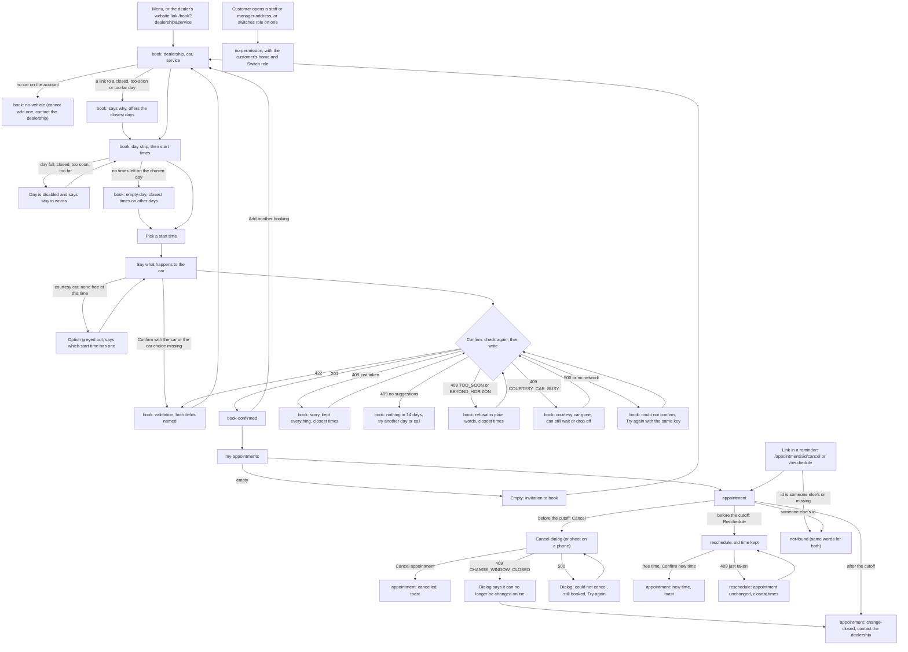

# Customer flow (B1)

Written 2026-10-28 by the designer role, step B1. It details the customer's screens on top of the foundation in [design.md](../design.md) (Direction A with free gaps, tokens, components, error words). design.md is binding; this file only adds. Nothing in design.md, `design/brand/` or another designer's file was edited.

**Inputs read:** design.md, `design/foundation.html`, `design/brand/*`, overview.md (NFR-4, NFR-7), architecture.md (endpoints, statuses, the 409 shape, AD-5, AD-9, AD-11), REQ-BOOK-001, 002, 003, 009, 010, 011, 012, 013, and (for the cutoff and the reasons) 007, 014; decisions D-0001-2, -7, -9, -13, -15, -16, -17, -19, -20, -22; D-0000-10, -12, -13, -16, -17; Q-0001-18, -20, -21; security.md SEC-5, SEC-6, SEC-11, SEC-13.

**Files this step wrote:**

| File | What |
|---|---|
| `design/customer.md` | this file |
| `design/customer-book.html` | prototype: `book` (22 states) |
| `design/customer-book-confirmed.html` | prototype: `book-confirmed` (4 states) |
| `design/customer-my-appointments.html` | prototype: `my-appointments` (8 states) |
| `design/customer-appointment.html` | prototype: `appointment`, the customer's side (11 states) |
| `design/customer-reschedule.html` | prototype: `reschedule` (12 states) |
| `design/customer-no-permission.html` | prototype: `no-permission` as a customer meets it (7 states) |
| `design/customer-not-found.html` | prototype: `not-found` as a customer meets it (3 states) |
| `0001-booking/D-0001-23` to `D-0001-27` | five questions for the human (all `needsHuman: true`, none answered) |

**B4 decisions (2026-10-28).** P1 to P10 are accepted (P2 merged with the manager's `fill` mode; P7 merged with the manager's status slot), P11 is accepted only if D-0001-25 is answered A, and the `leading-tight` token became `leading-snug`. The reasons are in design.md 13.2, and the components are now in design.md 8.8 to 8.21. B4 also made these changes to this flow's pages: every error StateBlock now shows "Reference 4bf92f35" with a Copy button; the cancel dialog says a confirmation message is sent and reminders are cancelled; "Go to Schedule" became "Go to the schedule"; each page's bar links to the start page. A new question, Q-0001-100 (does a move send a message?), touches the `rescheduled` state.

**Not verified.** No browser or shell was available in this step. The pages were checked by reading the HTML, CSS and script only. Nothing was opened at 390 px or at 1280 px. Open each page first at both widths (the pages draw a 390 px phone frame and a 1280 px desktop frame side by side, whatever the window is) and report what looks off. Visual QA owns the contrast ratios, which were worked out by hand from the README.

---

## 0. How to read the prototypes

- Every page takes `?state=<state>`. The dark bar on top lists every state of that screen with one line on what it shows; the links between pages follow the flow (Confirm on `book` goes to `book-confirmed`, and so on). The bar and the frame outlines belong to the prototype, not the product.
- Two more switches on the bar: **View** (`?view=phone`, `?view=desktop`, or both, the default) and **Long names** (`?names=long`, a stress test with a long dealership name and a long car name, on the pages that show them).
- The phone frame is 390 by 832 px and scrolls inside, so the sticky action bar and the tab bar behave as on a phone. The desktop frame is as wide as the window, 1280 px in the intended review. Both are containers, so layout follows the frame's width, not the window's (the same trick as `foundation.html`).
- On `book` and `reschedule` the time chips are real radios: picking one updates the summary and turns Confirm on. Everything else is a state to look at, not a working form.
- Made-up sample data, labelled: the customer is Aisha Rahman; the cars are a Ford Focus (AB12 CDE) and a Hyundai Kona (UV20 WXY); the dealership is "Northgate Motors, Leeds (sample dealership)"; staff names are those of the foundation; phone number 0113 496 0123 comes from the range the UK regulator keeps for TV and film, so it is not real; the reference 4bf92f35 is the architecture's example trace id. The sample "now" is Wed 28 Oct, 10:40 (except in the state `day-too-soon`, where it is 16:10, and the page says so). Lead time 2 hours, horizon 30 days, grid 15 minutes, a full service takes 3 hours.
- Every text value is a plain text node (SEC-11). Car plates are `dir=ltr`, tabular and never wrap; names use `dir=auto` in the build. Dates and times follow `en-GB` and the dealership's time zone (design.md section 9).

---

## 1. What this flow decides beyond design.md

Each item is small enough not to need the human, and each says what B4 or the builder should do. Five points are real questions and are in section 9.

1. **One Confirm button at any width.** design.md's BookingSummary puts Confirm in the panel and "repeats" it in the sticky bar on a phone. Two Confirm buttons in one page is two tab stops and two things to announce. The prototype puts Confirm in the summary from 1024 px and in the action bar below it; the other is not drawn (`display: none`), so only one is in the page's tab order. The bar also shows the chosen time in words.
2. **Result messages sit directly under the title.** The conflict panel, the validation summary, the "could not confirm" error and the refusals are page-level Alerts under the title, not inside the summary. On a phone the summary is far below the chips; a message there would be off screen when the customer presses Confirm in the bar. Each message takes focus on its heading and is scrolled into view. (design.md section 6 already puts the 409 panel there; this extends it to the others, replacing "Alert above the button" in 8.9.)
3. **Alert layout.** The icon sits on the heading's line, not in its own column, so the body (text and suggestion chips) gets the full width of the panel. On a 390 px phone this is the difference between suggestions two across and one across. Proposed for every Alert (section 8, P1).
4. **Suggestions are one list.** The API returns up to five times, nearest first (D-0001-16). The panel shows them as "Closest to your time" and, only if some are at the same clock time on another day, moves those under "Same time, another day" (design.md section 6). No time is shown twice.
5. **The technician and the bay are shown to the customer** on the confirmation and the appointment page (design.md section 6 and REQ-BOOK-003.AC-1), and not on the list cards. design.md 8.10 says "for staff and manager"; the two disagree. D-0001-26 asks. Until answered the pages show both; the Bay row is one line to remove.
6. **The appointment page has two columns from 768 px, not 640.** At 640 px the content is 592 px wide; a 22rem side column would leave 208 px for the facts. Below 768 px the actions move to the sticky bar.
7. **Cancel and Reschedule links in messages.** D-0001-17 f makes `/appointments/{id}/cancel` and `/appointments/{id}/reschedule` routes the customer screens must serve. `/cancel` opens `appointment` with the cancel dialog already open (state `cancel-dialog`); `/reschedule` is `reschedule`. If the customer is not signed in as the owner, both show `not-found` (SEC-5). If the appointment is past the cutoff, `/cancel` opens `appointment` in `change-closed` with no dialog, and `/reschedule` shows its `change-closed` state.
8. **The cutoff is shown as a clock time.** "You can change or cancel this online until 08:00 on Fri 30 Oct, which is 2 hours before it starts." It is start minus the dealership's lead time, inclusive (D-0001-17 a), in the dealership's zone. The words "2 hours" come from the dealership's lead time, never a fixed number.
9. **Reminders listed on the confirmation depend on time left.** Q-0001-21: a confirmation, a reminder 48 hours before, and a morning-of reminder (08:00, or 2 hours before if the start is at or before 08:00). A reminder whose time has passed is skipped, so the page lists only those that remain. The sample (booked two days before) lists the confirmation and the morning reminder.
10. **A past appointment is "Past".** The status model has only `confirmed` and `cancelled`; an appointment whose end is behind us is drawn with a neutral "Past" badge derived on the screen (proposal P3).

**For the architect (not decisions, things the screens rely on):**

- A reschedule's availability check and its `GET /availability` for that screen must ignore the appointment being moved. Otherwise its own bay and technician make its own time, and every time that overlaps it, look busy, and a customer could not move a job by 15 minutes. The screen also passes the appointment's own `transport`, so a courtesy car appointment is only offered times with a car free.
- The day strip needs a state for each of seven days (open with a count, closed, fully booked, too soon, too far). `GET /availability` takes one date per call, so the strip is seven calls, or a range form of the same call; either way a closed day must be told apart from a full one (REQ-BOOK-007.AC-4).
- The 409's `reasons` for a courtesy car (`COURTESY_CAR_BUSY`) must reach the screen even when the same time is free for a person who waits, so the page can say "no courtesy car is free" rather than "time taken".

---

## 2. Flow, with the failure and permission branches

design.md section 4.2 holds the main flow. This adds what B1 found: refused days, the courtesy car, the message links and the not-found branch.

---

## 3. Screens and states (the customer's side)

Ids, routes and requirement coverage are those of design.md section 5. A state name is the `?state=` value. "Both" means phone and desktop are drawn on the page.

| id | route | Mode | Requirements shown | Prototype | States |
|---|---|---|---|---|---|
| `book` | `/book?dealership&service` | Operate | REQ-BOOK-001, 002, 003.AC-1, 007.AC-4, 009.AC-1..5, 010.AC-1, 011.AC-1/2 | [customer-book.html](customer-book.html) | `idle`, `deep-link`, `time-chosen`, `validation`, `no-vehicle`, `empty-day`, `closed-day`, `day-too-soon`, `day-too-far`, `no-courtesy-car`, `courtesy-cleared`, `confirming`, `conflict`, `conflict-empty`, `conflict-too-soon`, `conflict-too-far`, `conflict-courtesy`, `confirm-error`, `loading`, `days-error`, `times-error`, `no-permission` |
| `book-confirmed` | `/book/confirmed/:appointmentId` | Read | REQ-BOOK-003.AC-1/2, 010.AC-1, 013.AC-1 | [customer-book-confirmed.html](customer-book-confirmed.html) | `success`, `loading`, `error`, `not-found` |
| `my-appointments` | `/appointments` | Operate | REQ-BOOK-003.AC-2, 012.AC-1/4 | [customer-my-appointments.html](customer-my-appointments.html) | `upcoming`, `past-and-cancelled`, `empty`, `loading`, `error`, `cancel-dialog`, `after-cancel`, `no-permission` |
| `appointment` | `/appointments/:appointmentId` (+ `/cancel`) | Operate | REQ-BOOK-003.AC-1, 010, 012.AC-1/4/5 | [customer-appointment.html](customer-appointment.html) | `confirmed`, `cancelled`, `change-closed`, `cancel-dialog`, `cancelling`, `cancel-refused`, `cancel-error`, `rescheduled`, `loading`, `error`, `not-found` |
| `reschedule` | `/appointments/:appointmentId/reschedule` | Operate | REQ-BOOK-012.AC-2/3/4, 009, 002 | [customer-reschedule.html](customer-reschedule.html) | `idle`, `time-chosen`, `courtesy-note`, `confirming`, `confirm-error`, `conflict`, `conflict-empty`, `empty-day`, `change-closed`, `loading`, `error`, `not-found` |
| `no-permission` | in place, the URL stays | Operate | REQ-BOOK-005.AC-3, 008.AC-3, 014.AC-5 | [customer-no-permission.html](customer-no-permission.html) | `schedule`, `manage`, `book-for-customer`, `adjust`, `signed-out`, `switch-role`, `signed-out-sheet` |
| `not-found` | `*` and any 404 | Operate | REQ-BOOK-012.AC-5, SEC-5 | [customer-not-found.html](customer-not-found.html) | `appointment`, `confirmation`, `page` |

**Why `appointment` and `book-confirmed` have no `no-permission` state for a customer.** Another customer's id answers 404, not 403 (SEC-5), so the customer meets `not-found`, whose words are the same as for a missing id. A role that may not open a customer page at all (staff on `/appointments` or `/appointments/:id/reschedule`) meets the shared `no-permission` block, drawn once on `my-appointments` (state `no-permission`) and described in section 7.

The staff and manager variants of `book`, `book-confirmed` and `appointment` belong to B2 and B3. `appointment`'s `flagged` state and the manager's Adjust are theirs; a customer never sees a flag (design.md 8.10).

**Coverage.** Every REQ-BOOK id the customer meets (001, 002, 003, 009, 010, 011, 012, 013.AC-1) is in a state above; REQ-BOOK-013.AC-1's "links to cancel or reschedule" are served by the routes in point 7 of section 1. The phone and desktop rule for each screen is section 3 of design.md plus the per-screen notes below.

---

## 4. `book`

### Contract

- **Mode:** Operate. **User and job:** a customer who knows what is wrong with, or due on, their car picks a day and a start time they can live with, and says what happens to the car. Often on a phone, often from the dealer's website.
- **Eye finds first:** the selected day in the strip, then the time chips. After a 409 or any refusal: the heading of the message under the title.
- **Primary action:** Confirm booking (signal fill, one per screen). Off until a time is chosen, with the reason written in the button ("Pick a time to confirm", after a conflict "Pick a new time to confirm").
- **Density:** roomy; chips, not a table. **Hierarchy:** title → (message) → what we are booking (three fields) → day strip → start times → summary. The summary says the choice back in words.
- **Interaction:** day strip and chips are radio groups (arrow keys, one tab stop each). A time appears only when a bay and a qualified technician are free for the whole job; the page says "We check once more when you confirm." Confirm shows "Confirming…" and ignores a second press; a retry reuses the same key (AD-5). Picking a day announces "18 times on Fri 30 Oct" in a polite live region. The first day with times is selected when the strip first loads (a deep link, or after choosing the three fields), so the eye finds chips straight away.
- **Order of choices:** dealership, car, service, then day, then time, then what happens to the car (D-0001-23 asks whether the last should come first). The car choice has no default; skipping it is named like any missing field.
- **Responsive priority:** phone: one column, the strip scrolls inside its own row, chips three across, summary below, sticky bar with the chosen time and Confirm, no tab bar. Tablet: same, wider chips, two-column fields. Desktop: picker left, summary panel 22rem right and sticky, no bar.
- **Avoids:** a month calendar; a wall of identical blue buttons; a modal for the apology; clearing the form after an error; a default for the car choice.

### States

| State | What the customer sees |
|---|---|
| `idle` | Title "Book a service". Three empty fields. A quiet box: "Pick a dealership, a car and a service above. Then we show which days have room." No strip. Confirm off. |
| `deep-link` | From the dealer's website: dealership and service filled in, car empty, a line saying where they came from. The first day with times is selected (today, afternoon only, because of the notice time). No time chosen. |
| `time-chosen` | Everything chosen; summary full; Confirm on. Picking another chip updates the summary. |
| `validation` | The customer pressed Confirm with the car and the car choice missing. Danger Alert "2 things need fixing before we can book this." with each problem as a link to its field; each field shows its own message; focus goes to the heading. Nothing was checked. |
| `no-vehicle` | The account has no car. An info Alert replaces the car select; the strip is not drawn. A customer cannot add a car (SEC-6.AC-3). |
| `empty-day` | The chosen day has no times left (the strip's number was stale). Its tile now says "Fully booked". The times area holds an empty block with the closest times on other days as suggestion chips. |
| `closed-day`, `day-too-soon`, `day-too-far` | A link pointed at a day that cannot be booked. An info Alert says why and offers the closest days as buttons. The times area says "Pick a day above to see the start times." Too soon uses the notice time, too far the horizon. |
| `no-courtesy-car` | Time chosen; the courtesy car option is greyed out with "Not available at this time", and a line says which start time has one. Wait and drop-off still work (Q-0001-18). |
| `courtesy-cleared` | The customer had chosen a courtesy car, then picked a time with none free. The choice is cleared, the option greyed out, and a line says so. |
| `confirming` | The button reads "Confirming…" with a turning arc, presses are ignored. |
| `conflict` | 409 `SLOT_UNAVAILABLE`. See "The conflict" below. |
| `conflict-empty` | The same apology, then "There are no other times in the next 14 days." and who to contact. The week's days are all full or closed; the taken chip stays struck through. |
| `conflict-too-soon` | 409 `TOO_SOON`: the time slipped inside the notice time while the page was open. Heading "Sorry, 12:30 on Wed 28 Oct is too soon to book." The struck chip says "Too soon". |
| `conflict-too-far` | 409 `BEYOND_HORIZON`: the dealership shortened its horizon. Every day in the week now reads "Too far ahead"; the closest times are offered as chips. |
| `conflict-courtesy` | 409 `COURTESY_CAR_BUSY`: the last courtesy car went first. The time itself is still free for waiting or drop-off; the panel offers closest times with a car. The car choice is cleared. |
| `confirm-error` | 500 or no network. Danger Alert with Try again. Nothing was booked; Try again reuses the key, so it cannot book twice. |
| `loading` | Skeleton days and chips in their final size, `aria-busy`, shown only after 200 ms, with a hidden "Loading the days and times". |
| `days-error`, `times-error` | The strip (or the times) is replaced by an error block with what failed, why, and Try again plus the reference. |
| `no-permission` | 403: a link to book for another customer (SEC-6.AC-1). A page-wide block. |

### The conflict (REQ-BOOK-009.AC-2), as drawn

The panel replaces nothing: the dealership, car, service and car choice stay as they were, and so does the day. Focus moves to the heading. Below it, "Closest to your time" holds up to five suggestion chips (each shows the start time, and "ends 13:15" under it; a time on another day shows "Sat 31 Oct · ends 13:00"). "Same time, another day" appears only if any exist. The struck chip in the grid stays, marked "Just taken". The strip's count for that day drops ("4 times"). The summary shows "Not chosen yet" for the time, and Confirm says "Pick a new time to confirm". Choosing a suggestion selects it in the grid and in the summary and turns Confirm on; it does not book.

### Copy (every message on this screen)

| Where | Text |
|---|---|
| Title | "Book a service" (nothing chosen) · "Choose a time for your full service" (the service's name is in the title once chosen) |
| Lede | "Tell us which car and which service. Then pick a day and a time." · "Your full service takes about 3 hours. Pick a day, then the time you want to arrive." |
| Fields | "Dealership (required)", "Car (required)", "Service (required)"; placeholders "Choose a dealership", "Choose a car", "Choose a service"; services read "Full service, about 3 hours" |
| Deep link | "The dealership and the service were filled in from the dealer's website. Change them if you need to." |
| Idle box | "Pick a dealership, a car and a service above. Then we show which days have room." |
| Week | "Wed 28 Oct to Tue 3 Nov"; Previous week disabled with "You cannot book a day that has passed"; Next week disabled with "Bookings open up to 30 days ahead" |
| Day tile | "18 times" · "1 time" · "Closed" · "Fully booked" · "Too soon" · "Too far ahead" |
| Time groups | "Morning · 10 times", "Afternoon · 1 time", "Morning · none left"; chip name "10:00 to 13:00"; struck chip "Just taken" or "Too soon" |
| Summary | "Your booking"; rows Dealership, Car, Service, Time; "Not chosen yet" for an empty row; "What will you do with the car?" with "Wait on site", "Drop it off", "Borrow a courtesy car" |
| Confirm | "Pick a time to confirm" · "Pick a new time to confirm" · "Confirm booking" · "Confirming…" |
| Under Confirm | "We check once more when you confirm, in case someone books first." |
| Validation | "2 things need fixing before we can book this." · "Car: choose which car is coming in." · "What you will do with the car: choose one." · field: "Car is missing. Choose which car is coming in." · fieldset: "Choose what you will do with the car." |
| No car | "There is no car on your account yet." "We can only book a car that is already on your account. Ask Northgate Motors to add yours, then come back. Call 0113 496 0123 (sample number)." |
| Courtesy, none free | "Not available at this time" on the option; below: "No courtesy car is free from 10:00 to 13:00. You can still wait or drop the car off. A courtesy car is free if you start at 10:45." |
| Courtesy, cleared | "A courtesy car is not free from 11:30 to 14:30, so we cleared that choice. Please choose again." |
| Empty day | "No times left on Mon 2 Nov." "Someone booked the last one a moment ago. These are the closest times on other days:" |
| Closed day | "Northgate Motors is closed on Sun 1 Nov." "The link you followed points at a day when the dealership is closed. These are the closest days with times:" |
| Too soon (day) | "Wed 28 Oct is too soon to book." "It is 16:10 in Leeds and bookings need at least 2 hours' notice, so there is no time left today. The next day with times is Thu 29 Oct." |
| Too far (day) | "Mon 30 Nov is too far ahead." "Bookings open up to 30 days ahead, so the last day you can pick is Fri 27 Nov." |
| Just taken | "Sorry, 10:00 on Fri 30 Oct was just taken." "Another customer confirmed that time a moment before you. Nothing was booked for you. We kept your car, service and choice, so you only need a new time." Groups: "Closest to your time", "Same time, another day" |
| Nothing else | "There are no other times in the next 14 days." "Try another day, or contact Northgate Motors. Call 0113 496 0123 (sample number)." (under the grid: "No other times are left on Fri 30 Oct.") |
| Too soon (409) | "Sorry, 12:30 on Wed 28 Oct is too soon to book." "Bookings need at least 2 hours' notice, and that time is now less than 2 hours away. Nothing was booked for you. We kept your car, service and choice, so you only need a new time." |
| Too far (409) | "Sorry, Fri 27 Nov is further ahead than we can book." "Bookings now open up to 21 days ahead, which is Wed 18 Nov. Nothing was booked for you. We kept your car, service and choice, so you only need a new day." Under the grid: "These days are further ahead than we can book. Choose one of the closest times above, or go back a week." |
| Courtesy gone | "Sorry, no courtesy car is free from 10:00 to 13:00 any more." "Another customer took the last one a moment before you. Nothing was booked for you. You can still book 10:00 and wait or drop the car off, or pick a time when a courtesy car is free." Group: "Closest times with a courtesy car" |
| Could not confirm | "Something went wrong on our side." "Nothing was booked. Your choices are still here. Try again; if it keeps happening, quote reference 4bf92f35." When there is no network the title is "We could not reach the booking service." and the body "Nothing was booked. Check your connection and try again. Your choices are still here." |
| Days or times error | "We could not check the days." / "We could not load the times." "Something went wrong on our side, so we cannot show … Nothing was changed. Try again; if it keeps happening, quote reference 4bf92f35." |
| 403 | "You cannot do that as Customer." "Customers can only book for themselves, and this link is for a different customer. Garage staff book for customers from their own page. Switch role, or start a booking for yourself." Buttons "Book for myself", "Switch role" |
| Live region | "18 times on Fri 30 Oct" · "Confirming your booking" · "Loading the days and times" |

### Components

Built from the foundation, with no new colour or size: AppShell (task mode: no tab bar), RoleSwitcher, SelectField, DayStrip, TimeChipGrid (with the suggestion chip), BookingSummary (variant `customer`), ChoiceCards, Button, Alert, StateBlock, ActionBar. Changes and proposals: P1 (Alert layout), P2 (suggestion group), P7 (ActionBar), see section 8.

---

## 5. `book-confirmed`

### Contract

- **Mode:** Read. **User and job:** a customer wants to know it worked, what exactly was booked, and what happens next. **Eye finds first:** "You are booked" and the time under it. **Primary action:** View my appointments (secondary style, as design.md says); "Add another booking" is a quiet button.
- **Density:** one calm column, 65ch. **Hierarchy:** result → what (service, car, dealership, technician, bay, what happens to the car) → what happens next (messages; until when they can change it).
- **Responsive priority:** phone: one column, actions stacked; tablet and desktop: actions in a row. The tab bar shows (a browse page).
- **Avoids:** confetti, a hero tick, a stats row. A success-tint panel with a small tick is enough.

| State | What the customer sees |
|---|---|
| `success` | The three blocks above. |
| `loading` | Skeleton panels, hidden "Loading your confirmation". |
| `error` | "We could not show your confirmation." and says the booking went through, with a button to My appointments first and Try again second. |
| `not-found` | The shared words (section 7). |

**Copy.** "You are booked" · "Fri 30 Oct, 10:00 to 13:00" · "Your appointment" · rows "Service", "Car", "Dealership", "Technician", "Service bay" (see D-0001-26), "The car" with "You will drop it off" / "You will wait on site" / "You will borrow a courtesy car" · "What happens next" · "We will send you a confirmation now, and a reminder on the morning of your appointment, at 08:00 on Fri 30 Oct. This is a demo, so nothing is really sent: the messages wait in an outbox that the garage manager can open." · "You can change or cancel this appointment online until 08:00 on Fri 30 Oct, which is 2 hours before it starts. After that, contact Northgate Motors. Call 0113 496 0123 (sample number)." (the first sentence's link goes to `appointment`) · buttons "View my appointments", "Add another booking". Error: "We could not show your confirmation." "Your booking went through, but something went wrong on our side while we loaded this page. Open My appointments to see it. If it is not there, try again; if that keeps happening, quote reference 4bf92f35." Buttons "Open my appointments", "Try again".

**Components:** Alert (success), FactsList (P5), Button, StateBlock, AppShell (browse).

---

## 6. `my-appointments`, `appointment`, `reschedule`

### `my-appointments`

- **Mode:** Operate. **Job:** find my next appointment; change or cancel it. **Eye finds first:** the first upcoming card (its date is the largest on the page). **Primary action:** "Book a service" in the title row (primary); each card has View details, Reschedule and Cancel appointment.
- **Hierarchy:** title row → "Upcoming" → "Past and cancelled". A card: date (large) and time → badges (status, what happens to the car) → service, car, dealership → actions. The date is a link to the appointment; the three buttons are explicit so a customer is never told to "tap to see". A card inside the change window drops Reschedule and Cancel for one sentence: "It is too close to the start to change online. Contact Northgate Motors. Call 0113 496 0123 (sample number)."
- **Long lists.** Past and cancelled grow without limit. The build shows the latest 10 and a "Show earlier" button; upcoming has no limit in this demo. (Not drawn: the sample has 4.)
- **Responsive priority:** one column on a phone (buttons wrap to two rows); two columns from 640 px.

| State | What the customer sees |
|---|---|
| `upcoming` | Three upcoming cards (the first inside the change window) and three past or cancelled. |
| `past-and-cancelled` | Nothing upcoming: "You have nothing booked at the moment. Use Book a service to pick a time." and the past and cancelled cards. |
| `empty` | The invitation: "You have no appointments yet", one primary button. The title-row button is not drawn, so there is one primary on the page. |
| `loading`, `error` | Skeleton cards; "We could not load your appointments." with Try again and the reference. |
| `cancel-dialog` | The cancel dialog (below) opened from a card. |
| `after-cancel` | The card moved to Past and cancelled, marked Cancelled; toast "Appointment cancelled. The time is free again." |
| `no-permission` | Staff opened a customer page. The shell shows the staff navigation. "You cannot do that as Staff." "My appointments lists a customer's own bookings, so it is only for customers. Staff see appointments on the schedule. Switch role, or go to the schedule." |

**Copy.** "My appointments" · "Book a service" · "Upcoming" · "Past and cancelled" · date line "Today, Wed 28 Oct" then "12:00 to 13:00" · badges "Confirmed", "Cancelled", "Past", "Waiting", "Drop-off", "Courtesy car" · rows "Service", "Car", "Dealership" · buttons "View details", "Reschedule", "Cancel appointment" · empty: "You have no appointments yet" "When you book a service, it shows up here, and you can change or cancel it until 2 hours before it starts." · error: "We could not load your appointments." "Something went wrong on our side, so we cannot show your list. Nothing was changed. Try again; if it keeps happening, quote reference 4bf92f35."

### `appointment`

- **Mode:** Operate. **Job:** see everything about one appointment, and act on it. **Eye finds first:** the date and time range, then the status badge. **Primary action:** Reschedule (secondary style) and Cancel appointment (secondary; the danger button lives only in the dialog, design.md 8.5). The manager's Adjust and the staff view are B2 and B3.
- **Hierarchy:** back link → time → badges → (message) → facts → actions. Desktop and tablet from 768 px: the facts left, actions and "until when" right (22rem). Phone: facts, then the "until when" line, and the actions in a sticky bar that replaces the tab bar; with no actions (`cancelled`, `change-closed`) the tab bar returns.
- **The cancel dialog.** Title "Cancel this appointment?"; the sentence says what is cancelled (service, date, car, dealership); "The time will be free for other customers. We will send you a message to confirm, and your reminders are cancelled. You can book again at any time." Actions: Keep appointment (safe, takes focus), Cancel appointment (danger). A centred dialog from 640 px; a bottom sheet below, actions stacked with the danger one on top. The scrim does not close it. While cancelling, both buttons are disabled and the dialog cannot be closed.

| State | What the customer sees |
|---|---|
| `confirmed` | Time, Confirmed + car badge, facts, Reschedule, Cancel appointment, and the cutoff line. |
| `cancelled` | Cancelled badge, facts on `surface-sunken`, no actions, "Cancelled on Wed 28 Oct, 10:41. The time is free for other customers." and a Book a service button; toast. |
| `change-closed` | Info Alert "This appointment can no longer be changed online." / "It starts in less than 2 hours. Contact Northgate Motors to change it. Call 0113 496 0123 (sample number)." No buttons (REQ-BOOK-012.AC-4). |
| `cancel-dialog` | The dialog. This is where `/appointments/{id}/cancel` lands. |
| `cancelling` | The dialog with "Cancelling…". |
| `cancel-refused` | 409 `CHANGE_WINDOW_CLOSED`: the cutoff passed while the dialog was open. The dialog's title becomes "This appointment can no longer be changed online." with "It starts in less than 2 hours. Contact Northgate Motors to change it. Call 0113 496 0123 (sample number). Nothing was cancelled." One button, Close; after it the page is `change-closed`. |
| `cancel-error` | 500: danger Alert in the dialog "We could not cancel it." "Something went wrong on our side. Your appointment is still booked. Try again; if it keeps happening, quote reference 4bf92f35." Buttons Keep appointment, Try again. |
| `rescheduled` | Back from `reschedule`: the new time is the title, a toast "Appointment moved to Mon 2 Nov, 14:00. The old time is free again." |
| `loading`, `error`, `not-found` | Skeleton; "We could not load this appointment." with Try again; the shared not-found words. |

**Copy** not listed above: facts rows "Service", "Car", "Dealership", "Technician", "Service bay", "The car"; the cutoff line "You can change or cancel this online until 08:00 on Fri 30 Oct, which is 2 hours before it starts. After that, contact Northgate Motors. Call 0113 496 0123 (sample number)."; back link "My appointments"; dialog description "Full service on Fri 30 Oct, 10:00 to 13:00 for your Ford Focus (AB12 CDE) at Northgate Motors."

### `reschedule`

- **Mode:** Operate. **Job:** move my appointment to a time that suits, without risking the one I have. **Eye finds first:** the info panel "Your current time stays until the new one is confirmed." (it takes the place of design.md's "panel"), then the strip with the appointment's own day selected. **Primary action:** Confirm new time.
- **What is fixed.** The dealership, car, service and what happens to the car cannot be changed here (D-0001-24); the summary shows them with "This stays the same". The appointment's own time is a disabled chip "Your time" (not struck through, since it is not "taken"). The summary has two rows side by side: "Current time" (with "Kept until the new time is confirmed") and "New time".
- **Responsive priority:** as `book`. Task screen: no tab bar while choosing.

| State | What the customer sees |
|---|---|
| `idle` | The appointment's day; "Your time" marked; no new time; Confirm off ("Pick a new time to confirm"). |
| `time-chosen` | Mon 2 Nov 14:00 chosen; the summary shows both times. |
| `courtesy-note` | The appointment has a courtesy car; "Your appointment includes a courtesy car, so we only show times when one is free." |
| `confirming`, `confirm-error` | As `book`; the error says "Your appointment has not changed." |
| `conflict` | "Sorry, 14:00 on Mon 2 Nov was just taken." "Another customer confirmed that time a moment before you. Your appointment has not changed: it is still on Fri 30 Oct, 10:00 to 13:00. Pick another time and confirm again." Closest times. The current appointment is untouched (REQ-BOOK-012.AC-3). |
| `conflict-empty` | The same, then "There are no other times in the next 14 days." and who to contact. |
| `empty-day` | As in `book`. |
| `change-closed` | The page cannot be used: "This appointment can no longer be changed online." "It starts in less than 2 hours. Contact Northgate Motors to change it. Call 0113 496 0123 (sample number). Your appointment has not changed." One button back to the appointment. |
| `loading`, `error`, `not-found` | As `appointment`; the error says "Your appointment has not changed." |

**Copy** not listed above: title "Choose a new time for your full service"; lede as in `book`; info panel "Right now you are booked for Fri 30 Oct, 10:00 to 13:00. If the new time is taken before you confirm, nothing changes."; summary title "Moving your appointment"; confirm "Confirm new time"; back link "Back to the appointment"; error "Something went wrong on our side." "Your appointment has not changed. Try again; if it keeps happening, quote reference 4bf92f35."

---

## 7. `no-permission` and `not-found` (shared copy, as a customer meets it)

B1 writes the words; the shell and the page frame are the foundation's. Both are a StateBlock drawn in place of the page content: the URL stays, the header stays, the navigation is the viewer's own role. Focus goes to the heading. `role=alert`.

**No permission.** Title "You cannot do that as Customer." (the role name comes from the viewer). The line says what the viewer cannot do and why, then both ways out. Actions: the role's home as the primary button (for a customer: "Go to Book a service"), and "Switch role". On a phone Switch role opens the role sheet; from 640 px it moves focus to the "Viewing as" control (drawn with the focus ring in the state `switch-role`).

| State | Line under the title |
|---|---|
| `schedule` | "Only garage staff and the garage manager can see the schedule. Switch role, or go to Book a service." |
| `manage` | "Only the garage manager can change opening hours, shifts and flagged bookings. Switch role, or go to Book a service." |
| `book-for-customer` | "Only garage staff can book for a customer. Customers book for themselves on the Book page. Switch role, or go to Book a service." |
| `adjust` | "Only the garage manager can move an appointment or change its technician or bay. To change your own appointment, open it from My appointments. Switch role, or go to My appointments." The primary button is "Go to My appointments". |
| `signed-out` (401) | Title "You are not signed in." "Pick who you are with Viewing as at the top of the page. This is a demo, so there is no password." The header says "Not signed in"; no navigation; one button, "Pick who you are". |

The role sheet (`switch-role`, `signed-out-sheet`) is the foundation's RoleSwitcher sheet, with the three seeded users and "Demo only: in a real product you would sign in."

**Not found.** Title "We cannot find that appointment." Line "It may have been removed, or it belongs to someone else." Actions "Go to My appointments" (primary), "Book a service". The same words are used for a missing id and for another customer's id, and the status, title and text do not depend on which it is (SEC-5.AC-1); the cutoff is never mentioned to someone who does not own the appointment (SEC-5.AC-2). For an unknown address: "We cannot find that page." "The link may be out of date or mistyped. Go to Book a service, or open My appointments."

---

## 8. Components: what B1 used, and what it proposes for B4

All pages use only the foundation's tokens (values copied into each page's `:root`, as `foundation.html` does). **No missing token.** Three unitless line heights (1.2 and 1.25 on tab labels and two-line chips) and the browser-surface underline offset (`.2em`) are copied from `foundation.html`; B4 may add a `leading-tight` token. The frame sizes in the prototype (390 by 832 px) are the harness's and are not product values.

Used as specified: AppShell, RoleSwitcher (a segmented control from 640 px, a button and sheet below), SegmentedControl, SelectField, ChoiceCards, DayStrip, TimeChipGrid and its suggestion chip, BookingSummary, AppointmentCard, Badge, Dialog and Sheet, Toast, Alert, StateBlock, Button, skeleton, icons from the foundation sprite plus `refresh` (named in design.md 8, drawn here because the foundation sprite lacks it) and `clock`.

Proposals (B4 decides; the prototypes already draw them):

| # | Proposal | Why | Used on |
|---|---|---|---|
| P1 | **Alert header row.** The icon sits on the heading's line (icon, then heading), and body and actions use the full width. | Suggestion chips and buttons need the width on a phone. | `book`, `reschedule`, `appointment` (dialog) |
| P2 | **SuggestionGroup.** A titled row of suggestion chips (`Closest to your time`, `Same time, another day`) that can sit inside an Alert or a StateBlock. Chips are two-line, one per row on a phone below two times the chip width, selectable like grid chips (one shared radio group per page). | The same list appears in an Alert (409) and in the empty day. | `book`, `reschedule` |
| P3 | **Badge `past`.** Neutral (`surface-sunken`, `text-secondary`, `border-subtle`), clock icon, "Past". A derived state, not a stored status. | A past appointment should not read "Confirmed". | `my-appointments` |
| P4 | **TimeChip `own`.** A disabled chip with the caption "Your time", not struck through. | A reschedule shows the appointment's own start. | `reschedule` |
| P5 | **FactsList.** A flat panel with a heading (screen-reader only on the appointment page), a two-column description list (term small and secondary, value medium), values wrap anywhere. | `book-confirmed` and `appointment` (and the staff and manager appointment) show the same facts. | `book-confirmed`, `appointment` |
| P6 | **PageBack.** A 44 px link with a left chevron and the parent's name ("My appointments"). | The appointment is a detail of the list, and the tab bar is hidden when its sticky bar shows. | `appointment`, `reschedule` |
| P7 | **ActionBar, two forms.** (a) Time and one button (`book`, `reschedule`): the left text is the chosen time in words, and it is empty until a time is chosen. (b) Two buttons that share the row (`appointment`). Both hide from 1024 px (`book`, `reschedule`) or 768 px (`appointment`). | Different screens need different widths. | `book`, `reschedule`, `appointment` |
| P8 | **StateBlock `info` kind.** An information icon and a calm tone for "this cannot be done now, here is who to call", as opposed to an error. | `reschedule` in `change-closed`. | `reschedule`, `appointment` |
| P9 | **Toast offset above an ActionBar.** The phone toast sits above the bar when there is one (6rem), above the tab bar otherwise. | The toast must not cover the bar. | `appointment` |
| P10 | **Inline note.** A one-line information icon with text (`text-sm`, navy; the icon takes `text-link`), no panel. | Short, quiet explanations (courtesy choice cleared, "courtesy car appointment"). | `book`, `reschedule` |
| P11 | **Phone link.** "Call 0113 496 0123" as a tap-to-call link (`tel:`), `text-link`, 44 px target. Waits on D-0001-25. | Four messages end with "contact the dealership". | `book`, `book-confirmed`, `my-appointments`, `appointment`, `reschedule` |

---

## 9. Questions for the human

All five are in `0001-booking/`, marked `needsHuman: true`, each with options and a recommendation, none taken. The pages show the recommended reading unless noted.

| File | Question | Recommendation | What changes if the answer differs |
|---|---|---|---|
| [D-0001-23](../0001-booking/D-0001-23.md) | Say how to handle the car after the time (as drawn) or before it? | A (after) | Two blocks swap places on `book`; the strip's numbers change with the choice |
| [D-0001-24](../0001-booking/D-0001-24.md) | Can a customer change wait, drop-off or courtesy car while rescheduling? | A (no) | The summary row "The car" becomes the three options; the contract gets `transport` on reschedule |
| [D-0001-25](../0001-booking/D-0001-25.md) | Does a dealership have a phone number to show? | A (add an optional one) | Four sentences lose "Call … (sample number)" |
| [D-0001-26](../0001-booking/D-0001-26.md) | Does the customer see the technician and the bay? | C (technician only) | One row (Service bay) goes, or two |
| [D-0001-27](../0001-booking/D-0001-27.md) | Can one car have two overlapping appointments? | A (allow, note the gap) | A new 409 reason and one message |

---

## 10. Phone and desktop, per screen

| Screen | 390 px phone | 1280 px desktop |
|---|---|---|
| `book` | One column. Strip scrolls sideways inside its own row; chips three across; summary below the times; sticky bar (time + Confirm); no tab bar. Suggestion chips one per row, full width. | Picker left, summary 22rem right and sticky; strip is seven equal tiles; no bar. Suggestion chips wrap in a row. |
| `book-confirmed` | One column; actions stacked; tab bar. | 65ch column, actions in a row. |
| `my-appointments` | One column of cards; the title-row button is full width below the title; card buttons wrap. | Two columns of cards; the button beside the title. |
| `appointment` | One column; actions in a sticky bar (in place of the tab bar) when there are any; the cutoff line sits under the facts. Dialog is a bottom sheet. | Facts left, actions and cutoff right (22rem); a centred dialog. |
| `reschedule` | As `book`; the info panel on top. | As `book`. |
| `no-permission`, `not-found` | One block; buttons wrap; the role sheet is a bottom sheet. | One block; Switch role moves focus to the header control. |

Checked by reading (not rendered): nothing scrolls sideways except the day strip's own row on a phone; every control is at least 44 px (`size-target`) with 8 px between; text is never below `xs`; grid children use `min-width: 0`; names wrap anywhere and plates never wrap.

---

## 11. Craft floor, checked in one pass

| Check | Result |
|---|---|
| Contrast | Navy on white, on `warning-tint`, `info-tint`, `danger-tint`, `success-tint`: 11:1 or more (README). Secondary text on white, `surface-sunken`: 7.5:1 and 6.7:1. Carbon on the primary fill: 6.9:1. `text-link` icons on `info-tint`: 5.0:1. Tools to confirm: Visual QA. |
| Colour never alone | Status = icon + word; selected day or chip = fill + tick; taken = strike + word ("Just taken", "Too soon"); disabled day = fill + word ("Closed", "Fully booked", "Too soon", "Too far ahead"); courtesy option = grey + words; errors = icon + words + a 2px edge. |
| Targets and focus | 44 px on buttons, chips, day tiles, fields, nav; the ring is the foundation's on every control, never removed; a sticky bar adds bottom padding so a focused control is never hidden behind it (design.md 10). |
| Error words | Every error says what happened, why, and what to do (sections 4 to 7). No codes on their own, never "Oops". |
| Real data | A long dealership name and a long car name wrap (try `?names=long`); empty values read "Not chosen yet"; 60 past appointments are cut to 10 with "Show earlier"; 40 chips wrap under their group headings; names are text nodes. Right-to-left names lay out with logical properties; the time axis and plates stay left-to-right. |
| Empty state | An invitation to the primary action ("You have no appointments yet" with Book a service). |
| Refuse list | No kicker or eyebrow, no section numbers, no nested cards (a card holds a definition list and a note, nothing boxed), no side stripes, no gradient text, no glass, no hard shadows, no emoji or glyph icons, no hero metric, no "Oops". |
| Motion | The day-strip bars grow once; the sheet slides in 240 ms; everything else is a 120 to 150 ms colour change; reduced motion turns all of it off. |
| Values | Colours, sizes, radii, shadows, motion and fonts are the foundation's tokens, copied into each page's `:root`. Breakpoints repeat tokens in container queries (allowed). Inline `style` is used only with tokens, and for the bar fill width, which is data. |
| **Not verified** | **Not opened in a browser. Layout at 390 and 1280 px and every ratio were checked by reading. Open each page at both widths and report what looks off, in particular: the phone strip's scroll, the chips three across, the sticky bar over the last chip, the dialog and sheet positions inside the frame, and the toast positions.** |
