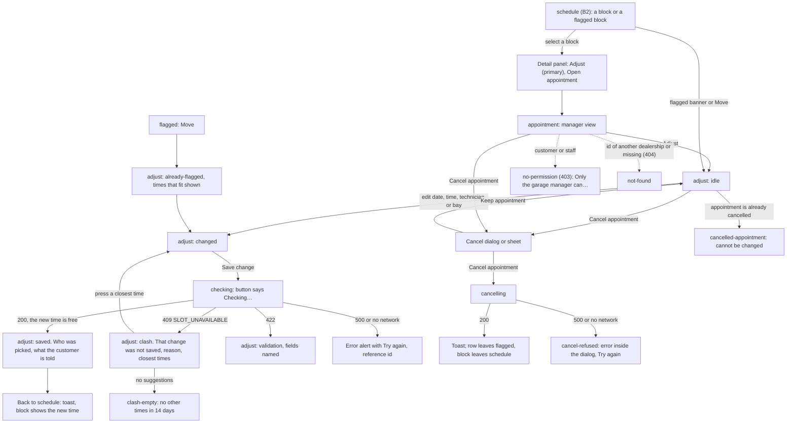
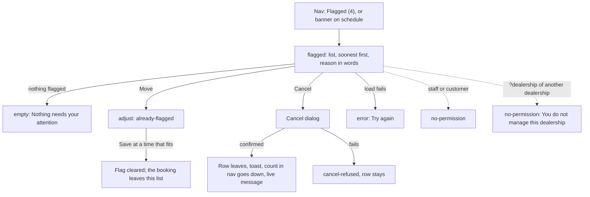
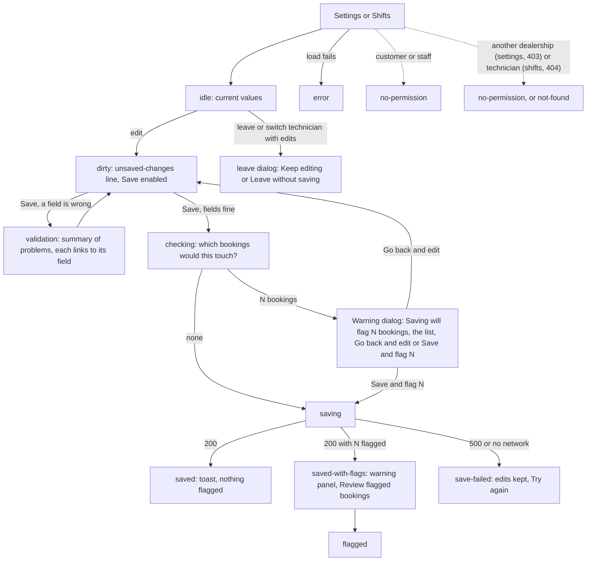
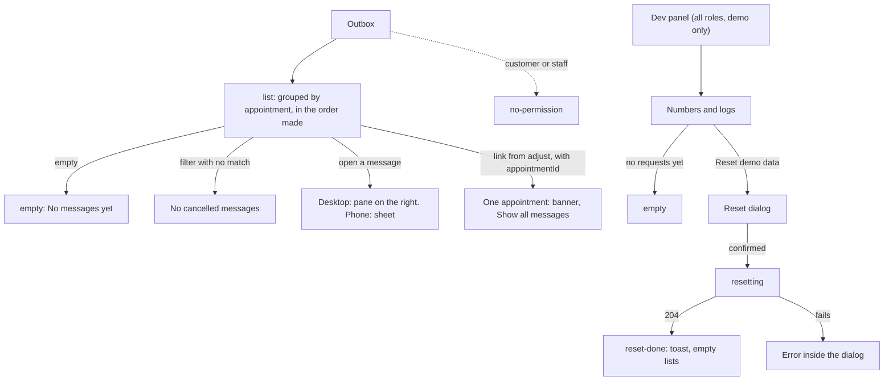

# Design: the manager (admin) flow (B3)

Written 2026-10-28 by the designer role. This file details the screens that `design.md` assigns to the manager. It does not change `design.md`, the tokens or any other designer's file. Where the manager flow needs something the foundation does not have, it is listed in section 8 as a **proposal for B4**, and where it disagrees with `design.md`, in section 9.

**Inputs read:** `design.md` (all of it: direction A plus free gaps, screen list, flows, phone/desktop rules, components 8.1–8.17, words in section 9), `design/foundation.html`, `design/brand/*`, `design/direction-a.html`, `overview.md` (NFR-4, 6, 7), `architecture.md` (endpoints, statuses, flags, error codes, metrics, dev endpoints), REQ-BOOK-005, 006, 007, 008, 011, 012, 013, D-0001-3, 4, 5, 8, 10, 12, 13, 14, 15, 16, 17, 19, 22, Q-0001-7, 10, 12, 18, 19, 20, 21, `security.md` (SEC-4, 10, 11, 13, 14, 17), D-0000-10, 12, 17.

**Files written:** this file; the six prototype pages `design/manager-<screen id>.html` (section 10); four questions, [D-0001-33](../0001-booking/D-0001-33.md), [71](../0001-booking/D-0001-34.md), [72](../0001-booking/D-0001-35.md), [73](../0001-booking/D-0001-36.md).

**Words.** Dealership, Service bay, Technician, Appointment, Customer, Vehicle, Service type (D-0000-14). Plain everyday English (D-0000-10). All names, plates, times, numbers and message wording in the prototypes are made-up sample data and are labelled so on every page.

**B4 decisions (2026-10-28).** WeekPatternEditor, DateExceptionList, FlagImpactDialog, ChangeSummary (for `adjust` only), the `danger` and `sm` badge, the ActionBar status slot, the `fill` suggestion chip, `--font-mono`, `--size-form` and the `copy` icon are accepted; section 9 items 1 to 10 are accepted as drawn or left with the open question named there. The reasons are in design.md 13.4, and the components are now design.md 8.18, 8.19 and 8.23 to 8.26. A new question, Q-0001-100, asks whether a move sends the customer a message (section 5.1 and 5.5 draw option B). B4 also made these changes to this flow's pages: "Go to my schedule" became "Go to the schedule" (wherever this file says "my schedule" for that button, read "the schedule"); the Alert has the icon on the heading's line; the flag badge wraps; Try again has the `refresh` icon; each page's bar links to the start page.

**Not verified in a browser.** No browser and no shell were available in this step. The prototype pages were checked by reading the CSS and the script, not by opening them. Layout at 390 px and 1280 px, the container queries and the sticky dialog placement are unconfirmed. **Open each page at 1280 px and at 390 px first (or use the `Phone, 390 px` link in the page bar) and report what looks off.** See section 11.

---

## 1. The manager in one paragraph

Elena Petrova manages Northgate Motors, Leeds. She opens the app to see what needs attention (flagged bookings, in the nav with a count), to move or cancel one appointment, to change the opening hours or a technician's shifts, to check that customers were sent the right messages, and, when something looks wrong, to follow it in the dev panel. She is on a desktop at the front office most of the time and on a phone when she is out on the forecourt. She reads before she acts, because one edit can touch many bookings.

**Direction.** Inherited from `design.md` section 2 (A, Front desk, plus free gaps). Nothing new is chosen here. The manager-only touches are: yellow with an icon, words and a dashed edge means "a booking needs you" (flag), a danger tint only for "this was refused" and "this failed", navy selection, one signal-blue primary per screen.

**Defaults this flow avoids.**

| Default | Used instead |
|---|---|
| An admin dashboard of big numbers and charts | Lists and forms. The only "numbers" are the four in the dev panel, set in running text, not as hero figures |
| A settings page that saves on every blur, with no word of what it did | One Save, a status line that says whether anything changed, and a warning with the real count before anything that flags bookings |
| A wide data table of weekdays on a phone | One weekday per row, fields wrapping two to a line; the row keeps its day name, its Closed or Day off switch and its times in view |
| A toggle with no label | A checkbox with the words "Closed" or "Day off" |
| A modal for every edit | A page for every edit; a dialog only for cancel, reset, leave-with-changes and the flag warning (section 9, item 4) |
| Raw error codes and "Oops" | Section 5 wording: what happened, why, what to do |

---

## 2. Flows (all paths through the manager's requirements)

### 2.1 Adjust one appointment

### 2.2 Flagged bookings

### 2.3 Hours and shifts (the same shape)

### 2.4 Outbox and dev panel

---

## 3. Screens

Routes and ids are `design.md` section 5; this table adds what B3 drew. A state in **bold** is one `design.md` did not list.

| id | route | Mode | States drawn (`?state=`) | Requirements covered |
|---|---|---|---|---|
| `adjust` | `/appointments/:appointmentId/adjust` | Operate | `idle`, `changed`, `checking`, **`validation`**, `clash`, **`clash-empty`**, `already-flagged`, `saved`, `cancel-dialog`, **`cancelling`**, **`cancel-refused`**, **`cancelled-appointment`**, `loading`, `error`, `no-permission`, **`not-found`**. Also the manager's parts of two screens other designers own: **`appointment`**, **`appointment-flagged`**, **`schedule-additions`** | REQ-BOOK-005.AC-1, AC-2, AC-3; REQ-BOOK-002 and REQ-BOOK-009 (the suggestions come from the same check); REQ-BOOK-012.AC-1 (manager cancel frees the resources); REQ-BOOK-013.AC-3, AC-4 (the message the customer gets) |
| `flagged` | `/manage/flagged` | Operate | `list`, `after-cancel`, `empty`, `loading`, `error`, `cancel-dialog`, `cancelling`, `cancel-refused`, `no-permission`, **`no-permission-dealership`** | REQ-BOOK-005.AC-1 (Move), REQ-BOOK-007 and REQ-BOOK-008.AC-4 (what is flagged and why), Q-0001-12 |
| `dealership-settings` | `/manage/dealership?dealership` | Operate | `idle`, `dirty`, `validation`, **`checking`**, **`confirm-flags`**, `saving`, `saved`, `saved-with-flags`, **`leave-dialog`**, **`save-error`**, `loading`, `error`, `no-permission`, `no-permission-dealership` | REQ-BOOK-007.AC-1..5, REQ-BOOK-011.AC-1..5 |
| `shifts` | `/manage/shifts?technicianId&dealership` | Operate | `idle`, `dirty`, `validation`, **`checking`**, **`confirm-flags`**, `saving`, `saved`, `saved-with-flags`, **`leave-dialog`**, **`save-error`**, `loading`, `error`, **`empty`**, `no-permission`, **`not-found`** | REQ-BOOK-006 (the pattern the schedule shades), REQ-BOOK-008.AC-1..4 |
| `outbox` | `/manage/outbox?dealership&appointmentId` | Read | `list`, `message-open`, **`message-cancelled`**, **`by-appointment`**, **`filter-empty`**, `empty`, `loading`, `error`, `no-permission`, `no-permission-dealership` | REQ-BOOK-013.AC-1..5 |
| `dev-panel` | `/dev` | Operate | `metrics`, `logs`, **`problems`**, `empty`, `loading`, `error`, `reset-dialog`, **`resetting`**, **`reset-done`** | NFR-6 |

**Coverage check (manager's requirements).** REQ-BOOK-005.AC-1 `adjust` `saved`, AC-2 `adjust` `clash`, AC-3 `no-permission` states and the manager-only buttons · 006 `shifts` (weekly pattern with break) · 007.AC-1 two dealerships each with their own hours (the page edits one dealership; the header shows which), AC-2 and AC-3 override that is longer or shorter, AC-4 override that closes a day, AC-5 weekly hours as the default · 008.AC-1 extra shift, AC-2 leave, AC-3 `no-permission`, AC-4 `confirm-flags`, `saved-with-flags`, `flagged` · 011.AC-1/2 notice and horizon fields, AC-3/4 break field, AC-5 line under "Booking rules" · 013.AC-1 `list` (confirmation and reminders with links), AC-2 times shown in the dealership's zone, AC-3 and AC-4 the cancelled reminders and the new ones in the first group, AC-5 a message appears once (the list never shows two with the same kind and time) · NFR-6 `dev-panel` · NFR-7 section 7 below · NFR-4 tokens only.

Not in the manager's scope and **not drawn**: editing bays or skills (Q-0001-7), adding technicians, a log in, cross-dealership views (a manager has one dealership, D-0001-14), a bulk "copy Monday to the other days" shortcut, a visual calendar of overrides.

---

## 4. Screen contracts

Each: **Mode** · **User and job** · **Eye finds first** · **Primary action** · **Density** · **Hierarchy** · **Interaction** · **Responsive priority** · **Avoids**.

### 4.1 `adjust`

- **Mode:** Operate. **User and job:** the manager moves an appointment, or changes who does it or where, and wants to know before and after whether it fits. **Eye finds first:** the "What changes" table with Now beside After the change; when a change was refused, the danger-tint alert "That change was not saved." **Primary action:** Save change (signal fill). It is disabled until something differs, and the reason is written beside it (and in the phone bar's left side).
- **Density:** roomy, two columns on desktop. **Hierarchy:** back link → title and one-line identity (service, customer, vehicle, plate) → badges (status, car choice, flag) → alert if any → form column (left) and "What changes" panel (right, sticky) → Save row → "Cancel this appointment" section at the very bottom, away from Save.
- **Interaction:** the form has Date, Start time (15-minute step), Technician, Service bay. Technician and Bay start at "Same as now (name)". If the time changes and the current person or bay is busy, another free one is picked and the page says so afterwards (D-0001-33, recommended A). Naming a different technician or bay is strict. The check runs on Save, not while typing ("We check once more when you save, in case someone books first"). "Checking…" disables the fields. A 409 keeps every entry, moves focus to the alert heading, lists up to five closest free times as buttons that **fill** the form and do not save (D-0001-16: nearest first, 14 days). The panel shows the refused values tagged **Refused** (icon, word, danger tint). After a save the form is replaced by a success alert and the panel with **Changed** tags, plus "Back to schedule" and "See the message". Cancel is a button at the bottom that opens a dialog; the dialog's safe button is first and has focus.
- **Responsive priority:** phone — panel first, then the form, one column; Technician and Bay stack; the suggestions are full-width rows (time left, "ends 12:00" right); sticky bar shows the chosen time, the reason or status, and Save; the tab bar is hidden (task screen). Desktop — form left, panel 22rem right and sticky; Save sits in the page, no bar.
- **Avoids:** a modal for the form, a date picker widget with a month grid, an automatic save when a suggestion is pressed, clearing the form after a refusal, showing `TECHNICIAN_BUSY` raw.

**The manager parts of two screens other designers own** (drawn so B1 and B2 can copy them; they do not replace their screens):

- `appointment` (B1 owns): for the manager, Adjust (primary), Cancel appointment (secondary) and a quiet "See the messages sent" link under the facts. A flagged booking adds the warning panel above the facts with **Move this appointment** (primary, in the panel; then Adjust is not shown a second time). Customer and staff do not see these. Staff do not see Cancel (D-0001-19).
- `schedule` (B2 owns): (a) above the facts line, when the count is above 0, a warning strip "4 bookings need a new time" with the button "Review flagged bookings"; staff do not get it; (b) in the detail panel under the timeline, a manager sees **Adjust** (primary) and **Open appointment**; a flagged block shows **Move** (primary) instead of Adjust, with the flag reason as one line ("Flagged: runs past the end of the shift (13:00)."); staff see only Open appointment.

### 4.2 `flagged`

- **Mode:** Operate. **User and job:** see everything that no longer fits and deal with it, soonest first. **Eye finds first:** the first row's date and its yellow-dashed reason badge. **Primary action:** Move on each row. The rows repeat it, so it is a secondary button; the screen has no primary fill (the rule is one per screen, not one per row).
- **Density:** list rows, 64 px minimum, grouped under a day heading with a count ("Sat 31 Oct · 2 bookings"). **Hierarchy:** title → one sentence ("4 bookings need a new time, or to be cancelled. Soonest first. They are still booked and keep their technician and bay until you act.") → day groups → rows. Each row: time range (bold, own column), service and vehicle with plate, customer and technician and bay, badges (reason in words with the alert icon and a dashed edge, car choice), the reason as a sentence with the real numbers, "Flagged on Wed 28 Oct.", then Move and Cancel.
- **Interaction:** Move opens `adjust` with the closest times that fit already listed. Cancel opens the same dialog as in `adjust`; after it, the row leaves, a toast confirms, the nav count goes down and a polite live message says "Appointment cancelled. 3 flagged bookings left." When the last one goes, the empty state replaces the list. A booking with both reasons shows two badges and two sentences. Buttons have longer accessible names that start with the visible word ("Move Brake fluid change for Jonas Weber, Fri 30 Oct 12:15").
- **Responsive priority:** the row stays a row on a phone (time column 5.5rem, content beside it); Move and Cancel wrap under the text, 44 px each. Nothing is "tap to see".
- **Avoids:** a table, a bulk-select with a bulk cancel (too easy to cancel the wrong ones), colour as the only flag (icon, words and dashed edge go together), deleting anything silently.

### 4.3 `dealership-settings`

- **Mode:** Operate. **User and job:** set the opening hours for each weekday, mark dates that differ, set the notice, the horizon and the break, and know what the edit will do to existing bookings. **Eye finds first:** the weekday list with the current hours. **Primary action:** Save settings.
- **Density:** form panels, one column up to 60 rem (`size-form` proposal) so lines stay short. **Hierarchy:** title and one line naming the dealership and its zone → an info alert ("Shortening hours never deletes a booking…") → panel "Opening hours each week" → panel "Different hours on one date" (list, then "Add a date") → panel "Booking rules" → Save row.
- **Interaction:** a weekday row = day name, a "Closed" checkbox, Opens, Closes (15-minute step); ticking Closed disables and empties the two times. Date list: each row shows the date, a word badge (Longer, Shorter, Closed with an icon), what happens, how it compares with the usual hours, and Remove. "Add a date" adds to the list only; nothing is saved until Save settings (said under the button). Booking rules: Shortest notice (hours), Furthest ahead (days), Break between a technician's jobs (minutes). The notice helper discloses that it is also the last moment a customer can cancel or change online (Q-0001-20 A). The time zone is shown as text (D-0001-35, recommended A). **Save** runs the preview (D-0001-36, recommended A): none touched → saves; some touched → the warning dialog with the list and the choice. After saving with flags the panel at the top says how many and offers "Review flagged bookings". Leaving with unsaved changes asks first. The dirty state shows "You have unsaved changes." beside Save and "Unsaved changes" in the phone bar.
- **Responsive priority:** phone — weekday rows stacked (day name, Closed, then Opens and Closes side by side), sticky bar (status left, Save right), tab bar hidden; tablet — same with two fields per line; desktop — one row per weekday with column headings (Day, Opens, Closes) above, labels hidden visually but present for readers.
- **Avoids:** saving on blur, a weekly grid of 7 columns of times, an "Apply to all" that overwrites silently, the word "override" in the UI (it says "Different hours on one date").

### 4.4 `shifts`

- **Mode:** Operate. **User and job:** set one technician's weekly pattern, mark leave or an extra shift, and see what it does to their bookings before it happens. **Eye finds first:** the technician picker and the pattern. **Primary action:** Save shifts.
- **Hierarchy:** title → Technician select with previous and next buttons → one line on skills (not editable here) → info alert → "Weekly pattern" → "Leave and extra shifts" (list, then "Add leave or a different shift") → Save row.
- **Interaction:** each weekday row shows the dealership's hours for that day as a hint ("Dealership open 08:00 to 18:00") so the manager sees the limit. Fields: Day off checkbox, Starts, Ends, Break starts (optional), Break ends (optional); both break times or neither. "Add leave" takes First day, Last day (optional, makes one entry per day) and "On leave" or "Works a different shift"; a different shift shows the four time fields, leave hides them. New entries carry "New, not saved yet" until saved. Switching technician with unsaved edits asks first. Same preview, warning and `saved-with-flags` as hours (D-0001-36).
- **Responsive priority:** as `dealership-settings`; the weekday row has six fields, so it needs 1024 px to sit on one line; at tablet width Starts, Ends and the two break fields share one line; on a phone they pair up.
- **Avoids:** a drag-the-bar roster, a month calendar of leave, a technician list that needs a second page to find a name.

### 4.5 `outbox`

- **Mode:** Read (calm; the reader's question is "what did the customer get, and what is still to come?"). **Eye finds first:** the first group's heading and the state badges. **Primary action:** none; opening a message is the job. Secondary: Open appointment.
- **Hierarchy:** title and a line ("The messages the system would send to customers, and when. Times are Leeds time.") → info alert "Nothing is sent in this demo" → filter ("All (9)", "Scheduled (2)", "Sent in this demo (5)", "Cancelled (2)") → groups, one per appointment: heading (service · first name · time), the sub-line ("Moved from Fri 30 Oct, 09:15. In the order the messages were made."), rows.
- **Interaction:** a row is a button: icon by kind, kind in words, "when · To first name", a note ("For the old time, Fri 30 Oct, 09:15"), and a state badge. Kinds: Confirmation, Reminder 48 hours before, Reminder morning of the appointment, Moved to a new time, Cancelled. States: **Scheduled** (due in the future), **Sent in this demo** (due time has passed; nothing leaves the browser), **Cancelled** (reminders whose appointment was moved or cancelled; they stay in the list, D-0001-22 e). Desktop: the message opens in a pane on the right. Phone and tablet: it opens in a bottom sheet. The pane shows kind, state, who it goes to (first name only; "contact details are not stored in messages", SEC-17), when (dealership zone), which appointment, the message text with its cancel and change links, and for a cancelled one a "Not sent" info alert saying why. Message text is shown as plain text; the links are built from the app address, a fixed route and the appointment id only (SEC-11, SEC-17).
- **Responsive priority:** one column on phone, tablet; two panes from 1024 px with the pane sticky. The text column is at most 65ch.
- **Avoids:** showing a phone number or email (none exists in a message), a table with one column per message field, a "Resend" button (nothing is sent; not asked for).

### 4.6 `dev-panel`

- **Mode:** Operate. **User and job:** follow what the app did (a 409, a slow search, an error) and get the demo back to a clean start. **Eye finds first:** the "Demo only" badge, then the numbers. **Primary action:** none on the page; "Reset demo data" is a secondary button in its own section, behind a dialog.
- **Hierarchy:** title + "Demo only" badge + one line saying it is not part of a real build → desktop: "Numbers" left, "Recent requests" right → "Reset demo data". Phone: a two-button switch (Numbers, Logs), then the chosen one, then Reset.
- **Interaction:** the four numbers asked for (architecture 7.7): *time to find free times* (day search, check one time, closest times: searches, middle, slowest 5%, and the target where the architecture has one: under 50 ms and under 200 ms, with "Within target" or "Over target" as icon plus words), *bookings confirmed*, *times refused because they were just taken* (409, by reason), *searches that found no free time*. They are counted in this browser tab (architecture says per tab) and the page says so. Logs: newest first, each line shows time (UTC), level (icon and word), message, status and duration, then route, outcome, reasons and the **reference** (the first 8 characters of the trace id, the same one the error screens show). A line opens to the exact JSON (allowed fields only) with Copy reference and "Show only this trace". A search box finds a reference. "Problems only" shows status 400 and up.
- **Privacy.** The panel says once, above the logs, that names, phone numbers, emails and registrations are never logged (SEC-10). The sample lines use only the allowed fields. Nothing typed by a user can appear here except as ids.
- **Responsive priority:** phone — one list, wrapped lines, no sideways scroll; desktop — two columns (5fr / 7fr).
- **Avoids:** gauges, sparklines, a hero number (all on the refuse list), colour-only level markers, a terminal costume (the mono face is used only inside the JSON block, which is data).
- **Not in a real build:** the page and its link do not exist in a remote build (SEC-14.AC-2). No role may be told "no permission" here; in a remote build the route is simply `not-found`.

---

## 5. Words: every message

Quoted exactly as the prototypes show them. `{ }` marks a value from data. All times are in the dealership's zone; "(Leeds time)" is added once per screen when the viewer's zone differs.

### 5.1 `adjust`

| Where | Title / label | Line under it |
|---|---|---|
| Page | "Adjust appointment" | "{service} for {customer} · {vehicle} {plate}" |
| Panel | "What changes" (columns "Now", "After the change"; tags "Changed", "Refused") | Idle, changed: "The customer is sent a message about the new time. Their reminders move with it." |
| Panel, refused | | "Nothing was changed. Your entries are still in the form." |
| Panel, invalid | | "Nothing is checked until the form is fixed." |
| Form | Legend "New time and resources". Labels "Date", "Start time", "Technician", "Service bay". Select defaults "Same as now ({name})", "Same as now ({bay})" | Date: "{Fri 30 Oct}". Start: "Ends 12:15. The job takes about 3 hours." Technician: "If {name} is busy at the new time, we pick another free technician and tell you." Bay: "Same idea: another free bay is picked if this one is busy." Under the form: "We check once more when you save, in case someone books first." |
| Save row | "Save change", "Checking…", "Leave without saving" | Disabled: "Change the time, technician or bay to save." · after a refusal: "Pick a closest time, or change the form." · when a field is wrong: "Fix the two fields above to save." · flagged: "Pick a time that fits, or change the form." |
| Phone bar | "{Mon 2 Nov, 09:00}" / "Was {Fri 30 Oct, 09:15}" · "{date}" / "No change yet" · "Refused. Nothing was changed" · "Flagged: outside the shift" | |
| Validation (422) | Summary: "2 things need fixing before we can check this change." (a list; each item links to its field) | Date: "That date has passed. Choose today or a later date." Start: "Use a time on the quarter hour, for example 09:15." |
| Clash (409) | "That change was not saved." | "{Reason}. The appointment is still at {09:15} with {Maya Okafor} in {bay 1}." then "Closest times that are free" (up to 5; each "{Mon 2 Nov, 09:00}" and "ends {12:00}") and "Choosing a time fills in the form. It does not save anything." |
| Clash, no suggestions | same title | "{Reason}. The appointment is still at …" then "There are no other times in the next 14 days. Try another date, or leave the appointment where it is." |
| Reasons (capitalised first letter in the sentence) | `TECHNICIAN_BUSY` "every technician who can do this job is busy then" · `NO_QUALIFIED_TECHNICIAN_ON_SHIFT` "no technician who can do this job is working then" · `BAY_BUSY` "every service bay is in use then" · `COURTESY_CAR_BUSY` "no courtesy car is free then" · `OUTSIDE_OPENING_HOURS` "the dealership is closed at that time" · `DEALERSHIP_CLOSED` "the dealership is closed that day" · `TOO_SOON` "bookings need at least {lead time} notice" · `BEYOND_HORIZON` "bookings open up to {n} days ahead". Two reasons are joined with "and" | These are `design.md` section 9, unchanged |
| Already flagged | "This booking no longer fits" | "{Technician}'s shift ends at {13:00} on {Fri 30 Oct}. This booking ends at {13:45}. It is still booked and keeps its technician and bay until you move or cancel it. Moving it to a time that fits clears the flag." then "Times that fit" |
| Saved | "Change saved" (success) | "The appointment is now {Mon 2 Nov, 09:00 to 12:00} with {Tomas Havel} in {bay 3}. {Maya Okafor} was busy then, so {Tomas Havel} was picked. The customer has a new message in the outbox." Buttons "Back to schedule", "See the message". Toast "Appointment moved to {Mon 2 Nov, 09:00}." The "was busy, so … was picked" sentence appears only when the system chose someone else |
| Cancel section | Heading "Cancel this appointment"; button "Cancel appointment" | "The time becomes free again. The customer is sent a cancellation message and their reminders are cancelled. This cannot be undone." |
| Cancel dialog | Title "Cancel this appointment?"; buttons "Keep appointment" (first, focused), "Cancel appointment" (danger) | "{service} for {customer}, {Fri 30 Oct, 09:15}. The time becomes free again. The customer is sent a cancellation message and their reminders are cancelled. This cannot be undone." |
| Cancelling | button "Cancelling…" (dialog cannot be closed) | |
| Cancel refused | Alert in the dialog: "We could not cancel this appointment"; buttons "Keep appointment", "Try again" | "The booking service did not answer. Nothing was changed. Try again; if it keeps happening, quote reference {4bf92f35}." |
| Cancelled | "This appointment is cancelled" (info) | "It was {Fri 30 Oct, 09:15} with {Maya Okafor}. The time is free again, so it cannot be moved or changed." button "Back to schedule". Toast "Appointment cancelled. The customer is told and the time is free again." |
| `appointment` (manager) | Buttons "Adjust", "Cancel appointment", "See the messages sent" | Flagged: "This booking no longer fits" and the same sentence as above; button "Move this appointment" |
| `schedule` (manager) | Strip "{4} bookings need a new time" ("1 booking needs a new time") | "They no longer fit the opening hours or a technician's shift. They are still booked." button "Review flagged bookings" · panel buttons "Move", "Adjust", "Open appointment" |
| Loading | (screen reader) "Loading the appointment" | |
| Error (500, no network) | "Something went wrong on our side." | "We could not load this appointment. Nothing was changed. Try again; if it keeps happening, quote reference {4bf92f35}." Buttons "Try again", "Copy" (reference) |
| No permission (403) | "You cannot do that as {Staff}." | "Only the garage manager can move, reassign or cancel an appointment. Switch role, or go to your schedule." Buttons "Go to the schedule", "Switch role" |
| Not found (404) | "We cannot find that appointment." | "It may have been removed, or it belongs to someone else." button "Back to schedule" |

### 5.2 `flagged`

| Where | Title / label | Line under it |
|---|---|---|
| Page | "Flagged bookings" | "{4} bookings need a new time, or to be cancelled. Soonest first. They are still booked and keep their technician and bay until you act." (one: "1 booking needs a new time, or to be cancelled…") |
| Day heading | "{Sat 31 Oct}" and "{2} bookings" ("1 booking") | |
| Row | Badges "Outside the technician's shift" (`outside_shift`) and "Outside opening hours" (`outside_opening_hours`), each with the alert icon; car-choice badge. Buttons "Move", "Cancel" | Shift: "{Bartholomew Wojciechowski}'s shift ends at {13:00}. This booking ends at {13:45}." or "{Priya Nair} is on leave on {Mon 2 Nov}." · Hours: "{Northgate Motors} now closes at {14:00} on {Sat 31 Oct}. This booking ends at {15:30}." or "{Northgate Motors} is closed on {Sun 1 Nov}." · "Flagged on {Wed 28 Oct}." |
| After a cancel | Toast "Appointment cancelled. The customer is told and the time is free again."; live message "Appointment cancelled. {3} flagged bookings left." | |
| Cancel dialog and refusal | as `adjust` | |
| Empty | "Nothing needs your attention" | "Every booking fits the opening hours and the technicians' shifts. If you change hours or shifts and a booking no longer fits, it shows up here." button "Open the schedule" |
| Loading, error | (screen reader) "Loading flagged bookings"; "We could not load the flagged bookings. …" as above | |
| No permission | "You cannot do that as {Staff}." | "Only the garage manager can review flagged bookings. Switch role, or go to your schedule." |
| Another dealership | "You do not manage this dealership." | "You manage {Northgate Motors, Leeds}. {Riverside Motors, Ho Chi Minh City} has its own manager. Show {Northgate Motors}, or switch role." Buttons "Show Northgate Motors", "Switch role" |

### 5.3 `dealership-settings`

| Where | Title / label | Line under it |
|---|---|---|
| Page | "Dealership settings" | "Opening hours and booking rules for {Northgate Motors, Leeds}. All times are {Leeds} time." |
| Info alert (always) | "Shortening hours never deletes a booking" | "If a booking no longer fits the new hours, we tell you before you save. It stays booked and shows up under Flagged, so you can move or cancel it." |
| Weekly hours | "Opening hours each week"; per day "Closed", "Opens", "Closes" | "These hours repeat every week. A booking has to fit wholly inside them. Use times on the quarter hour, for example 08:15." |
| Dates list | "Different hours on one date"; list label "Dates with different hours"; badges "Longer", "Shorter", "Closed"; "Remove" | "Use this for a bank holiday, a late opening or a day the dealership is shut. It replaces the weekly hours for that date. Earlier dates are not shown." · row: "Open 08:00 to 19:00" / "Longer than usual: closes 2 hours later (usual 08:00 to 17:00)." · "Closed all day" / "Replaces the usual 08:00 to 18:00." · "Shorter than usual: closes 4 hours earlier (usual …)." |
| Add a date | Legend "Add a date"; "Date", "What happens on this date" (options "Open different hours", "Closed all day"), "Opens", "Closes", button "Add this date" | "Adding a date does not save it. Nothing is saved until you press Save settings." |
| Booking rules | "Booking rules"; "Shortest notice (hours)", "Furthest ahead (days)", "Break between a technician's jobs (minutes)"; "Time zone" | Section: "These rules apply to new bookings and new searches straight away. They never change a booking that already exists." Notice: "A customer cannot book a start time sooner than this. It is also the last moment a customer can cancel or change a booking online." Ahead: "Customers can book up to this many days from today." Break: "Rest time after each job. It applies to technicians only, not to bays." Zone: "Europe/London (Leeds time)" and "The time zone was set when the dealership was set up. It cannot be changed here." |
| Save row | "Save settings" · "Checking bookings…" · "Saving…" · "Discard changes" | Idle: "Nothing has changed yet." · dirty: "You have unsaved changes." · invalid: "Fix the {4} things above to save." · phone bar: "No changes yet" / "Change something to save" · "Unsaved changes" / "Saturday now closes at 14:00" |
| Validation (422) | Summary "4 things need fixing before we can save." (each links to its row) | Row: "{Monday} closes at {07:00}, before it opens at {08:00}. Choose a closing time after {08:00}." · "{Tuesday} opens at {08:10}. Use a time on the quarter hour, for example 08:15." · date: "There is already a change for {Fri 25 Dec}. Remove it first, then add it again." · notice: "Shortest notice must be between 0 and 72 hours. You entered {100}." Also (not drawn, same pattern): "Furthest ahead must be between 1 and 365 days." "Break must be between 0 and 60 minutes." "Choose today or a later date." |
| Warning before saving | Dialog title "Saving will flag {2} bookings"; buttons "Go back and edit" (first, focused), "Save and flag {2} bookings" | "You changed {Saturday}: it now closes at {14:00} instead of {17:00}. {Two} bookings on {Sat 31 Oct} end after that." List rows "{Sat 31 Oct, 14:30 to 15:30}" / "{Inspection} · {Ana Costa} · ends 1 hour after closing". Then "They stay booked and keep their technician and bay. Nothing is deleted or moved. After you save, they show under Flagged, where you can move or cancel each one." More than 5: the list shows 5 and a last row "and {3} more" |
| Saved | "Settings saved" (success) | "The new hours and rules apply to new bookings now. Every booking that already exists still fits." Toast "Dealership settings saved." |
| Saved with flags | "Saved. {2} bookings no longer fit." (warning) | "The new hours apply to new bookings now. These {2} bookings are still booked and are now flagged. Move or cancel each one." button "Review flagged bookings". Toast "Dealership settings saved. {2} bookings flagged." |
| Leave dialog | "Leave without saving?"; buttons "Keep editing" (first), "Leave without saving" (danger) | "You changed the opening hours and have not saved them. If you leave now, the changes are lost." |
| Save failed | "Your changes were not saved" (danger) | "We could not reach the booking service. Nothing was changed, and your edits are still here. Try again; if it keeps happening, quote reference {4bf92f35}." button "Try again" |
| Loading, error | (screen reader) "Loading the settings"; "We could not load the settings. …" | |
| No permission, another dealership | "You cannot do that as {Staff}." / "Only the garage manager can change opening hours and booking rules. Switch role, or go to your schedule." · "You do not manage this dealership." (as in 5.2) | |

### 5.4 `shifts`

| Where | Title / label | Line under it |
|---|---|---|
| Page | "Shifts" | "Weekly pattern, leave and extra shifts for each technician at {Northgate Motors, Leeds}. All times are {Leeds} time." |
| Picker | "Technician" (options "{name} · {skills}"); buttons "Previous technician", "Next technician" | "Skills: {Service, diagnostics}. Skills come with the demo data and are not edited here." |
| Info alert | "Changing a shift never deletes a booking" | "If a booking no longer fits this technician's shift, we tell you before you save. It stays booked and shows up under Flagged, so you can move or cancel it." |
| Weekly pattern | "Weekly pattern"; per day "Day off", "Starts", "Ends", "Break starts (optional)", "Break ends (optional)" | Section: "The hours this technician works each week, with one optional break. Time outside the dealership's opening hours cannot be booked. Use times on the quarter hour, for example 09:15." Per day: "Dealership open {08:00 to 18:00}" / "Dealership closed" |
| Leave and extra shifts | "Leave and extra shifts"; badges "On leave", "Extra shift", "New, not saved yet"; "Remove" | "A date here replaces the weekly pattern for that day. Use it for leave, an extra shift on a day off, or different hours for one day. Earlier dates are not shown." Rows: "{Sat 7 Nov}" / "Works 09:00 to 13:00, no break" / "Extra shift: the weekly pattern has Saturday off." · "On leave all day" / "Not available for any booking." |
| Add | Legend "Add leave or a different shift"; "First day", "Last day (optional)", "What happens on these days" (options "On leave", "Works a different shift"), time fields, button "Add to the list" | "Leave empty for one day." · "On leave hides the four time fields below." · "Adding a date does not save it. Nothing is saved until you press Save shifts." |
| Save row | "Save shifts" and the states of 5.3 | Phone bar: "Unsaved changes" / "Leave added for Mon 2 Nov" |
| Validation (422) | Summary "3 things need fixing before we can save." | "{Thursday} has a break start but no break end. Add both break times, or leave both empty." · "{Friday}'s break starts at {08:30}, before the shift starts at {09:00}. Put the break inside the shift." · "The last day is before the first day. Choose the same day or a later one." · also (same pattern): "{Monday} ends at {08:00}, before it starts at {09:00}. Choose an end time after {09:00}." |
| Warning before saving | "Saving will flag {1} booking" (1) / "…{N} bookings" | "You marked {Priya Nair} on leave on {Mon 2 Nov}. One booking is with her that day." list row "{Mon 2 Nov, 09:00 to 10:00}" / "{Diagnostics} · {Li Wei} · {Priya Nair} is on leave" then "It stays booked and keeps its technician and bay. Nothing is deleted or moved. After you save, it shows under Flagged, where you can move or cancel it." (plural: "They stay booked…") Buttons "Go back and edit", "Save and flag {1} booking" |
| Saved | "Shifts saved" | "{Priya Nair}'s new shifts count in every search from now on. Every booking she has still fits." Toast "Shifts saved for {Priya Nair}." |
| Saved with flags | "Saved. {1} booking no longer fits." | "{Priya Nair}'s new shifts count in every search from now on. This booking is still booked and is now flagged. Move or cancel it." (plural: "These {N} bookings are …") Toast "Shifts saved. {1} booking flagged." |
| Switch dialog | "Switch technician without saving?"; "Keep editing", "Switch without saving" | "You changed {Priya Nair}'s shifts and have not saved them. If you switch now, the changes are lost." |
| Save failed, loading, error | as 5.3 with "shifts" | |
| Empty | "No technicians yet" | "This dealership has no technicians in the demo data, so there are no shifts to edit. Technicians come with the demo data; there is no screen to add one. You can reset the demo data from the dev panel." button "Open the dev panel" |
| No permission | "You cannot do that as {Staff}." | "Only the garage manager can change shifts. Switch role, or go to your schedule." |
| Not found | "We cannot find that technician." | "They may have been removed, or they work somewhere else. Choose a technician from the list." button "Show all technicians" |

### 5.5 `outbox`

| Where | Title / label | Line under it |
|---|---|---|
| Page | "Outbox" | "The messages the system would send to customers, and when. Times are {Leeds} time." |
| Info alert | "Nothing is sent in this demo" | "You see what would go out. No text message or email leaves this browser." |
| Filter | "Show messages": "All ({9})", "Scheduled ({2})", "Sent in this demo ({5})", "Cancelled ({2})" | |
| Group | "{Full service} · {Marta} · {Mon 2 Nov, 09:00}"; "Open appointment" | "{Moved from Fri 30 Oct, 09:15}. In the order the messages were made." |
| Kinds | "Confirmation", "Reminder, 48 hours before", "Reminder, morning of the appointment", "Moved to a new time", "Cancelled" | Row: "{Sent Wed 28 Oct, 10:38} · To {Marta}" / "{To Mon 2 Nov, 09:00}"; "Due {Sat 31 Oct, 09:00}"; "Was due {Fri 30 Oct, 08:00}" |
| States | "Scheduled", "Sent in this demo", "Cancelled" | |
| Message | Heading = kind; "To", "When", "About"; "Message text (sample wording)"; "Open appointment" | To: "{Marta} (first name only; contact details are not stored in messages)". When: "{Mon 2 Nov, 08:00} (Leeds time)". Cancelled: info alert "Not sent" — "This message will not be sent. The appointment moved to {Mon 2 Nov, 09:00}, so this reminder was replaced by a new one." / "This message will not be sent. The appointment was cancelled." |
| One appointment | banner | "Showing the messages for {Full service, Marta, Mon 2 Nov, 09:00} ({AP-1042})." button "Show all messages" |
| Filter, no match | "No cancelled messages" | "A reminder is marked cancelled when its appointment is moved or cancelled. None are cancelled at the moment." button "Show all messages" |
| Empty | "No messages yet" | "A message appears here when a booking is confirmed, moved or cancelled, and when a reminder is scheduled." button "Open the schedule" |
| Loading, error | (screen reader) "Loading the outbox"; "We could not load the outbox. …" | |
| No permission, another dealership | "You cannot do that as {Staff}." / "Only the garage manager can read the outbox. Switch role, or go to your schedule." · "You do not manage this dealership." / "… has its own manager and its own outbox. …" | |

The message text itself is sample wording (see section 9, item 6); the build uses what the message template produces.

### 5.6 `dev-panel`

| Where | Title / label | Line under it |
|---|---|---|
| Page | "Dev panel"; badge "Demo only" | "Logs and numbers from this browser tab, so you can follow what the app did. This page is not part of a real build." |
| Numbers | "Numbers" | "Counted in this browser tab since {09:02} UTC. Reloading the page clears them." (prototype adds "These are sample numbers.") |
| | "Time to find free times": "Day search", "Check one time", "Closest times" | "{42} searches · middle {6} ms · slowest 5% from {14} ms". "Target: under 50 ms" + "Within target" / "Over target"; "No target set." |
| | "Bookings confirmed" | "{7} bookings"; "{4} by customers, {3} by staff." |
| | "Times refused because they were just taken" | "{3} refused (409)"; "Every technician who can do the job was busy: {2}. Every service bay was in use: {1}." (reasons use the section 5.1 words) |
| | "Searches that found no free time" | "{2} searches"; "A day with no free start time shows the closest times on other days." |
| Logs | "Recent requests" | "The last 500 lines, newest first. Logs hold ids, routes and outcomes only. No names, phone numbers, emails or registrations are ever logged." |
| Find | "Find a reference" | "Paste the 8 letters and digits from an error message, for example 4bf92f35." Count: "{8} of {8} lines" |
| Filter | "All lines", "Problems only" | |
| Line | "{09:14:02} UTC", level "info", "warn", "error", message "appointment.book", "{409} · {9} ms", "{POST} {/appointments} · {slot_unavailable} · {TECHNICIAN_BUSY} · reference {4bf92f35}" | Opened: JSON, "Copy reference {4bf92f35}", "Show only this trace" |
| Reset | Section "Reset demo data", button "Reset demo data" | "Put the demo back to its starting data. This clears every booking, customer, message and number you made in this browser. Other browsers are not touched." |
| Reset dialog | "Reset all demo data?"; "Keep my data" (first), "Reset demo data" (danger) | "This deletes every booking, customer, message and number you made in this browser, and loads the starting data again. It cannot be undone. Other browsers are not affected." |
| Resetting | "Resetting…" | |
| Reset failed | Alert in the dialog: "We could not reset the demo data" | "Nothing was changed. Try again; if it keeps happening, quote reference {4bf92f35}." |
| Reset done | Toast "Demo data reset. The starting data is loaded again." | Page: "No requests yet" / "The demo data was reset. Use the app, then come back to see new lines and numbers here." |
| Empty | "No requests yet" | "Use the app (book a time, adjust an appointment), then come back. Every request is logged here with a reference you can quote." button "Open the schedule" |
| Loading, error | (screen reader) "Loading the logs and numbers"; "We could not load the logs and numbers. …" | |

---

## 6. Components

Reused from `design.md` section 8 (no change): AppShell, Button, Form fields (TextField, SelectField, Checkbox, DateField, TimeField), Dialog and Sheet, Toast, Alert, StateBlock, Badge, SegmentedControl, ListRow, AppointmentCard (flagged row variant), TimeChipGrid (suggestion chip), ActionBar (from BookingSummary). Each state in section 8 applies as written.

| Screen | Built from | Used how |
|---|---|---|
| `adjust` | Form fields, Button, Alert (danger for refusal, warning for flagged, success for saved, info for cancelled), Badge, Dialog/Sheet (cancel), Toast, StateBlock, ActionBar | The suggestion buttons are the TimeChipGrid suggestion chip as a plain button (section 8.1) |
| `flagged` | ListRow/AppointmentCard (flagged row variant), Badge (flag), Button, Dialog/Sheet, Toast, StateBlock | Day groups are headings over plain lists, no boxes |
| `dealership-settings` | Form fields, Checkbox, Button, Alert, Badge, Dialog/Sheet, Toast, ActionBar, StateBlock | New: WeekPatternEditor, DateExceptionList, FlagImpactDialog (section 8) |
| `shifts` | as above plus SelectField with previous and next Buttons (the same pattern as OneTechnicianDay's stepper) | New: the same three |
| `outbox` | ListRow (message row), Badge, SegmentedControl, Dialog/Sheet (phone), Alert, StateBlock | Local: MessageRow, MessagePane (not shared) |
| `dev-panel` | Badge, Button, SegmentedControl (phone tab), TextField (search), Dialog/Sheet, Toast, StateBlock | Local: MetricItem, LogLine (a `details` element), JSON block |

**Component states for the manager's local parts** (all must render):

- **MessageRow** (a button): default; hover (`surface`); focus (inset ring); active (`surface-sunken`); selected (`aria-pressed`, 3px navy inset outline); cancelled (secondary text, "Cancelled" badge); disabled n/a; loading (skeleton rows of the same height); error n/a (list-level).
- **MessagePane**: default; empty ("Choose a message"); cancelled (info alert "Not sent"); loading n/a; error n/a.
- **LogLine**: default (closed); hover (`surface-page`); focus; open (JSON visible); problem (level badge warn or error); loading (skeleton); error n/a.
- **MetricItem**: default; within target / over target (icon and words); empty ("No requests yet").
- **Switch/Checkbox "Closed" and "Day off"**: default; hover; focus; checked (times disabled and empty); disabled (whole form while checking or saving); error n/a (the row carries the error).

---

## 7. Phone (390) and desktop (1280)

| Screen | Phone (below 640, drawn at 390) | Tablet (640–1023) | Desktop (1024 and up, drawn at 1280) |
|---|---|---|---|
| `adjust` | Panel first, then the form, one column. Suggestions are full-width rows. Dialog becomes a bottom sheet. Sticky bar: chosen time, status or reason, Save. No tab bar | Two fields per line; panel above the form | Form left, panel 22rem right and sticky; Save row in the page; no bar |
| `flagged` | Rows keep time column and content; Move and Cancel wrap under; tab bar kept (it is a browse screen) | Same, wider | Same, wider; rows are readable at 65ch |
| `dealership-settings` | Weekday rows stacked: name, Closed, then Opens and Closes side by side. Notice, horizon, break stacked. Sticky bar. No tab bar. Warning dialog is a sheet that scrolls inside | Two fields per line | One row per weekday with column headings; booking rules two per line; Save row in the page |
| `shifts` | Weekday rows: name and dealership hours, Day off, then Starts/Ends and break pair | Starts, Ends and the two break fields on one line | One line per weekday (six columns); leave list and the add form below |
| `outbox` | One list; tap a row → bottom sheet with the message | Same | Two panes (list, message); the pane is sticky |
| `dev-panel` | Two-button switch (Numbers, Logs); wrapped log lines; tab bar kept | Same | Two columns (5fr, 7fr) |

Rules from `design.md` section 3 that these pages follow: no sideways scroll at 320 px or 200% zoom; names and values wrap (`overflow-wrap:anywhere`), plates never wrap; touch targets 44 px (checkbox rows, Remove, log lines, message rows); dialogs are sheets below 640 px with the safe action first on desktop and the confirm on top on a phone; tab bar hidden on task screens (adjust, settings, shifts); body text 16 px. The page keeps bottom padding equal to the bar so a focused field is never hidden behind it (build note: `scroll-padding-bottom` equal to the bar's height).

---

## 8. Proposals for B4 (new shared parts, tokens, icons)

None of these exist in the foundation. Each is built only from tokens.

1. **WeekPatternEditor** (used by `dealership-settings`, `shifts`).
   - Props: `mode: 'hours' | 'shift'`, `days[{weekday, label, hint?, off, start, end, breakStart?, breakEnd?, error?: {fields[], message}}]`, `disabled`, `onChange`.
   - Anatomy: a `group` per weekday labelled by its day name; a checkbox ("Closed" in hours mode, "Day off" in shift mode); the time fields (Opens, Closes) or (Starts, Ends, Break starts (optional), Break ends (optional)); a row error under the row that spans the columns, and the offending fields get the error edge and `aria-describedby` that row error. Time fields use the foundation TimeField (step 900).
   - Layout: phone — name, checkbox, fields two per line; from 640 — four fields on one line (shift mode); from 1024 — one line per weekday with a column header row (`aria-hidden`; the real labels become visually hidden).
   - States: default; hover/focus per field; off (fields disabled and empty); error; disabled (whole editor while checking or saving); loading (skeleton rows of the same height).
2. **DateExceptionList** (used by `dealership-settings` as "Different hours on one date", `shifts` as "Leave and extra shifts").
   - Props: `items[{date, kind, badgeLabel, summary, comparison, isNew}]`, `addForm` (a slot for the fields), `onAdd`, `onRemove`, `emptyText`.
   - Anatomy: a list; each row has the date (bold, tabular), a badge with icon and word, the summary, the comparison line and a quiet Remove button whose accessible name includes the date; below it a "Add …" fieldset ending in a secondary button and the line "Adding a date does not save it. Nothing is saved until you press Save." New rows carry the badge "New, not saved yet" (info tint).
   - States: default; empty (text "No dates yet." under the heading); new row; add form error (the field message); disabled; loading n/a.
3. **FlagImpactDialog** (used by `dealership-settings`, `shifts`; it is the foundation Dialog with a fixed body).
   - Props: `count`, `changeSentence`, `bookings[{start, end, service, customerName, reason}]` (first five), `moreCount`, `onBack`, `onConfirm`, `loading`, `error`.
   - Behaviour: title "Saving will flag {N} booking(s)"; initial focus on "Go back and edit"; confirm is primary (not danger, because nothing is destroyed) and says the count; Esc and the close button do the same as "Go back and edit"; the scrim does not close it (like a destructive dialog).
   - States: default; saving (confirm "Saving…", cannot close); error (an Alert inside).
4. **ChangeSummary** (used by `adjust`; B1's `reschedule` "Current time stays until the new one is confirmed" panel could use it).
   - Props: `rows[{label, now, after, tag?: 'Changed' | 'Refused'}]`, `footnote`.
   - Anatomy: a `table` with a visually hidden first column header, columns "Now" and "After the change", row headers; a changed cell has the right arrow icon, bold text and a small tag; the tag is a Badge `sm` ("Refused" uses the `danger` variant). The panel is flat, 12px radius, sticky on desktop.
   - States: default (all unchanged: no tags); changed; refused; saved; loading (skeleton rows).
5. **Badge: `danger` variant and `sm` size.** `danger`: `danger-tint` fill, 1px `text-danger` edge, navy text, icon + word (used for "Refused" and the log level "error"). `sm`: `xs` text, `space-2` side padding. Neither is interactive.
6. **ActionBar: status slot.** The foundation ActionBar shows the chosen time and one button. Settings, shifts and adjust need a status line on the left ("Unsaved changes" / "Saturday now closes at 14:00"). Props add `title` and `status`. Same sticky, shadow and safe-area rules.
7. **TimeChipGrid suggestion chip, `mode: 'fill'`.** A suggestion that fills a form instead of selecting a radio in a grid: same two-line look, a `button` with `aria-pressed`, full width on a phone (time on the left, "ends 12:00" on the right).
8. **Tokens.** (a) `--font-mono` (a system monospace stack): the README says code uses `ui-monospace` but `tokens.css` has no variable; the dev panel's JSON block needs one. (b) `--size-form: 60rem`: the widest line of a settings form; the prototypes write `calc(var(--space-16) * 15)`. Nothing else is missing: every colour, space and size used comes from `tokens.css`.
9. **Icons.** `copy` (Copy reference). The foundation sprite already holds flag, sliders, mail, clock, arc, lock and search; design.md section 8's list should add them (B4's call).

---

## 9. Where this file differs from `design.md`, for B4

1. **Warning before saving** (section 4.4 of `design.md` draws the flag count after saving). The lead's brief asks for a clear warning first. Needs a preview call: D-0001-36 (recommended A). Without it, `checking` and `confirm-flags` go and the fixed info alert stays.
2. **`adjust` `saved` stays on the page** with "Back to schedule" instead of going straight back to the schedule with a toast (section 4.4, M3). The manager has to see that another technician may have been picked (D-0001-33). The toast still shows. If the technician was not changed, B4 may go straight back.
3. **The flagged list needs a filter and a detail field** that the contract does not have: D-0001-34 (for the architect; recommended A).
4. **Dialogs.** `design.md` limits dialogs to cancel, discard and reset. Added: the flag warning (it protects a choice that changes many bookings, so it needs a focus trap and a safe default) and "switch technician without saving" (a discard). Everything else is a page.
5. **No primary button on `flagged`** (one per row would break "one primary per screen").
6. **Outbox message text is sample wording.** The architecture says messages hold ids only (AD-13, SEC-17), so the text is made by a template at display time. The words in the prototype are placeholders for that template; the cancellation message links to `/book` (not stated anywhere).
7. **Outbox state "Sent in this demo"** is worked out from the due time having passed; the architecture stores `queued` and `cancelled` only (D-0001-22 e). B4 or the architect should confirm.
8. **Manager has one dealership**, so there is no DealershipPicker for the manager (the header shows the name as text); "another dealership" is a 403 on a screen that names it (settings, flagged, outbox: `no-permission-dealership`) and a 404 for a record id (adjust, shifts: `not-found`), as SEC-4 says.
9. **Time zone is read-only** (D-0001-35, recommended A).
10. **Notice is also the customer's cutoff** (Q-0001-20 A, still provisional). The helper text says so; if a separate cutoff is chosen, that sentence goes.

---

## 10. Prototype pages

Six pages in `design/`, in flow order. Each has a bar at the top (not part of the product) with the flow order, every state of the page as a link (`?state=<state>`), and a width switch (`&view=phone` shows a 390 px frame inside a wide window, because the pages use container queries; a real 390 px window gives the same result). They need JavaScript; they use only the shared token values (copied into `:root` because a plain page cannot read the Tailwind `@theme`), and nothing from other designers' files except links to `staff-schedule.html` (B2) and `staff-book-customer.html` (B2) in the navigation. If those pages do not exist, the links are dead; nothing else depends on them.

| Page | States |
|---|---|
| `manager-adjust.html` | appointment, appointment-flagged, schedule-additions, idle, changed, validation, checking, clash, clash-empty, already-flagged, saved, cancel-dialog, cancelling, cancel-refused, cancelled-appointment, loading, error, no-permission, not-found |
| `manager-flagged.html` | list, after-cancel, empty, loading, error, cancel-dialog, cancelling, cancel-refused, no-permission, no-permission-dealership |
| `manager-dealership-settings.html` | idle, dirty, validation, checking, confirm-flags, saving, saved, saved-with-flags, leave-dialog, save-error, loading, error, no-permission, no-permission-dealership |
| `manager-shifts.html` | idle, dirty, validation, checking, confirm-flags, saving, saved, saved-with-flags, leave-dialog, save-error, loading, error, empty, no-permission, not-found |
| `manager-outbox.html` | list, message-open, message-cancelled, by-appointment, filter-empty, empty, loading, error, no-permission, no-permission-dealership |
| `manager-dev-panel.html` | metrics, logs, problems, empty, loading, error, reset-dialog, resetting, reset-done |

Sample data is consistent across the pages: Elena Petrova manages Northgate Motors, Leeds; AP-1042 (Marta Kowalska, Full service) is the appointment moved in `adjust` and shown in `outbox`; the Saturday cut in `dealership-settings` flags the two bookings that `flagged` lists; marking Priya Nair on leave in `shifts` flags the booking that `flagged` also lists.

---

## 11. Accessibility and craft floor, checked in one pass

| Check | Result |
|---|---|
| Contrast | Only foundation token pairs are used (navy text on white, page, info, warning, success and danger tints; `text-secondary` for helpers; `text-link` for links). New pairs, worked out by hand from the README ratios: navy on `danger-tint` for the `danger` badge, ≥ 5.3:1 (README gives `text-danger` on it; navy is darker). Icons are ≥ 3:1. A tool check is for Visual QA |
| Colour alone | Flag = icon + words + dashed edge; refused = icon + "Refused" + danger tint; level = icon + word; state of a message = icon + word; changed = arrow + bold + "Changed"; required fixes name the field and link to it |
| Targets and focus | 44 × 44 px for every control; checkbox rows are labels at least 44 px high across the row; Remove, Copy and log lines are 44 px; focus ring on every control; the dialog returns focus to its opener; on a sticky bar the page leaves bottom padding |
| Forms | Labels above fields; hints under; errors with the alert icon and a way out; a summary at the top with links, focus moves to its heading; first invalid field focused; `aria-invalid`, `aria-describedby` |
| Structure | One `h1` per page; sections as `h2`, weekdays as `h3`; landmarks from the shell; lists are lists; the compare table has row and column headers; log lines are `details` |
| Announcements | Cancel on `flagged` and save results use polite status messages; refusals and failures use `role="alert"`; loading uses `aria-busy` and a screen-reader message |
| Zoom, width | `rem` units, wrapping text, no sideways scroll at 320 px or 200% zoom; the only wide thing is the six-column weekday row, and it exists only from 1024 px |
| Real data | Long name "Bartholomew Wojciechowski" in select options, rows and the dialog (wraps, never clips); names use `dir="auto"`, plates `dir="ltr"` and no wrap; times and dates in the dealership's zone and `en-GB` formats; empty values show a sentence, never a blank; 4 or 60 flagged rows both work (plain list); more than 5 bookings in the warning dialog show 5 and "and N more" |
| Motion | The sheet slides in 240 ms; colour changes 120–150 ms; nothing else; reduced motion removes it |
| Refuse list | No eyebrow or kicker, no section numbers, no nested cards (panels hold rows and fields, not panels), no side stripes, no gradient text, no glass, no hard shadows, no emoji or glyph icons, no hero metric (the dev panel numbers are body-size text), no sparklines |
| Values | Only token values; the prototype defines no other colour or size, except the harness frame width (`--frame-phone`) and the proposed `--font-mono` |
| **Not verified** | **No browser or shell was available. Nothing was opened. Layout at 390 and 1280 px, container-query behaviour, the sticky dialog and toast placement, and the page scripts were checked by reading only. If a page shows a blank body, the script has an error; open the browser console and report the first message.** |
