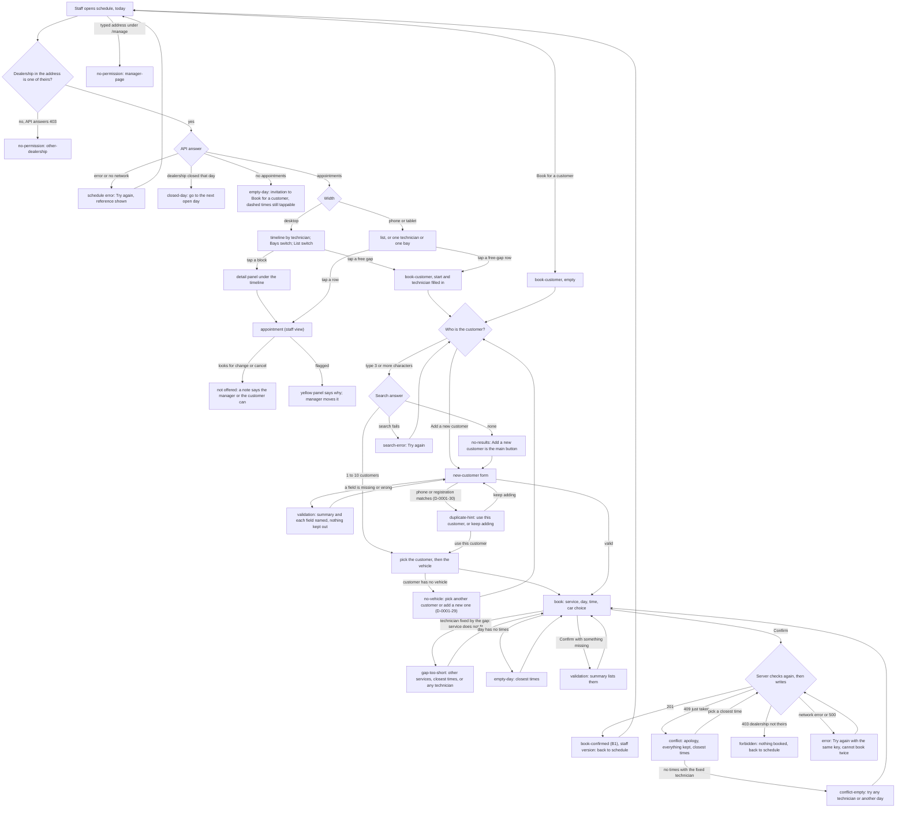

# Design: the staff flow (B2)

Written 2026-10-28 by designer B2. It builds on [design.md](../design.md) (the foundation, binding) and uses only the shared tokens in `design/brand/` (D-0000-12). It does not change design.md, the tokens or the other designers' files. Where this file needs something the foundation does not have, it is written as a **proposal for B4** (section 8).

**Inputs read:** design.md (all), foundation.html, brand/tokens.css + tokens.json + README.md, direction-a.html and direction-b.html (the free gap), overview.md (NFR-4, NFR-7), architecture.md (statuses, flags, endpoints, the 409 body, the error codes), REQ-BOOK-001, 004, 005, 006, 008, 009, 010, 014, D-0001-11, -12, -13, -14, -15, -18, -19, -20, -21, -22 (g), Q-0001-23, security.md SEC-4, -10, -11, -13, D-0000-26, -27, -28.

**Files this step wrote:** this file; the prototype pages `staff-schedule.html`, `staff-appointment.html`, `staff-book-customer.html`, `staff-book.html`, `staff-no-permission.html` in `design/`; five questions for the human, [D-0001-28](../0001-booking/D-0001-28.md) to [D-0001-32](../0001-booking/D-0001-32.md).

**Words (D-0000-10, D-0000-14).** Plain everyday English. The screens say Dealership, Service bay, Technician, Appointment, Customer, Vehicle, Service. All names, plates, phone endings, dealerships and times in the prototypes are **made up** (sample data) and said so on the pages.

**How to open the prototypes.** Open the HTML files in a browser. Each page has a dark bar on top (the harness, not part of the product) with: the pages in flow order, every state of this page as a link (`?state=<state>`), and a switch between full width and a 390 px phone frame (`&frame=phone`). The frame is a container: a narrow frame shows the phone layout whatever the window is; a full-width frame shows the desktop layout from 1024 px. Pages need JavaScript (they draw themselves from sample data, as foundation.html does).

**B4 decisions (2026-10-28).** P1 to P8 are accepted (P4 replaces SearchCombobox on `book-customer`; P7 depends on D-0001-31), P9 is accepted as the one exception to the 8px rule, and the two unnamed values in section 8 ("Tokens") stay un-named. The reasons are in design.md 13.3, and the components are now in design.md 8.4, 8.12, 8.13, 8.17 and 8.22. B4 also made these changes to this flow's pages: the width switch is `?view=phone` (the old `?frame=phone` still works); the Alert now has the icon on the heading's line; error blocks say "quote reference 4bf92f35" and show Copy; Try again has the `refresh` icon; each page's bar links to the start page. Wherever this file says `frame=phone`, read `view=phone`.

**Not verified.** No browser and no shell were available in this run. The pages were **not opened** at 390 px or at 1280 px; layout was checked by reading the CSS. Section 11 lists what to look at first.

---

## 1. Open points that touch this flow

D-0001-19 (staff cannot cancel or reschedule), D-0001-20 (a free gap fixes the technician), D-0001-21 (gaps come from the domain, 30 minutes or more), D-0001-22 g (a duplicate customer is shown through search and never refused), D-0000-26 (search from 3 characters, 10 results), D-0000-27 (403 for another dealership, 404 for a record id), D-0000-28 (the search text travels in a body, not the URL) are all decided and designed in. Five points still need the human. Each is drawn on the recommendation so far, and each says what changes if the answer differs.

| Q | Question | Drawn as | If the answer differs |
|---|---|---|---|
| [D-0001-28](../0001-booking/D-0001-28.md) | Free time in the **bay** view | No gaps on bay rows; one line says "Free time is shown by technician." | Only bay rows and the legend change |
| [D-0001-29](../0001-booking/D-0001-29.md) | An existing customer with **no vehicle, or a second car** not on file | "{Name} has no vehicle on file" and a pointer to another customer or a new one | Adds an "Add another vehicle" row to the picked customer (the vehicle half of the new-customer form) |
| [D-0001-30](../0001-booking/D-0001-30.md) | Duplicate hint **inside the new-customer form** | A blue, non-blocking note after the phone or registration is filled (state `duplicate-hint`) | Remove that one state; a quiet line "Not sure they are new? Go back and search first." replaces it |
| [D-0001-31](../0001-booking/D-0001-31.md) | With a **fixed technician**, do the strip, chips and suggestions follow that technician? | Yes; "Any technician" drops it | The strip and chips would show everyone; the Technician row still tells the truth |
| [D-0001-32](../0001-booking/D-0001-32.md) | The extra shortcut "Book another visit for {first name}" on the staff appointment page | Kept, as a secondary button | Delete one button on `appointment` |

Small choices made inside the design that are not worth a question (B4 or the human can change them with a reason):

- The header's dealership is plain text for a staff member linked to one dealership, and a select for two or more (design.md 8.3, SEC-4.AC-5). The prototype draws the one-dealership case. On the booking pages the dealership is not editable: to book at another one, go back to the schedule and change it there (the time and the technician belong to a dealership).
- The booking has two pages, **who** (`book-customer`) and **when** (`book`, staff variant). The two are one flow with no step numbers (two steps do not need them). The page title says what the step is for.
- Phone: tapping a block or a list row goes straight to the appointment page. Tablet (640 to 1023): in the Technician view a tap on a block opens a sheet with the details and "Open appointment" (design.md rule 6, "Technician with a detail sheet").

---

## 2. Direction

No new directions: this is inside an existing product world (design.md section 2, **Direction A, Front desk, plus B's free gaps**). Every staff screen is **Operate**: the world lends type, palette, density and the two signature moves (the day strip on the customer side; the dashed free gap here). `book-confirmed` stays B1's page (Read).

**Generic defaults this flow avoids**

| Default | What is used instead |
|---|---|
| A rainbow calendar that draws only what is busy | One tint for appointments; hatching for time that does not exist; **dashed outline for time that can be taken**; yellow only for flags |
| A staff calendar squeezed onto a phone | A time-ordered list with the free gaps as rows between appointments, or one technician's day with hours running down |
| A customer picker that is a dropdown of every customer | A search that needs 3 characters, shows 10 at most and says so |
| A "duplicate found" modal that blocks | A blue note with two choices; nothing is ever refused |
| Red inline errors that clear the form | Every message names the field and what to do; the form keeps what was typed |
| Clearing the new customer when a time is taken | The details stay in screen memory; the apology says so |

---

## 3. Screens

Routes are the ones in design.md section 5. Requirement ids are the ones the screen lets a user do or see.

| id | route | Mode | States | Requirements | Prototype |
|---|---|---|---|---|---|
| `schedule` | `/schedule?date&dealership&rows=technicians\|bays&view=timeline\|list\|technician` | Operate | `timeline`, `selected`, `selected-flagged`, `list`, `list-bays`, `technician`, `bays`, `bay-day`, `empty-day`, `closed-day`, `past-day`, `loading`, `error` (and `no-permission`, see below) | REQ-BOOK-004.AC-1 to AC-6, 006.AC-4, 010.AC-2, 013.AC-2 (zone line), D-0001-11, -20, -21 | `staff-schedule.html` |
| `appointment` (staff view) | `/appointments/:appointmentId` | Operate | `confirmed`, `flagged`, `cancelled`, `loading`, `error`, `not-found` | REQ-BOOK-003.AC-1, 004.AC-1, 005.AC-3, 010.AC-2, D-0001-19 | `staff-appointment.html` |
| `book-customer` | `/book/for-customer?start&technicianId` | Operate | `idle`, `from-gap`, `too-short`, `searching`, `results`, `results-capped`, `no-results`, `picked`, `no-vehicle`, `search-error`, `new-customer`, `validation`, `duplicate-hint` | REQ-BOOK-014.AC-1, AC-2, AC-3, AC-5, D-0000-26, -28, D-0001-18, -22 g, SEC-10, -11, -13 | `staff-book-customer.html` |
| `book` (staff variant) | `/book?dealership&service&customerId&vehicleId` and `start`, `technicianId` | Operate | `idle`, `from-gap`, `from-gap-fits`, `gap-too-short`, `time-chosen`, `validation`, `confirming`, `conflict`, `conflict-new-customer`, `conflict-empty`, `empty-day`, `loading`, `error`, `forbidden`, `confirmed` (preview of B1's page) | REQ-BOOK-001.AC-1/2, 002, 009.AC-2/3/4, 010.AC-1, 014.AC-2, AC-4, D-0001-20, SEC-4.AC-2 | `staff-book.html` |
| `no-permission` (staff) | in place, the address stays | Operate | `other-dealership`, `manager-page` (and `forbidden` on confirm, drawn in `book`) | REQ-BOOK-005.AC-3, SEC-4, D-0000-27 | `staff-no-permission.html` |

**The new-customer form is a state of `book-customer`, not a screen** (design.md lists it as a state). `home`, `book-confirmed`, `not-found` and the shared `no-permission` copy are B1's and B4's; this file only writes the staff lines.

**Coverage.** REQ-BOOK-004 `schedule` (AC-1 every block shows time, service, vehicle plate and model, technician, bay; AC-2 a fresh load or "Try again" shows a new booking; AC-3 `empty-day`; AC-4 timeline rows per technician with off-shift and break shading; AC-5 `bays`; AC-6 `list` and the block names) · REQ-BOOK-006.AC-4 the blocks of one row are exactly that technician's appointments · REQ-BOOK-010.AC-2 the car-choice icon and word on every block, row and detail · REQ-BOOK-005.AC-3 and D-0001-19 `appointment` offers no change or cancel to staff and says who can · REQ-BOOK-014.AC-1 `results`, AC-2 `book` with `customer=new`, AC-3 `validation`, AC-4 `conflict-new-customer`, AC-5 the customer role never sees `book-customer` (design.md nav) · REQ-BOOK-001.AC-2 `book` `validation` · REQ-BOOK-009.AC-2/3 `conflict` · NFR-7 every page has a phone and a desktop layout.

---

## 4. Flows

### 4.1 Staff, whole flow

### 4.2 What the staff member sees for a new customer after a 409

The new customer is held in the screen's memory only (not in the address, not in browser storage: SEC-10.AC-4, SEC-13), from the moment the form is valid until the booking is confirmed (Q-0001-23). After a 409 nothing is saved, the panel at the top of `book` still shows the person with the badge "New customer. Saved when you confirm.", and the apology says the details are kept. "Edit details" returns to the form with every value in place.

---

## 5. Screen contracts

Each: **Mode**, **user and job**, **the object the eye must find first**, **primary action**, **density**, **hierarchy**, **interaction**, **responsive priority**, **avoids**.

### 5.1 `schedule`

- **Mode:** Operate.
- **User and job:** a service advisor at the desk or on the phone reads the day: who is where, what needs a look, where there is room, and starts a booking from a gap.
- **Eye finds first:** a flagged block (yellow, dashed navy edge, alert icon, the word "Flagged"), then the dashed free gaps; the "Now" line orients on today. "Show flagged" (desktop, only when something is flagged) jumps to the first one.
- **Primary action:** "Book for a customer" (signal fill, one per screen): top right on desktop, full width under the title on a phone. A tap on a free gap is the second way in.
- **Density:** the roomiest the product gets. Rows are `size-row` (64px) and blocks 48px high. At 1280 px about six technician rows fit before the page scrolls; 60 appointments a day work (the timeline grows downward, the list is a plain list).
- **Hierarchy (desktop):** title and the primary button → tools (day, Today, Rows, View) → facts line → timeline (rail, lanes) → legend → detail panel of the selected block.
- **Hierarchy (phone):** title → primary button → day stepper and Today → Rows and View switches → facts line → list → tab bar. In Technician view: technician stepper and select → facts → the day, hours running down → "What the shapes mean" in a fold.
- **Interaction:** every block is a button with a full name; a tap selects it (3px navy outline, the detail panel fills; focus stays on the block). Every free gap is a **link** (it goes to a page) whose name ends "Book this time." Tab walks row by row, in time order; no custom arrow keys. The day stepper changes `?date=`. The date between the arrows is a button that opens the browser's date picker. "Today" is disabled on today and says why in its title. Rows and View are saved in the address (`rows`, `view`). The timeline scroll area has `tabindex=0` and the label "Day timeline, scrolls sideways".
- **Responsive priority:** the list first on a phone (rule 6), then one technician or one bay; the timeline from 1024 px. The page never scrolls sideways; the timeline scrolls inside its own box only if the window is narrower than 192 + 88 per hour px.
- **Avoids:** a rainbow per service; drag and drop; blocks without text; the table squeezed onto a phone; a spinner on the page.

**Rules the design follows (D-0001-11, -20, -21)**

- One row per technician (or per bay). The time axis runs from the earliest opening to the latest closing among the dealership's open dates that day, `size-hour` (88px) per hour, so 30 minutes is 44px. The axis uses real minutes, so on a clock-change day the hour labels skip or repeat and blocks stay in the right place.
- Outside the shift: hatching, and the shift times in the rail. Break: a grey block with a cup icon (it has a screen-reader name; it is not focusable). A technician on leave: the whole row hatched with the words "On leave today. No bookings." in the lane.
- Free gaps are only the ones the API returns (30 minutes or more, on the 15-minute grid, after the lead time and the rest between jobs). The 15 minutes after a job stay empty, not dashed. Past time on today is never a gap; on a past day no gaps are drawn.
- The bay view has no gaps (D-0001-28, drawn as A).

**States**

| State | What staff see | Where |
|---|---|---|
| `timeline` | Desktop: the timeline by technician. Phone: the list. No block selected: the detail panel says what to do. | `?state=timeline` |
| `selected` | A block selected (3px navy outline); the panel shows time, customer, registration, technician, bay, car choice and "Open appointment". | `selected` |
| `selected-flagged` | The flagged block selected; the panel adds the flag badge and "The booking is still valid. The garage manager can move it." | `selected-flagged` |
| `list` | The time-ordered list, free-gap rows between appointments, on every width. | `list` |
| `list-bays` | The same list with "Bay 1, Maya Okafor" first and no gap rows. | `list-bays` |
| `technician` | Phone and tablet: one technician's day. Desktop falls back to the timeline. | `technician` |
| `bays` | Rows per bay (six, one empty). Desktop: the bay timeline; phone: the list in bay mode. | `bays` |
| `bay-day` | Phone and tablet: one bay's day. | `bay-day` |
| `empty-day` | A compact empty panel with the invitation, then every technician's free time as dashed gaps. | `empty-day` |
| `closed-day` | The closed message and a way to the next open day; no timeline. | `closed-day` |
| `past-day` | Appointments only; no gaps, no Now line; the facts line says why. | `past-day` |
| `loading` | Skeleton rows in the final layout (same row heights); shown only after 200 ms; `aria-busy`; `sr-only` "Loading the schedule". | `loading` |
| `error` | What happened, why, what to do, Try again, reference. | `error` |
| `no-permission` | The dealership in the address is not theirs: see 5.5. | `staff-no-permission.html` |

A closed day that still has bookings (hours were cut after booking): those bookings are flagged "outside opening hours"; the day shows the closed notice **above** the timeline or list and still draws those bookings, so nothing disappears (AD-14). Not drawn in the prototype; the notice copy is in the table below.

**Copy (schedule)**

| Where | Words |
|---|---|
| Title | "Schedule" |
| Zone line (only when the viewer's zone differs) | "Times are in Leeds time." |
| Facts, normal | "17 appointments, 1 flagged, 3 free gaps. 5 technicians working, 1 on leave." |
| Facts, nothing booked | "No appointments. 5 technicians working, 1 on leave." |
| Facts, past day | "17 appointments, 1 flagged. This day has passed, so no free gaps are shown." |
| Facts, bays | "17 appointments across 5 of 6 bays. Free time is shown by technician." |
| Rail | "Maya Okafor" over "Service, brakes, shift 08:00 to 16:30"; on leave: "Ewa Lindqvist" over "Service, diagnostics, on leave" |
| Block accessible name | "09:15 to 12:15, Full service, Vauxhall Corsa CD34 FGH, Maya Okafor, bay 1, Drop-off" and, if flagged, ", flagged: Ends after Bartholomew's shift, 13:00" |
| Free gap accessible name | "Free, 16:30 to 18:00, 1 hour 30 minutes, Sofia Marques. Book this time." |
| Free gap label | "1h 30m free" (icon only below 7rem) |
| Break | "Break 12:30 to 13:00" (screen reader only) |
| Now | "Now 10:40" |
| Detail panel, nothing selected | "Select an appointment to see who it is for, or a dashed time to book it." |
| Flag reason | Shift: "Ends after Bartholomew's shift, 13:00" · "Starts before Bartholomew's shift, 08:00" · "Bartholomew is not working this day". Opening hours: "Ends after closing time, 17:30" · "Starts before opening time, 08:00" · "The dealership is closed this day". |
| Empty day, title and body | "Nothing is booked for Thu 29 Oct yet." "Every technician is free during their shift. Book the first appointment for a customer, or tap a dashed time." Button "Book for a customer". |
| Closed day | "Northgate Motors is closed on Sun 1 Nov." "Nothing can be booked on a closed day, so there is no timeline to show. The garage manager sets the opening hours." Buttons "Go to Mon 2 Nov", "Back to today". |
| Closed day with bookings (notice above the schedule) | "Northgate Motors is closed on Sun 1 Nov, but 2 bookings are still on it. They are flagged. The garage manager can move them." |
| Error | "We could not load the schedule for Wed 28 Oct." "Something went wrong on our side, so no appointments are shown. Nothing was changed. Try again; if it keeps happening, quote the reference below." Buttons "Try again", "Copy reference"; "Reference 4bf92f35". |
| Range too large (never from the screen, one day per call) | The design.md line "That is too many days at once." stays for `outbox`. |
| Legend | "Appointment", "Flagged: needs a look", "Outside the shift", "Break", "Free: tap to book", "Now", "Waiting", "Drop-off", "Courtesy car" (only the shapes drawn on this view) |

**Components used:** AppShell, DealershipPicker (text for one dealership), SegmentedControl (Rows, View), DayStepper (extended, proposal P1), Button, Badge (status, flag, transport), Timeline, TimelineRow (technician, bay, on-leave variants, P3), TimelineBlock, FreeGap (as a link, P2), NowLine, Legend, OneTechnicianDay (also for one bay), ListRow (AppointmentRow, FreeGapRow), StateBlock (empty `compact`, closed, error; P8).

### 5.2 `appointment` (staff view)

- **Mode:** Operate.
- **User and job:** staff check one booking: when, what, which car, who has it, what the customer plans to do with the car; sometimes a customer on the phone asks to change it.
- **Eye finds first:** the date and time range (the page title), then the status badge and, if present, the flag panel.
- **Primary action:** none (design.md: staff have no primary action here). The secondary button is "Book another visit for {first name}" (D-0001-32). "Back to schedule" is the link at the top.
- **Density:** calm; two columns from 768 px (details, then a panel on who can change it), one column below.
- **Hierarchy:** back link → time → service and customer → badges (status, car choice, flag) → flag or cancelled panel → details → "Need to change or cancel this?".
- **Interaction:** read-only. Staff see **customer name** only, never phone or email (the `display` block carries a name). No Cancel, Reschedule or Adjust, not even disabled: a disabled button would be a promise (REQ-BOOK-005.AC-3, D-0001-19). The panel says who can: the garage manager, or the customer from their own account up to the cut-off time.
- **Responsive priority:** one column; the details list keeps label and value side by side down to 320 px and wraps long values (names, plates never wrap).
- **Avoids:** greyed-out buttons staff can never use; showing the customer's contact details.

**States**

| State | What staff see |
|---|---|
| `confirmed` | Details, badges "Confirmed" and the car choice, the "Need to change" panel |
| `flagged` | A yellow panel above the details: the reason in words and "It is still booked and still holds its technician and bay. The garage manager can move it from the Flagged list." |
| `cancelled` | The details on a sunken panel, badge "Cancelled", a blue note with the date; no change panel, only "What next?" |
| `loading` | Skeleton of the same layout, `aria-busy` |
| `error` | "We could not load this appointment." with Try again and the reference |
| `not-found` | Staff words: "We cannot find that appointment." "It may have been removed, or it belongs to another dealership." (D-0000-27: a record id of another dealership is a 404.) |

**Copy (appointment)**

| Where | Words |
|---|---|
| Back | "Back to schedule" |
| Title | "Wed 28 Oct, 09:15 to 12:15" |
| Subtitle | "Full service for Jan Nowak" |
| Panel title and body | "Need to change or cancel this?" "Staff cannot move or cancel appointments. Ask the garage manager, or the customer can do it from their own account until 2 hours before the start." (2 hours is the dealership's lead time, written from the data.) |
| Secondary button | "Book another visit for Jan" |
| Flag panel (shift) | "Flagged: Ends after Bartholomew's shift, 13:00" "The appointment runs 12:15 to 13:45, but the shift ends at 13:00. It is still booked and still holds its technician and bay. The garage manager can move it from the Flagged list." |
| Cancelled note | "This appointment was cancelled on Tue 27 Oct, 16:05." "Its time is free again. A cancelled appointment cannot be changed." |
| Cancelled next | "What next?" "To book this customer again, start a new booking." |
| Detail labels | Customer, Vehicle, Service, Dealership, Technician, Bay, Car choice, Booked (and Cancelled) |
| Car choice words | "Waiting", "Drop-off", "Courtesy car, Car 2" |
| Error | "We could not load this appointment." "Something went wrong on our side. Nothing was changed. Try again; if it keeps happening, quote the reference below." |
| Not found | "We cannot find that appointment." "It may have been removed, or it belongs to another dealership." Button "Go to the schedule". |

**Components used:** AppShell, AppointmentCard (header part as a heading and badges; the details list is flat, not a nested card), Badge, Alert (warning for the flag, info for cancelled), Button, StateBlock.

### 5.3 `book-customer` (who is it for)

- **Mode:** Operate.
- **User and job:** staff on the phone find who is calling, fast, or add them.
- **Eye finds first:** the one search field "Name, phone or number plate".
- **Primary action:** "Continue" once a customer and a vehicle are chosen. When the search finds nobody, "Add a new customer" becomes the primary button (Continue is not drawn then). "Add a new customer" is always visible under the field.
- **Density:** roomy; result rows are `size-target` + 12px tall (56px) and have 8px between them.
- **Hierarchy:** back link → title and one line → (the gap note, if a gap started this) → search field and Add button | results (and Continue) → on a phone, a sticky bar with the chosen customer and Continue.
- **Interaction:** results appear as the user types, from 3 characters, up to 10 (D-0000-26). Under 3 characters a quiet line explains, in words, not as an error. The results are a group of radio rows (name, "Phone ending 0123", vehicles); choosing one shows "Which vehicle?" right under it (a single vehicle is chosen for you); the customer's row and the vehicle are both required. A live region says "3 customers found". Focus stays where the user is; it never jumps into the list. Phone numbers are shown only as the last four digits. The search text goes in a request body, never the address (D-0000-28, SEC-10); the address holds only `start`, `technicianId`, and later `customerId` and `vehicleId`. Search text, the picked customer and the new-customer values live in screen memory for this flow, and are cleared when the role is switched (SEC-13.AC-2).
- **Responsive priority:** one column on a phone (field, Add, results, sticky bar); two columns from 768 px (search 22rem on the left, results on the right); the form's two groups (Customer, Vehicle) sit side by side from 768 px.
- **Avoids:** a dropdown of every customer; a modal; a blocking duplicate warning; clearing the form on any error.

**The new-customer form (state `new-customer`)**

- Two groups. **Customer:** Full name (required), Phone number (required), Email (optional). **Vehicle:** Registration (required), Make (required), Model (required), Year (optional). Labels sit above fields; "(required)" and "(optional)" are written; helper text under the field.
- The checks are D-0001-18, forgiving: a name, make and model only need to be there; the phone needs 7 to 15 digits (spaces, brackets and + are fine); an email needs an `@`; the registration needs 2 to 10 letters or numbers (spaces and hyphens are fine); a year is 1950 to next year. Values are trimmed. The error never repeats a value back from the server (SEC-9.AC-2); the page words come from the field and the rule.
- A blue note at the top, in the demo only (SEC-13.AC-3): "This is a demo. What you type stays in this browser. Use made-up names, numbers and plates." It is absent in a real build.
- "Nothing is saved yet. The customer and the vehicle are saved when you confirm a booking."
- After a failed Continue, the summary alert takes focus and lists each problem as a link to its field; the fields keep their values.
- Continue with a valid form goes to `book`; the new customer travels in screen memory, not in the address. (The prototype adds a flag `customer=new` to the address only so a page can show that state; the product must not.)

**States**

| State | What staff see |
|---|---|
| `idle` | Empty field; right side: "Customers you find appear here, as you type." |
| `from-gap` | `idle` plus the note: the time and technician from the tapped gap |
| `too-short` | One or two characters: "Keep typing. We search from 3 characters, so the list does not show everyone." |
| `searching` | "Searching…" with three skeleton rows, `aria-busy` (shown only after 200 ms) |
| `results` | "3 customers found", rows; Continue disabled with the reason written beside it |
| `results-capped` | Exactly 10 rows and "Showing the first 10. Type more of the name, phone number or plate to narrow it." |
| `no-results` | "No customer matches “Smithson”." and the way on; "Add a new customer" is the primary button |
| `picked` | A customer chosen, "Which vehicle?" under their row; Continue waits for the vehicle |
| `no-vehicle` | The note "{Name} has no vehicle on file" (D-0001-29) |
| `search-error` | "Search is not working." with Try again and the reference |
| `new-customer` | The form |
| `validation` | The form with the danger summary and the field messages |
| `duplicate-hint` | The form with the blue, non-blocking note (D-0001-30) |

**Copy (book-customer)**

| Where | Words |
|---|---|
| Title and line | "Who is the booking for?" "Find the customer who is calling. If they are new, add them." |
| Field | Label "Name, phone or number plate". Help "Type at least 3 characters. We show up to 10 customers." |
| Button | "Add a new customer" |
| Gap note | "Booking Sofia Marques on Wed 28 Oct, from 16:30." "You tapped a free gap. We keep this time and this technician while you choose the customer. She is free until 18:00." |
| Result row | "Marta Kowalska" / "Phone ending 0123" / "Ford Focus AB12 CDE, Nissan Micra MK07 XYZ" · no vehicle: "No vehicle on file" |
| Found | "3 customers found" · "1 customer found" · live region "No customer matches." |
| Vehicle group | "Which vehicle?" (one vehicle: "Vehicle") |
| No vehicle | "Ola Kowal has no vehicle on file." "A booking needs a vehicle. Choose another customer, or add a new customer with their vehicle." |
| Continue disabled | "Choose a customer and a vehicle to continue." · "Choose a vehicle to continue." · "Choose another customer to continue." |
| Phone bar | Left: "Marta Kowalska" over "Ford Focus AB12 CDE"; right: "Continue" |
| No results | "No customer matches “Smithson”." "Check the spelling, or try the phone number or the number plate. If this is a new customer, add them with their vehicle." |
| Search error | "Search is not working." "We could not search for customers just now. Nothing was changed. Try again; if it keeps happening, quote the reference below." |
| Form groups | "Customer", "Vehicle" |
| Field helps | Phone: "Spaces, brackets and + are fine." Email: "For the confirmation message." Registration: "The number plate, for example AB12 CDE." |
| Name missing | "Full name is missing. Enter the customer's first and last name, for example Marta Kowalska." |
| Phone missing / wrong | "Phone number is missing. Enter a number we can call, for example 07700 900123." / "That phone number looks too short or too long. Use 7 to 15 digits. Spaces, brackets and + are fine." |
| Email wrong | "That email address is missing an @. Check it, or leave it empty." |
| Registration missing / wrong | "Registration is missing. Enter the plate, for example AB12 CDE." / "That registration does not look right. Use 2 to 10 letters or numbers. Spaces are fine." |
| Make, Model missing | "Make is missing. Enter the make, for example Ford." / "Model is missing. Enter the model, for example Focus." |
| Year wrong | "That year does not look right. Use a year from 1950 to 2027, or leave it empty." (the upper year is next year, from the clock) |
| Summary | "3 things need fixing before you can continue." (1: "1 thing needs fixing before you can continue.") each item "Phone number: That phone number looks too short or too long. …" as a link |
| Demo note | "This is a demo." "What you type stays in this browser. Use made-up names, numbers and plates." |
| Not saved | "Nothing is saved yet. The customer and the vehicle are saved when you confirm a booking." |
| Duplicate hint | "A customer with this phone number already exists." "Jan Kowalczyk, phone ending 4567, has a Kia Ceed. If this is the same person, use their record so they are not saved twice. You can also go on and add a new customer." Buttons "Use this customer", "Keep adding a new customer". A registration match: "A vehicle with this registration is already on file." "It belongs to Jan Kowalczyk, phone ending 4567." |
| Form actions | "Continue", "Back to search" |

**Real data.** Names use `dir=auto` and wrap anywhere (the sample has a long double-barrelled name and an Arabic name); plates are `dir=ltr` and never wrap; an empty vehicle list says "No vehicle on file", never a blank; the row's tick is on the far side in either direction.

**Components used:** AppShell (task mode: no tab bar on a phone), TextField, TelField, EmailField, Alert (info, danger summary), Button, ActionBar, StateBlock (compact), and the proposals P4 `CustomerResultRow` and `VehiclePick`.

### 5.4 `book`, the staff version

B1 owns `book` for customers (idle, day strip, chips, conflict). This section is only what is different when staff book for a customer. The day strip, chips, suggestion chips, "just taken" chip and ChoiceCards are the foundation's components unchanged (copy changes in the table below).

- **Mode:** Operate.
- **User and job:** staff on the phone book the car in, with the customer's words in their ears: "Thursday after lunch", "Maya, if she can".
- **Eye finds first:** on arrival, the panel that says whose booking it is; then the service field; once a service is chosen, the chosen day and chip. On a conflict: the apology heading.
- **Primary action:** Confirm booking (one per screen). Disabled until a service and a time exist, with the reason written ("Choose a service to confirm", "Pick a time to confirm", "Pick a new time to confirm" after a conflict). The car choice has no default: skipping it is named when staff press Confirm.
- **Density:** roomy; the chip rows and strip as the customer's page.
- **Hierarchy:** back link → title → "Booking for" panel → (gap note, apology, summary or error alert) → Service → week and day strip → time groups → summary panel (22rem on the right; below the chips on tablet and phone, with the sticky bar).
- **Interaction:**
  - The **"Booking for" panel** shows the customer, the phone ending and the vehicle, with "Change customer" (back to the search, the pick kept in memory). For a new customer it adds the badge "New customer. Saved when you confirm." and "Edit details".
  - **From a gap** (D-0001-20): the page opens with a blue note, the start time and the technician kept. Choosing the service checks that it fits. If it does, the start chip is already chosen; if not, `gap-too-short` says why in numbers and offers other services, the closest times with that technician, or "Any technician". The summary's Technician row shows the name and "From the gap you tapped." with a quiet "Any technician" button; after it, "Picked for you" (D-0001-15). D-0001-31 decides that the strip, chips and suggestions follow the fixed technician; drawn so.
  - On Confirm the button shows "Confirming…" and ignores a second press; a retry reuses the same key (AD-5).
  - **The 409** replaces nothing: the customer, vehicle, service, car choice and a new customer's details are all kept; focus moves to the apology heading; Confirm is disabled and says "Pick a new time to confirm"; the taken chip stays in the grid struck through and marked "Just taken"; "Closest to your time" (nearest first, up to five) and "Same time, another day" appear above the grid. A new customer adds one sentence saying they are not saved yet and the details are kept (REQ-BOOK-014.AC-4).
  - **`forbidden`** (403, SEC-4.AC-2): a danger note says nothing was booked.
- **Responsive priority:** phone: "Booking for" panel (compact), service, strip scrolling inside its row, chips two or three across, summary, sticky bar with the chosen time and Confirm (no tab bar). Tablet: as phone with wider chips. Desktop: picker left, summary right and sticky.
- **Avoids:** a modal for the apology; clearing the form; a default car choice; showing raw reasons such as `TECHNICIAN_BUSY`.

**States**

| State | What staff see |
|---|---|
| `idle` | Customer chosen, no service: "Choose a service to see times." in place of the strip; Confirm disabled |
| `from-gap` | `idle` plus the gap note |
| `from-gap-fits` | Brake pads chosen; the strip for the week from Wed 28 Oct with counts for Sofia; one chip, 16:30, chosen; car choice not chosen yet |
| `gap-too-short` | Full service chosen; the warning "A full service does not fit at 16:30 with Sofia Marques."; no day chosen; closest times with her |
| `time-chosen` | A time chosen and a car choice made; Confirm enabled |
| `validation` | Danger summary "2 things need fixing" (time, car choice), the fieldset edged and worded |
| `confirming` | Confirm shows "Confirming…" |
| `conflict` | Apology, kept data, closest times, taken chip struck through |
| `conflict-new-customer` | As `conflict`, with the new customer's panel and the extra sentence |
| `conflict-empty` | The fixed technician has no other time in 14 days: "Try any technician" or "Pick another day" |
| `empty-day` | The chosen day has no times left; the closest times as suggestion chips |
| `loading` | The strip and skeleton chips |
| `error` | The danger note above Confirm: nothing was booked, Try again |
| `forbidden` | The 403 note |
| `confirmed` | A preview of B1's `book-confirmed` as staff see it |

**Copy (book, staff version)**

| Where | Words |
|---|---|
| Back and title | "Back to customer" · "Choose a service and a time" (no service yet) · "Choose a time for a full service" |
| Panel | "Booking for" (accessible name) · "Marta Kowalska" / "Phone ending 0123 · Ford Focus, AB12 CDE" · "Change customer" · new: "New customer. Saved when you confirm." and "Edit details" |
| Service field | Label "Service (required)"; first option "Choose a service"; options "Full service (about 3 hours)" |
| No service | "Choose a service to see times." "The times depend on how long the job takes and who can do it." |
| Gap note, before a service | "Booking Sofia Marques on Wed 28 Oct, from 16:30." "You tapped a free gap, 16:30 to 18:00. We keep this time and this technician while you choose the service, then check that the job fits." Button "Any technician". After a service: "We only show times with Sofia Marques. Choose another technician by pressing Any technician." |
| Too short | "A full service does not fit at 16:30 with Sofia Marques." "She is free for 1 hour 30 minutes from 16:30, and a full service takes about 3 hours. Pick another service, one of the times below, or any technician." Group "Closest times with Sofia Marques". |
| Day notes with a fixed technician | "1 time", "5 times", "No times" (not "Fully booked"), "Closed"; a chosen day that emptied: "No times left" |
| Group headings | "Morning · 10 times", "Afternoon · 1 time", "Closest to your time · nearest first", "Same time, another day · nearest first" |
| Car choice | Legend "What will the customer do with the car?"; "Waits on site", "Drops the car off", "Borrows a courtesy car"; error "Choose what the customer will do with the car." |
| Summary | Title "Booking for Marta Kowalska"; rows Dealership, Vehicle, Service ("Full service, about 3 hours"), Time ("Fri 30 Oct, 10:00 to 13:00" or "Not chosen yet"), Technician ("Sofia Marques / From the gap you tapped." or "Picked for you"); hint "We check once more when you confirm, in case someone books first." |
| Confirm | "Confirm booking" · disabled "Choose a service to confirm" / "Pick a time to confirm" / "Pick a new time to confirm" · loading "Confirming…" |
| Phone bar | "Fri 30 Oct, 10:00" over "Ends 13:00" · no time: "Pick a time" · conflict: "Pick a new time" |
| Missing things | "2 things need fixing before we can book this." "Time: pick a start time." "Car choice: choose what the customer will do with the car." |
| Conflict | "Sorry, 10:00 on Fri 30 Oct was just taken." "Someone else confirmed that time a moment before you did. Nothing was booked. We kept the vehicle, the service and the car choice, so you only need a new time." Customer's own wording stays "Another customer confirmed…" on B1's page; staff cannot know who it was, so the staff line says "Someone else". New customer: add "Marta Kowalska is not saved yet. We kept the details you entered. They are saved when you confirm a time." |
| Conflict, nothing nearby | "There are no other times with Sofia Marques in the next 14 days. Try any technician, or pick another day." (design.md's no-suggestions line, with the technician named.) With no fixed technician: "There are no other times in the next 14 days." "Try another day, or call Northgate Motors." |
| Day emptied | "No times left on Sat 31 Oct for a full service." "Try one of the closest times, or pick another day." |
| Error | "We could not reach the booking service." "Nothing was booked. Try again. We use the same request, so it cannot book twice." |
| Forbidden | "You cannot book at that dealership." "Your account is linked to Northgate Motors, Leeds only. Nothing was booked. Go back to the schedule and carry on from there." |
| Confirmed (staff) | "Marta Kowalska is booked in." "Fri 30 Oct, 10:00 to 13:00. Northgate Motors, Leeds." details; new customer: "Marta Kowalska is now saved, so you can find her next time." "We will send Marta a confirmation and reminders. In this demo they appear in the outbox." Buttons "Back to schedule" (primary), "Book another for a customer" |

**Components used:** AppShell (task mode), DayStrip, TimeChipGrid (with suggestion chips and the taken chip), BookingSummary (variant `staff`, with the proposals in P6 and P7), ChoiceCards, SelectField, Alert (info, warning, danger), Button, ActionBar, StateBlock, and P5 `ForCustomerPanel`.

### 5.5 `no-permission` (staff)

- **Mode:** Operate. One state, with the role's home and Switch role as actions (design.md).
- **User and job:** understand why the page did not open and get back to work in one press.
- **Eye finds first:** the heading, with a lock icon. **Primary action:** "Go to the Northgate Motors schedule" (or "Go to the schedule").
- **Copy:** the foundation's FORBIDDEN template, with a second sentence for the dealership case.

| State | Words |
|---|---|
| `other-dealership` (`/schedule?dealership=…` or any call that names a dealership that is not theirs: 403, D-0000-27) | "You cannot open that dealership." "Your account is linked to Northgate Motors, Leeds. Riverside Motors, Ho Chi Minh City is not one of your dealerships, so its schedule and customers stay hidden. If you should have access, ask the person who manages your account." Buttons "Go to the Northgate Motors schedule", "Switch role". "Reference 9ac1e204". |
| `manager-page` (typed `/manage/…`) | "You cannot do that as Staff." "Only the garage manager can see the flagged bookings. Switch role, or go to your schedule." Buttons "Go to the schedule", "Switch role". |
| On Confirm, another dealership (403) | Not a page: the `forbidden` alert in `book` (5.4). |
| A record id of another dealership (404, D-0000-27) | `not-found`: staff words in 5.2. |

The address stays as typed; the heading takes focus when the page replaces the content.

---

## 6. Words and data the screens share

- **Times** are the dealership's, through the one format helper; ranges "10:00 to 13:00", durations "3 hours" in sentences and "1h 30m" in tight spots; dates "Fri 30 Oct". Phone numbers appear only as "Phone ending 0123".
- **Stored or typed text is plain text** (SEC-11): names, makes, models, plates, emails and search results are drawn as text, never as HTML. The prototypes write sample data into the page; the product must not.
- **Not logged, not in the address** (SEC-10): the search text, names, phone, email and registration. Only ids and times are in addresses.
- **Empty values** show "Not set", "No vehicle on file", or "Not chosen yet", never a blank.
- **Big and odd data:** a technician called "Bartholomew Wojciechowski" truncates with an ellipsis in the rail and in blocks, and is complete in `title`, the accessible name, the detail panel and list rows (they wrap). Sixty appointments a day, ten technicians and a blocked 15-minute rest all draw. Right-to-left customer names lay out with `dir=auto`; the time axis stays left to right.

---

## 7. Components used, and where

| Component (design.md 8.x) | Screens here | Notes |
|---|---|---|
| AppShell | all five | Staff nav: Schedule, Book for a customer. `book-customer` and `book` are task screens: no tab bar on a phone, a sticky bar instead. |
| DealershipPicker | all five (header) | Plain text when linked to one dealership. |
| SegmentedControl | `schedule` | Rows (Technicians, Bays), View (Timeline, List; List, Technician or One bay). |
| DayStepper | `schedule` | Extended, P1. |
| Timeline, TimelineRow, TimelineBlock, FreeGap, NowLine, Legend | `schedule` | Row variants P3; the gap is a link, P2. |
| OneTechnicianDay | `schedule` | Also used for one bay. |
| ListRow (AppointmentRow, FreeGapRow) | `schedule` | Badge column from 768 px. |
| AppointmentCard | `appointment` | Header part only. |
| Badge | `schedule`, `appointment`, `book` | A flag badge may wrap (P8). |
| Alert | all | info, warning, danger, success. |
| Button | all | Primary once per screen. |
| TextField, TelField, EmailField, SelectField | `book-customer`, `book` | |
| SearchCombobox | not used | The result rows hold vehicles and a second choice, so a popup list does not fit; P4 replaces it on this screen. |
| DayStrip, TimeChipGrid, ChoiceCards, BookingSummary, ActionBar | `book` | Staff variant words and rows, P6, P7. |
| StateBlock | `schedule`, `appointment`, `book-customer`, `book`, `no-permission` | A `compact` variant, P8. |
| Toast | not used | Nothing here confirms an action in place. |
| Dialog and Sheet | not used here (tablet detail sheet is the foundation's Sheet) | No modal in this flow. |

---

## 8. Proposals for B4 (new or changed shared parts)

None of these is built or decided. Each says what it is, why, and where it is used.

- **P1 DayStepper with a date button and "Today".** The date between the arrows becomes a button (a hidden native `date` input over it, so the browser's picker opens) and a quiet "Today" button sits beside the stepper, disabled on today. Why: staff look at tomorrow, next Monday or last Friday; arrows alone are slow. Used by `schedule`; `flagged` (B3) may want it.
- **P2 FreeGap and FreeGapRow render as links.** Both go to a page (`/book/for-customer?start&technicianId`), so `<a>` is the right element; design.md 8.12 and 8.13 say button. Names and states do not change.
- **P3 TimelineRow variants.** (a) *On leave*: whole lane hatched, the words "On leave today. No bookings." in a small pill, rail sub-label "…, on leave". (b) *Bay row*: rail shows the bay name and "4 appointments" or "No appointments"; no shift hatching, no break, no gaps; the block's second line shows the technician (not the bay); the header cell reads "Service bay". (c) Hour labels are drawn from real instants (clock-change days).
- **P4 CustomerResultRow and VehiclePick** (customer search results). A radio group of rows, each: name (`dir=auto`, wraps), "Phone ending ····", vehicles in a line; selected = navy fill with a tick; 56px high. Under the selected row, a `fieldset` "Which vehicle?" with ChoiceCards-style rows (or one pre-chosen vehicle). Why: SearchCombobox is a popup list of single options; staff need to choose a customer *and* a vehicle, on a phone with the keyboard open. States: default, hover, focus, selected, disabled n/a, loading (skeleton rows), error (the StateBlock).
- **P5 ForCustomerPanel** ("Booking for"). A flat bordered panel: user icon, name, one line (phone ending, vehicle), optional badge "New customer. Saved when you confirm.", and a quiet button ("Change customer" or "Edit details"). Used at the top of staff `book`; also suitable for `reschedule` on the manager side.
- **P6 BookingSummary, `audience: staff`.** The Technician row has two forms: "Picked for you", or the name, "From the gap you tapped." and a quiet "Any technician". The car-choice legend and labels are in the third person ("What will the customer do with the car?", "Waits on site", "Drops the car off", "Borrows a courtesy car"). The 409 line says "Someone else confirmed…".
- **P7 DayStrip, fixed technician.** Zero-time days read "No times" instead of "Fully booked"; a chosen day that has emptied reads "No times left" and stays selectable.
- **P8 StateBlock `compact`, and a wrapping flag Badge.** `compact` is the StateBlock with `space-5` padding for use inside a page section (empty day, no results, empty chips). The flag Badge may wrap onto two lines and then takes the `radius-control` corner instead of the pill, because flag reasons are sentences ("Ends after Bartholomew's shift, 13:00").
- **P9 Inherited exception to flag.** SegmentedControl options sit 4px apart inside their pill (foundation); design.md rule 2 asks for 8px between targets. B4 should decide whether the pill's padding counts as the gap or whether options need 8px.

**Tokens.** Nothing is missing. Every value on the pages is a token from `brand/tokens.css`; the only extra value is `--frame-phone` (390 px, the width of the phone frame), which is a harness value and not a product token. Two small notes for B4: the result row height is written as `size-target` + `space-3`, and the schedule's `max-width` for the flag-badge column is `size-side`; if either repeats elsewhere, it may deserve a name.

---

## 9. Accessibility

- **Contrast.** All text uses the pairs in the README (navy on white 13.9, secondary on white 7.5, secondary on the page 6.7, link blue on the page about 5.9, danger text on its tint 5.3, light text on navy 10 or more). The secondary line of a selected result row is `border-subtle` on navy (about 10:1). The "Now" line is coral at 2.8:1 and always carries the text "Now 10:40". Hatching and the break fill carry no meaning alone: the rail has the shift times, the break has a name.
- **Colour is never alone.** Flag = icon + the word "Flagged" + dashed edge; selected = fill + tick or outline; free = dashed edge + plus + words; taken = strike + "Just taken"; error = icon + words; off shift = hatching + shift times in the rail.
- **Targets and focus.** Every control is at least 44px (buttons, segments, the date button, result rows, chips, strip days, the free gap, the tab bar). Blocks are 48px high. One exception to decide: two appointments in the same row **touch** when a dealership sets the rest between jobs to 0 minutes; the default is 15 minutes, which leaves 22px between blocks. Focus ring: 3px navy, 2px offset, on everything; inside rows and the tab bar the ring is drawn inside.
- **Structure.** One `h1` per page. The timeline rows are `role=group` with the technician's or bay's name; blocks are buttons with full names; the list is an ordered list in time order (REQ-BOOK-004.AC-6). The result group is a `radiogroup`; the day strip and chips are native radios; the car choice is a `fieldset`. Landmarks: header, nav (two, only one visible at a time), main. A "Skip to main content" link.
- **Announcements.** Search results: "3 customers found" (polite). The summary alert, the apology, the forbidden note and the page-level no-permission heading take focus when they appear. The detail panel is a polite live region. Loading is `aria-busy` with an `sr-only` line.
- **Zoom and width.** Text is in `rem`; at 320 px the list, the form, the strip (which scrolls in its own row) and the summary reflow; the only inner scroll areas are the day strip on a phone and the timeline on a narrow desktop, each focusable and labelled.
- **Motion.** The strip's fill bars grow once (240 ms); the sheet slides in; nothing else moves. Reduced motion turns it all off.

---

## 10. Craft floor, checked in one pass

| Check | Result for B2 |
|---|---|
| Contrast | By hand from the README ratios; Visual QA should confirm with a tool. |
| Depth | Flat panels; shadow only on the phone bars and the tab bar; the frame's shadow is harness. |
| Spacing | Tight inside groups (8 to 12px), loose between groups (24 to 32px), more above a heading than below it. |
| Type | Scale `xs` to `3xl`; measure 65ch for sentences; balanced headings; tabular figures on times, plates, counts and phone endings. |
| Motion | The existing single moment; no new motion. |
| States | Every screen's states are listed in section 5 and reachable by `?state=`. Hover, focus and pressed come from the controls themselves. |
| Browser surfaces | Selection, caret, scrollbar, focus ring, underline offset and tabular numbers are set in the page base from the tokens. |
| Copy | Section 5 tables: each message says what happened, why and what to do next. |
| Coverage | Section 3. |
| Refuse list | No kicker or eyebrow, no section numbers in the product, no nested cards (the details list is a flat panel; the vehicle choice sits under its row without a card), no side stripes, no gradient text, no glass, no hard shadows, no emoji or glyph icons (one authored sprite, one stroke), no hero metric (the facts line is a sentence). |

---

## 11. What was not verified, and what to look at first

No browser was available, so none of the five pages was opened at 390 px or 1280 px. These are the places most likely to need a fix, in the order to look:

1. `staff-schedule.html` at 1280 px, state `timeline`: rail 192px + 10 hours at 88px should fit without a sideways scroll inside the 1216px content; the Now line and the hour labels should line up with the blocks; the tools row (stepper, Today, two switches) should wrap cleanly at 1024 px.
2. `staff-schedule.html` in a 390 px frame, states `list`, `technician` and `bay-day`: the badge column should sit under the text; the vertical lane's Now label should not be clipped; the tab bar should stick to the bottom of the frame.
3. `staff-book-customer.html` at 390 px with a keyboard: the sticky bar and the result rows (type "kow", pick Marta); at 1280 px the two columns; `validation` should show three problems and focus the summary.
4. `staff-book.html`, `from-gap-fits` and `conflict`: the week strip from Wed 28 Oct, the single 16:30 chip, the struck-through taken chip, and the sticky bar text at 390 px.
5. The harness bar wraps on a phone window: it is not part of the product.

Also unverified: that the Google Fonts request loads (it is the foundation's `@import`; SEC-15.AC-2 replaces it with local files in the product), and screen-reader output.
