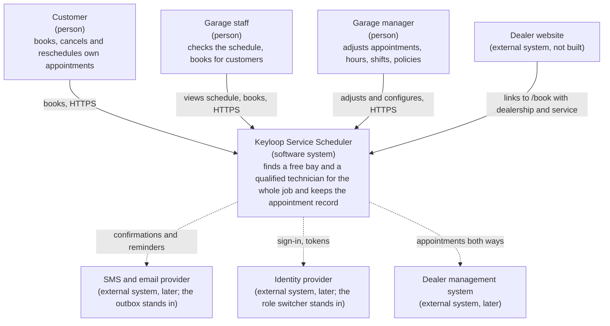
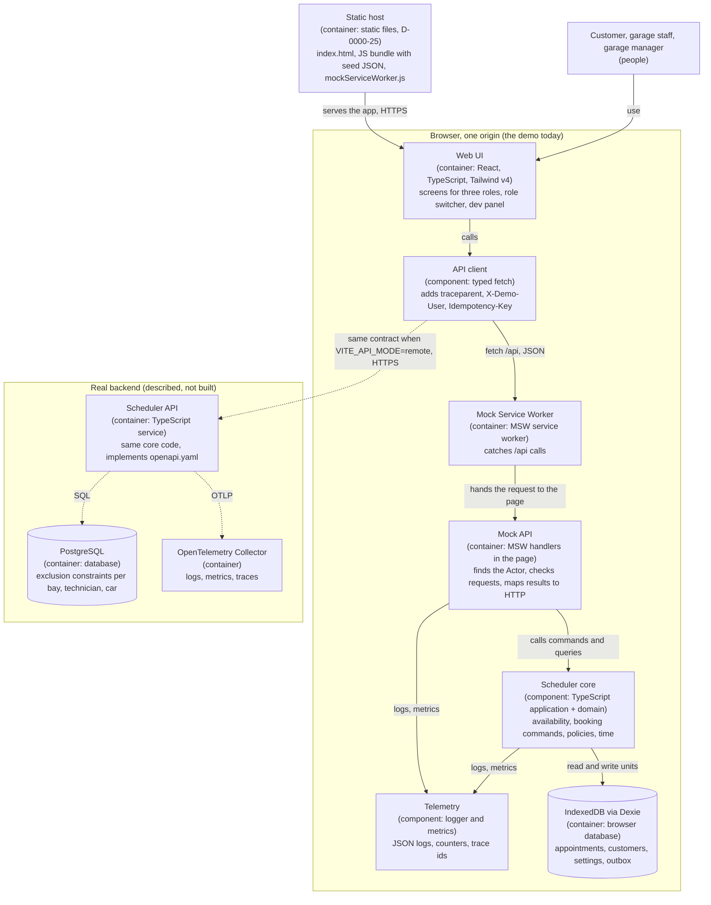
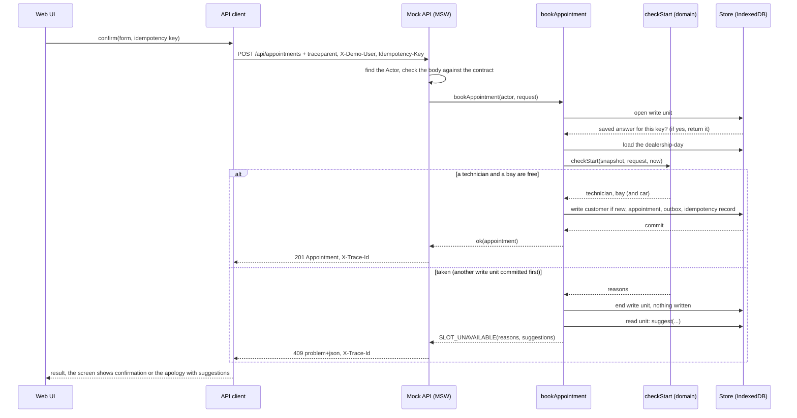
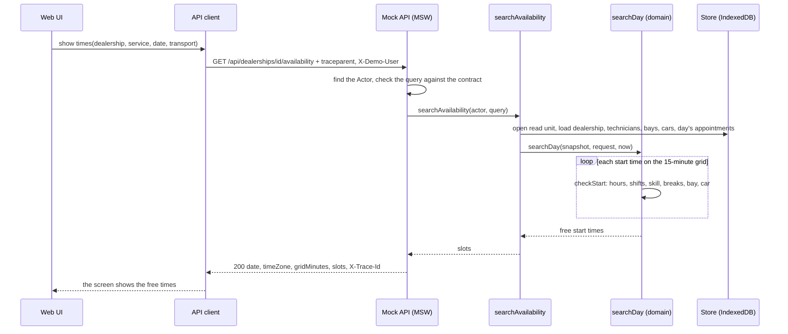

Status: draft until the screens are built.

# System Design Document: Keyloop Service Scheduler

This is deliverable 1 of the Keyloop Technical Assessment, Scenario A (the Unified Service Scheduler). It describes what is built, why, and what a real backend would look like.

Contents:

- [Overview and scope](#overview-and-scope)
- [Architecture (diagram)](#architecture-diagram)
- [Components and their roles](#components-and-their-roles)
- [Data flow](#data-flow)
- [Technology choices](#technology-choices)
- [Observability](#observability)
- [Scalability and reliability](#scalability-and-reliability)
- [Real backend design (PostgreSQL)](#real-backend-design-postgresql)
- [Time zones](#time-zones)
- [Security and privacy](#security-and-privacy)
- [How GenAI was used in design](#how-genai-was-used-in-design)
- [Assumptions](#assumptions)
- [Out of scope](#out-of-scope)

How to read the ids. `D-0000-n` and `D-0001-n` are decisions the human made. `Q-` files are open questions where we took a reasonable option and wrote it down. `AD-n` are architecture decisions. `REQ-BOOK-n` are requirements. `SEC-n` are security requirements. `NFR-n` are non-functional requirements. These files live in the work repo (`context/`), not in this repo.

## Overview and scope

**The problem.** A dealership service department books by hand. The scheduler replaces that. A customer asks for a service for a vehicle, at a dealership, at a time. The system confirms it only when a **service bay** and a **qualified technician** are both free for the **whole job**. If they are not, it suggests other times. A confirmed **appointment** links the customer, the vehicle, the technician and the bay, and it is kept.

**Who uses it.** Three kinds of user (D-0001-1): the customer books and changes their own bookings; garage staff check the schedule and book for customers (D-0001-12); the garage manager adjusts appointments, opening hours, technician shifts and booking rules.

**What is built.** The brief lets us build one layer and mock the other. We build the **frontend fully** and mock the backend (D-0000-2). The scheduling rules are still real. They live in a plain TypeScript module with no React, behind an OpenAPI contract, so a real backend can replace the mock with no screen changes (D-0000-3, NFR-2).

**The core, from the brief.** These three come first and are tested first (D-0000-9):

1. A user requests an appointment for a vehicle, a service type and a dealership at a time (REQ-BOOK-001).
2. Before confirming, the system checks that a bay and a qualified technician are free for the whole duration (REQ-BOOK-002).
3. On success, it stores a persistent appointment record (REQ-BOOK-003).

**Beyond the core.** Several dealerships with their own hours and time zones (D-0001-3, D-0001-4, D-0001-10); technician shifts the manager edits (D-0001-5); rest breaks, a lead time and a booking horizon (D-0001-8); wait, drop-off or courtesy car (D-0001-7); customers cancel and reschedule themselves, with reminders in a mocked outbox (D-0001-9); a staff timeline with free gaps (D-0001-11, D-0001-13). The design direction is A (Front desk) plus the free gaps from B (D-0001-13). Every screen is mobile responsive, from 360 px wide up (NFR-7).

**Non-functional goals.** Scalability, performance, reliability, maintainability and observability are part of the design and the code (NFR-1). The rules have their own test suite (NFR-3). The look follows Keyloop's visual language and WCAG 2.1 AA contrast, with no Keyloop logo (NFR-4, D-0000-4). Every AI-assisted step is logged (NFR-5). Logs, metrics and trace ids are built in (NFR-6).

**Words.** Code and API use the brief's names: `Dealership`, `ServiceBay`, `Technician`, `Appointment`, `Customer`, `Vehicle`, `ServiceType` (D-0000-14).

**Deadline.** 2026-11-01 (D-0000-9).

**What is not done yet.** The screens are not built. A short final pass will add the screen and flow section, the final test and coverage numbers, links to the merged pull requests and the demo link. Until then this document holds only what is already decided.

## Architecture (diagram)

### The idea in short

Build **one Vite React app that carries its own mock backend in the browser**. This was candidate A of three.

- The **rules** live in a pure TypeScript `domain` folder. The **booking commands** (book, reschedule, adjust, cancel, edit hours and shifts) live in an `application` folder on top of it.
- The **mock API** (MSW) answers an **OpenAPI contract** by calling the application folder. The **screens talk only to that contract**, through a typed client (AD-2).
- Data sits in **IndexedDB through Dexie**, behind a **repository port**. Tests use an in-memory version of the same port (AD-8).
- Each booking write (book, reschedule, adjust) is **one IndexedDB read-write transaction**: check again, then write. The first transaction the browser commits wins. The other one finds the time gone and gets a **409 with suggested times** (AD-4).
- Every time is a **UTC instant plus the dealership's IANA zone**. Only one folder knows about time zones (AD-9).
- Every call carries a **trace id**. Logs are JSON with no contact details. A few metrics feed a small **dev panel** (AD-12).
- For the real backend, the same `domain` and `application` code runs on a server with **PostgreSQL**, where **exclusion constraints** refuse overlapping bookings (AD-18).

### Why this candidate

| Candidate | What it is | Score (out of 150) |
|---|---|---|
| A. Mock backend in the page, IndexedDB transaction as the point of order | MSW's service worker catches each `/api` call and hands it to handlers in the page. Handlers call the application code, which writes through Dexie | **138** |
| B. A plus a cross-tab lock | The same, plus the browser's Web Locks API around each write | 133 |
| C. Mock backend in a SharedWorker | One worker serves every tab: one queue, one log | 118 |

A leads B by 5 points and C by 20. It wins because it is the smallest design that meets the hard constraints and the top drivers: one winner per race, a swappable backend, tests in Node, and DST-safe times. It adds almost no new technology.

One condition. A's score for "one winner per race" rests on a claim about IndexedDB that is still unverified (see [Assumptions](#assumptions)). If the Playwright two-tab race ever fails in a target browser, we add B's lock inside the Dexie adapter. That is one wrapper in one folder.

### What the design gives up

| Decision | Gains | Gives up | What softens it |
|---|---|---|---|
| IndexedDB transaction is the point of order (AD-4) | No server; the same "check again, then write" shape as the PostgreSQL design | Bookings are per browser profile, so the race exists only between tabs of one browser | Written as an assumption; the PostgreSQL design is the real fix |
| MSW ships in the hosted demo (AD-2, AD-15) | Reviewers open a link and the whole flow works | A service worker can keep an old version until reload; the mock is code a real build leaves out | `VITE_API_MODE=mock` switches it on; the README says to reload once after a deploy |
| Instants plus dealership zone (AD-1, AD-9) | DST-safe; one meaning for every stored time | Every display and every "local day" query needs a zone conversion | One time module; one UI format helper; a test under two `TZ` values |
| "Outside hours" is a flag, not a status (AD-14) | A flagged appointment keeps its bay and technician until moved | Screens show a status and a flag | A status badge plus a warning chip |
| The same appointment record on reschedule (AD-4) | One id for the customer, the outbox and links | No built-in history of old times | `version` grows on each change; an audit log is a later step |

### Level 1: system context



Solid arrows exist in the demo. Dashed arrows are later integrations.

### Level 2: containers



### Layers and import rules

Code is split in layers. Inner code never names outer code (AD-6). Lint rules fail the build when a rule is broken.

```
src/
  domain/          pure rules, synchronous, no I/O (AD-7)
  application/     use cases; imports domain only
  infrastructure/  adapters: storage (memory, Dexie), seed, telemetry
  api/             contract, mock handlers, typed client
  ui/              screens; reaches the rest only over HTTP through api/client
  config/          reads VITE_API_MODE and VITE_API_BASE_URL (AD-15)
  styles/tokens.css  the only place colours, fonts and sizes are defined (AD-16)
docs/postgres/     the real backend's schema (AD-18)
```

The domain is pure: no React, no Dexie, no `async`, no `Date.now()`, no `Math.random`. "Now" and new ids come in as arguments (AD-7). That is why every rule runs as a Node unit test with no browser.

## Components and their roles

The twenty components below come from the requirement map of the architecture. Folders are in the product repo.

| Component | Role | Folder |
|---|---|---|
| UI-C | The customer screens: pick a dealership, service and time; see suggested times; confirm; see, cancel and reschedule own appointments. | `src/ui/features/customer/` |
| UI-S | The staff screens: the day schedule as a timeline (one row per technician), a bay view and a list; free gaps that start a booking; book for an existing or new customer. | `src/ui/features/staff/` |
| UI-M | The manager screens: adjust an appointment, edit opening hours and date overrides, edit technician shifts and booking rules, see the outbox. | `src/ui/features/manager/` |
| UI-Shell | The frame around the screens: routes, the role switcher and the dealership picker. | `src/ui/app/` |
| UI-Dev | The dev panel: recent logs and the metric values. | `src/ui/features/dev/` |
| Client | The typed client the screens use. It adds the `traceparent`, `X-Demo-User` and `Idempotency-Key` headers. | `src/api/client/` |
| Contract | `openapi.yaml`, the one agreed shape of every request and answer, and the types made from it. | `src/api/contract/` |
| Mock | The MSW handlers. They find the Actor, check the request against the contract, call the application code and turn the result into HTTP. | `src/api/mock/` |
| Cmd | The booking commands: book, reschedule, adjust, cancel, update dealership settings, update technician shifts. Each write is one all-or-nothing write unit. | `src/application/commands/` |
| Qry | The read operations: search and check availability, get the schedule, get an appointment, list my appointments, search customers, list the outbox. | `src/application/queries/` |
| Avail | The availability rules. `checkStart` is the only function that says yes or no for a start time and picks the technician, bay and courtesy car. Search and suggestions only call it. | `src/domain/availability/` |
| Appt | The appointment rules: which appointments block resources, status changes, and flags such as "outside opening hours". | `src/domain/appointment/` |
| Time | The only place that knows time zones. It turns local dates and times into instants and back. | `src/domain/time/` |
| Policy | The dealership rules about lead time, booking horizon, the break between jobs and the customer change cutoff. | `src/domain/policies/` |
| Outbox | Which messages go out for a booking and at what times, in the dealership's zone. | `src/domain/outbox/` |
| Valid | The checks for a new customer and vehicle, and the check of the seed data. | `src/domain/validation/` |
| Store | The repository port (small interfaces and the write unit) and its two implementations: in memory for tests and Dexie over IndexedDB for the app. | `src/application/ports/`, `src/infrastructure/storage/memory/`, `src/infrastructure/storage/dexie/` |
| Seed | The made-up sample data in JSON and the loader that fills an empty database. | `src/infrastructure/seed/` |
| Tel | The logger, the metrics and the trace ids. | `src/infrastructure/telemetry/` |
| PG | The PostgreSQL schema for the real backend, with its SQL test. It is a design, not used by the demo. | `docs/postgres/` |

The repository port gives five guarantees, and one shared test suite checks each on every implementation (AD-8):

1. Two write units that would leave two blocking appointments overlapping on the same bay, technician (with the break) or courtesy car never both commit.
2. If the work fails, nothing it wrote is kept.
3. Reads inside a unit see the writes made earlier in the same unit.
4. The work awaits only store calls (Dexie needs this, AD-7).
5. Instants come back exactly as they went in.

## Data flow

### Confirming a booking

This is the path of the most important call: two people may press Confirm for the same last free time.



In words:

1. The screen sends the form with a new idempotency key, one per Confirm press. A retry of the same press reuses the key.
2. The client adds a trace id and the demo user, and calls `POST /api/appointments`. The service worker catches the call and hands it to the handlers in the page.
3. The handler builds the Actor from the demo user (never from the request body) and checks the body against the contract.
4. The command opens one write unit. First it looks for a saved answer for this key. If there is one, it returns that and stops.
5. It loads the dealership's day and runs `checkStart` on what is stored right now. This is the second check. The first one happened when the grid was shown.
6. If a technician and a bay are free, it writes the appointment (and the new customer and vehicle, the outbox messages and the idempotency record) in the same unit. The commit makes it real. The answer is 201.
7. If another write unit committed first, the check fails. Nothing is written. A read step then works out up to five other times. The answer is 409 `SLOT_UNAVAILABLE` with the reasons and the suggestions.
8. The screen shows the confirmation, or a polite "sorry, that time was just taken" with the suggested times. The form keeps what the user typed (REQ-BOOK-009).

"First" means first accepted by the server, never the user's clock (D-0001-6). Two confirms in the same millisecond still give exactly one winner.

### Searching for free times

This is the flow behind the time grid (REQ-BOOK-001, REQ-BOOK-002).



In words:

1. The customer picks a dealership, a service type, a date and how they will handle the car (wait, drop off or courtesy car).
2. The handler checks the query against the contract and finds the Actor.
3. One read unit loads everything the check needs for that one local date: the dealership's hours and policies, the service type, the technicians with skills and shifts, the bays, the courtesy cars and the day's blocking appointments.
4. `searchDay` walks the start-time grid from opening time to the last start that still ends by closing time. For each start it asks `checkStart`: is the time inside the opening hours, is there a qualified technician on shift for the whole job (with the break after their last job), is a bay free, and, when a courtesy car was chosen, is a car free?
5. The free starts go back as `slots`. The grid steps are taken in real time from the opening instant, so a DST day stays right.
6. The grid can show a time that someone books a moment later. That is why the confirm checks again (see above).

A time that is not free is answered with reasons such as `TECHNICIAN_BUSY`, `BAY_BUSY`, `TOO_SOON` or `DEALERSHIP_CLOSED`. A separate call, `POST /availability-checks`, answers for one start time and never returns 409.

### The contract in short

- Base path `/api`, JSON. Instants on the wire are RFC 3339 UTC. Local dates are `YYYY-MM-DD`, local times `HH:mm`. Every dealership and appointment carries its `timeZone`.
- Every error is `application/problem+json` with a fixed `code` and a `traceId` (AD-11). Codes: `VALIDATION_FAILED` (422), `IDEMPOTENCY_KEY_MISSING` (400), `IDEMPOTENCY_KEY_REUSED` (422), `UNKNOWN_USER` (401), `FORBIDDEN` (403), `NOT_FOUND` (404), `SLOT_UNAVAILABLE` (409), `CHANGE_WINDOW_CLOSED` (409), `SEARCH_RANGE_TOO_LARGE` (422), `INTERNAL` (500).
- Limits: a start-time grid of 15 minutes (Q-0001-11); one local date per availability call; up to five suggestions within 14 days (D-0001-16); list and shift ranges up to 31 days.
- "Real-time" means the check runs live when a user asks and again inside the confirm. Other people's bookings are not pushed to open screens.

## Technology choices

Every row is a choice the human made or confirmed. The decision id is in the second column.

| Technology | Decision | Why it was chosen | What was rejected |
|---|---|---|---|
| React and TypeScript | D-0000-5, D-0000-3 | The human asked for React to move faster. TypeScript lets the rules be a typed, pure module with no React. | None recorded. |
| Vite (a React single-page app) | D-0000-16 | The scheduler is a booking and back-office app, not a marketing site, so there is nothing for a search engine to index. The mock backend runs in the browser. A build is static files, so reviewers open a link with no server. | Next.js: server rendering would need a real server for the data, which is the layer we mock. SEO belongs to the dealer's own site. |
| Tailwind CSS v4 | D-0000-5, D-0000-12 | The human asked for it to move faster. One token file, `src/styles/tokens.css`, is the only place for colours, fonts and sizes. A lint rule fails the build on raw colours. | None recorded. |
| MSW (Mock Service Worker) | D-0000-3 | It catches the app's own network calls, so the screens use real `fetch` against a real contract. The same handlers run in Node tests. | json-server: an extra server, and the rules would not be in it (D-0000-8). |
| OpenAPI 3.1, written first in YAML, with openapi-typescript, openapi-fetch, an Ajv-based validator and Spectral | D-0000-3, D-0000-24 | A reviewer or a future backend team reads one designed contract. The types and the tests both come from it, so drift fails a test instead of reaching a screen. | Code-first with Zod (the contract would be generated, not designed). Hand-written types with no generation (nothing stops drift). |
| Dexie over IndexedDB, with seed data in JSON | D-0000-8 | Data survives a reload. A read-write transaction lets "check again, then write" be all or nothing, so two tabs give one winner. | localStorage (no transactions across tabs). PGlite (heavier, riskier). |
| Temporal, through the `@js-temporal/polyfill` package | D-0000-18, D-0000-31 | Correct DST handling is a driving scenario. Temporal states the rules for skipped and repeated hours in its API. Only `src/domain/time/` imports it. | Luxon (less explicit about skipped and repeated times; the fallback). date-fns with its time-zone add-on (the zone must be passed around by hand). |
| React Router | D-0000-19 | The familiar choice. It covers deep links such as `/book?dealership=…&service=…` and query parameters. | TanStack Router (type safety we do not need for about ten pages). No router (back button and query parameters would be ours to build). |
| TanStack Query | D-0000-20 | "Refresh the schedule after a booking" and "never retry a write by itself" are one setting each. | SWR (fewer options for writes). Hand-written hooks (caching and loading states are ours to write and test). |
| React Hook Form with Zod | D-0000-21 | Zod describes the fields once. The form keeps the typed values after a 409 with no extra code. | TanStack Form (newer, fewer people know it). Hand-written forms (more code for five forms). |
| Vitest, Testing Library, axe-core | D-0000-22 | Vitest is the runner made for Vite projects. The domain suite runs in Node with no browser. Testing Library tests screens the way a user uses them. axe-core scans pages for accessibility problems. | Jest (extra setup to understand Vite and TypeScript). Vitest only (storage race tested only in the browser). |
| fake-indexeddb | D-0000-22 | An in-memory IndexedDB for Node, so the Dexie store and its two-writer race run in the normal test run. | Testing the Dexie code only in Playwright. |
| fast-check | D-0000-22 | Property tests: for many random schedules, no two blocking appointments overlap, and every suggested time passes the check. | Table tests only. |
| Playwright | D-0000-13 | End-to-end tests, including the two-tab race, and the videos in each pull request. | None recorded. |
| ESLint with typescript-eslint, `eslint-plugin-boundaries` and Prettier | D-0000-23 | One command, `npm run lint`, checks every architecture rule, including folder import rules and the no-raw-colour rule. | ESLint plus dependency-cruiser (a second tool to run). Biome (no folder-boundary rule of the kind we need). |
| PostgreSQL, for the described backend only | D-0000-8 | Exclusion constraints let the database refuse overlapping bookings itself. | Nothing else was weighed for the real backend. |

Browser features used with no library: `Intl.DateTimeFormat` with a `timeZone` (display), `crypto.randomUUID` (ids and idempotency keys), IndexedDB, Service Worker.

Other decided choices. Hosting is a free static host linked to the private repo, but only after everything else is finished (D-0000-25). Library checks in CI are the light set (D-0000-30, see [Security and privacy](#security-and-privacy)). The code is in English, in plain words (D-0000-10).

The new-technology budget is 0.5 of 1. It is spent on two unusual uses that the constraints force: the browser's IndexedDB transaction as the booking order, and MSW shipped as the backend of a hosted demo. No version numbers are in this document. Versions come from the lockfile.

## Observability

NFR-6 asks for logs, metrics and traces even though the backend is a mock. All of this is built in the demo and described for the real backend.

### Trace rules (AD-12)

- The client makes a W3C `traceparent` header for every call.
- The mock keeps that trace id for the whole request, puts `traceId` in every log line and every error body, and returns it in the `X-Trace-Id` response header.
- Only well-formed trace ids are accepted. Anything else gets a new id (SEC-9).
- Inside a command, each step (load, check, write, suggest) is timed and logged as a child step of the same trace.

### Log fields

Logs are JSON lines, written to the console and to an in-memory ring buffer of the last 500 lines for the dev panel. Only these fields are allowed:

`ts`, `level`, `msg`, `traceId`, `route`, `method`, `status`, `durationMs`, `dealershipId`, `actorRole`, `outcome`, `code`, `reasons`, `appointmentId`, `technicianId`, `serviceBayId`, `candidates`.

The logger keeps only these keys. It drops everything else, so a new field cannot leak by accident. A customer's name, phone, email, registration and any free text are never logged. `route` is the path template (`/appointments/{id}`) and the query string is never recorded. Only the telemetry folder may call `console`.

Example (a 409 on a booking):

```json
{"ts":"2026-11-03T09:14:02.120Z","level":"info","msg":"appointment.book","traceId":"4bf92f3577b34da6a3ce929d0e0e4736","route":"POST /appointments","status":409,"durationMs":9,"dealershipId":"dlr-london","actorRole":"customer","outcome":"slot_unavailable","reasons":["TECHNICIAN_BUSY"]}
```

### Metrics

Metrics are kept in memory and shown in the dev panel. **They are per browser tab in the demo**, because each tab has its own page and its own counters. The metric names are the team's own proposals, not a published standard.

| Metric | Type | Labels | Golden signal |
|---|---|---|---|
| `http_requests_total` | counter | route, method, status | traffic, errors |
| `http_request_duration_ms` | histogram | route, method, outcome (ok or failed, kept apart as the Google SRE book advises) | latency |
| `availability_search_duration_ms` | histogram | dealershipId, kind (day, check, suggest) | latency |
| `availability_search_empty_total` | counter | dealershipId | domain |
| `appointments_confirmed_total` | counter | dealershipId, actorRole | traffic |
| `appointment_conflicts_total` | counter | dealershipId, reason | errors (expected) |
| `appointments_cancelled_total` | counter | dealershipId, actorRole | traffic |
| `idempotent_replays_total` | counter | route | none |
| `bay_utilisation_ratio` | gauge, worked out on read | dealershipId, date | saturation |

### For the real backend

The same signals map to OpenTelemetry:

| OpenTelemetry signal | In the demo | In the real backend |
|---|---|---|
| Traces ("the path of a request through your application") | The `traceparent` header, the trace id in every log line, timed steps inside a command | The same `traceparent` continues from the browser into the API. The OpenTelemetry SDK records HTTP and database spans |
| Logs ("a recording of an event") | JSON lines with the allowed fields | The same lines and fields, sent through a collector to a log store |
| Metrics ("a measurement captured at runtime") | The counters, histograms and gauge above | The same metrics, sent to the collector. Names will follow the OpenTelemetry semantic conventions, which we have not looked up yet |

The four golden signals of the Google SRE book map like this:

| Golden signal | What we measure |
|---|---|
| Latency | `http_request_duration_ms` and `availability_search_duration_ms`, with failed requests kept apart from good ones |
| Traffic | `http_requests_total`, `appointments_confirmed_total`, `appointments_cancelled_total` |
| Errors | 5xx in `http_requests_total`, and `appointment_conflicts_total` (409s are expected, not faults) |
| Saturation | `bay_utilisation_ratio`. In the real backend, also the database connection pool |

**Proposed targets. These are our own and are not sourced.** No fetched source gave a published target for a booking system (research Q5).

- Availability search p95 under 300 ms.
- Failed (5xx) requests under 0.1% a month.
- Raise an alert when the 409 share of confirms jumps well above its weekly normal.

## Scalability and reliability

Each point is tied to the architecture decision that holds it.

**One winner per race (AD-4, AD-8, AD-18; S1).** Two confirms for the last free technician and bay must give exactly one appointment.

- In the demo, each booking write is one IndexedDB read-write transaction: check again, then write. The browser runs two such transactions on the same stores one after the other. The first to commit wins. The second re-checks, finds the time gone and gets a 409 with suggestions. The target is zero double bookings in 100 repeated in-memory races and in the Playwright two-tab test.
- In the real system, the PostgreSQL exclusion constraints refuse the overlap, even if two requests pass the code check at the same time (see [Real backend design (PostgreSQL)](#real-backend-design-postgresql)).
- The demo's guarantee holds inside one browser profile. Two different browsers never share a diary.

**Idempotency keys (AD-5).** The client makes one UUID per Confirm press and reuses it on a retry. The store keeps the saved answer, written in the same write unit, only for a successful write. Same key and same body: the saved answer, and one appointment. Same key with a different body: 422. No key: 400. Keys are kept at least 24 hours, as Stripe's guide does. A double-click or a network retry cannot make two bookings.

**Stateless API instances (AD-2, AD-6; real backend).** The real API holds no state in memory. The rules are in the shared `domain` and `application` code, and all state is in PostgreSQL. So instances can be added behind a load balancer. The client already works only through the contract.

**Per-dealership day queries (AD-4; real backend).** A search or a confirm reads one dealership and one local day, a small read. Indexes cover the day queries. Partitioning the appointment table by dealership or by month is a later step, only when volume needs it.

**The search budget (AD-19; S7).** For 10 technicians, 6 bays and 60 appointments a day: one day's search under 50 ms and 14-day suggestions under 200 ms, measured in Node on the CI machine. Work segments and busy lists are built once per day, so each start costs a few comparisons. A timed test reports it as a warning, not a blocker.

**Other reliability points.**

- A failed write unit writes nothing. A reschedule keeps the old time until the new time is written, so a customer never loses both (AD-4).
- Outbox messages are written in the same write unit as the appointment, once. A failed booking leaves no message (AD-13).
- One availability function serves search, check, confirm, adjust and suggestions, so the grid never shows a time that the confirm then refuses (AD-10).
- Changing hours or shifts flags affected appointments. It never deletes or moves them (AD-14).
- The seed is validated and versioned (AD-17).
- Maintainability: layers with lint-enforced import rules (AD-6), one repository port with a shared test suite (AD-8), a swappable backend (AD-2, AD-15).

## Real backend design (PostgreSQL)

The schema is in [docs/postgres/schema.sql](postgres/schema.sql). It is a design for a real backend. The demo does not use it (D-0000-8). Its SQL test is in [docs/postgres/check.sql](postgres/check.sql).

**The idea (AD-18, REQ-BOOK-009).** The database itself refuses double booking, so a future backend does not rely only on checks in code.

- **Three exclusion constraints on the `appointment` table**, one for each resource:
  - `appointment_bay_no_overlap`: the same service bay cannot have two overlapping time ranges.
  - `appointment_technician_no_overlap`: the same technician cannot have two overlapping ranges. This one uses a second range, `technician_busy`, which is the job plus the break after it. Two jobs closer together than the break are refused on both sides.
  - `appointment_courtesy_car_no_overlap`: the same courtesy car cannot have two overlapping ranges. It applies only when a car is chosen.
- **A partial predicate on each: `WHERE (status <> 'cancelled')`.** Cancelled rows stop blocking a bay, technician or car. The predicate says "not cancelled" and not "confirmed", so later statuses such as checked in or in progress would still block.
- **Half-open ranges.** `during` is a `tstzrange` stored as `[start, end)`. A check constraint insists on an inclusive start and an exclusive end. So a job ending at 10:00 and a job starting at 10:00 do not clash (REQ-BOOK-002.AC-5).
- **`btree_gist`.** This extension lets the GiST index compare ids with `=`, so "same bay and overlapping time" is one constraint.

**Confirming a booking in PostgreSQL.**

1. Begin a transaction (Read Committed).
2. Insert the idempotency row, or return the saved answer.
3. Load the dealership's day and run the same `checkStart` code.
4. Insert the appointment.
5. If the database raises an exclusion error, roll back to a savepoint, reload and try the next free technician and bay pair. Try at most three times, then answer 409.
6. Insert the outbox rows.
7. Commit.

The code check runs first so that most clashes are caught cheaply. The constraints are the safety net for the race. Serializable isolation is not needed because the constraints catch the race. If it is ever used, the code must retry on SQLSTATE 40001.

If the manager later changes the break, old rows keep the break they were booked with. The code check uses the new value. The constraint stays a safety net.

**Tested.** Ticket A8 (pull request #1 in the product repo) loaded `schema.sql` and `check.sql` into PostgreSQL 17.11. All 20 checks passed. That run settled two claims that were marked unverified: `btree_gist` accepts the `uuid` type, and an exclusion clash raises SQLSTATE 23P01. The checks cover an overlapping insert failing, a cancelled row not blocking, and touching ranges passing.

**Other tables.** Dealership settings and opening hours with date overrides; skills, service types, bays, courtesy cars and technicians with their shift pattern and exceptions; customers and vehicles (personal data); the idempotency table, keyed by actor and key; and the outbox, with a unique dedupe key and ids only (contact details are looked up at send time).

## Time zones

Times are where scheduling goes wrong, so the rules are strict (D-0001-10, AD-9).

- **Every dealership has an IANA time zone**, for example `Europe/London` or `Asia/Ho_Chi_Minh`. The manager picks it from the dealership's location.
- **Opening hours, shifts and reminder times are local** to the dealership. They are stored as local dates and local `HH:mm` times.
- **An appointment is a UTC instant** (start and end) plus the dealership's zone. The instant never moves.
- **The browser's zone is never used**, and neither is a fixed offset such as "+7". The screens format every time with the dealership's zone through one helper. They label the zone when it differs from the viewer's.
- **Only one folder, `src/domain/time/`, imports the date library.** The rest of the code uses it and plain numbers. Lint rules ban the local `Date` methods elsewhere.
- **DST rules.**
  - A local time that does not exist (the spring-forward gap) **moves later**, to the first real instant.
  - A local time that happens twice (fall back) **uses the earlier one**.
  - Durations are real minutes. A job that spans a clock change is counted right. "48 hours before" is 48 real hours. "The morning of" is 08:00 local on that date.
- **Tests.** The domain, application and contract suites run under `TZ=UTC` and under `TZ=Pacific/Kiritimati`, and must give the same results. Dedicated tests cover a spring-forward day and a fall-back day in `Europe/London`.

**The `Europe/London` example dates (2026).**

| Date | What happens | Effect |
|---|---|---|
| Sunday 2026-03-29 | At 01:00 UTC the clocks jump from 01:00 GMT to 02:00 BST. The day has 23 hours. | Local 01:30 does not exist. It moves later, to 02:00 BST, which is 01:00 UTC. |
| Sunday 2026-10-25 | At 01:00 UTC the clocks go back from 02:00 BST to 01:00 GMT. The day has 25 hours. | Local 01:30 happens twice. We use the earlier one, 01:30 BST, which is 00:30 UTC. |

The seed has at least one zone with DST (`Europe/London`) and one without (`Asia/Ho_Chi_Minh`). The start-time grid is walked in real time from the opening instant, so a DST day keeps the right slots.

## Security and privacy

The full threat model is in `context/security.md` of the work repo. This is the short version.

### Read this first

**The demo has no real security boundary.** The "server" runs inside the user's own browser (D-0000-2). Whoever opens the app can open the developer tools, change the `X-Demo-User` header, edit IndexedDB, change the clock or skip any check. So in the demo, the role and dealership checks **show the rules and make them testable**. They protect nothing against the person at the keyboard.

What we can still do honestly:

- Write the checks once, in the application layer, so a real backend gets them unchanged (AD-3, NFR-2).
- Test every allowed and every denied case. The same tests become the acceptance tests of a real API.
- Keep real mistakes out of the code: personal data in logs, unescaped text, a mock that ships in a real build, a bad library.

Seed data is made up. No real customer data goes in. The new-customer form shows a visible notice in the demo (SEC-13). This document holds no secret, no real person's data and no Keyloop logo (D-0000-4).

Compliance: none is in the requirements, so none is claimed.

### Assets

| Id | Asset | Why it matters |
|---|---|---|
| A1 | Customer personal data: name, phone, email, vehicle registration | Can identify and contact a person. High sensitivity |
| A2 | The appointment diary | Shows where a person will be, and links a customer to a vehicle |
| A3 | Manager powers: hours, shifts, policies, moving any appointment | One wrong change flags or moves many bookings |
| A4 | Booking capacity: bays, technicians, courtesy cars | Fake or duplicate bookings block real customers |
| A5 | The signed-in identity (the Actor: role, customer id, dealership list) | Every other check depends on it |
| A6 | Logs, metrics, traces and the dev panel | Must stay free of A1 |
| A7 | Outbox messages and the links inside them | A link that cancels a booking is a power |
| A8 | Idempotency records | They replay a saved answer, so they must not cross users or hold A1 |
| A9 | The shipped app: bundle, service worker, libraries | If it is tampered with, everything above is |

### Trust boundaries

| Id | Boundary | In the demo | Real backend |
|---|---|---|---|
| TB1 | User and browser (developer tools, storage, clock) | None. The user controls everything | Still untrusted. The server must not believe the client |
| TB2 | UI and API contract | A code boundary in one browser | HTTPS to the API. The client is untrusted |
| TB3 | Mock handlers and application (the Actor built from `X-Demo-User`) | The one place where identity becomes an Actor | The Actor is built from a verified token |
| TB4 | Application and store | The user's own IndexedDB, readable and editable by them | PostgreSQL behind the API |
| TB5 | Static host and browser | Files over HTTPS; a service worker is installed | The same, plus CORS and headers |
| TB6 | npm registry and CI, and our build | Libraries enter the bundle | The same |
| TB7 | Dealer website to `/book?dealership=…&service=…` | Query values are untrusted input | The same |
| TB8 | API to SMS and email provider | Not built; the outbox stands in | Contact details leave the system |
| TB9 | API to telemetry backend | Console and in-memory buffer | Collector and log store |
| TB10 | Identity provider and dealer management system | Not built; the role switcher stands in | External systems whose data we must not trust blindly |

### Threats by group, and the SEC-n that answers each

| Group | Threats | Answered by |
|---|---|---|
| Identity and roles | A call with no user or an unknown user is served. A customer sends `role: manager` and is believed. A new endpoint ships with no role check. A customer or staff member calls a manager-only operation | SEC-1: unknown user gets 401. SEC-2: the role comes only from the seeded user record. SEC-3: refuse before reading any data. A matrix test covers every operation, allowed and denied |
| Dealership and customer scope | Staff of one dealership read or change another. One customer reads, cancels or reschedules another's appointment. A customer books for someone else's customer id or vehicle | SEC-4: staff and managers act only on their own dealerships. SEC-5: a customer sees only their own records, and a foreign record looks the same as a missing one (404). SEC-6: a customer books only for themselves and their own vehicles |
| Input and errors | Extra fields change things the caller may not change. Huge strings, long lists, 10-year ranges, one-letter customer searches. A double-click makes two bookings. One user replays another's idempotency key. An error shows a stack or an internal name. A forged `traceparent` fills the logs | SEC-7: every request is checked against the contract, unknown fields are rejected, every size is bounded. SEC-8: the idempotency key is a UUID per user, tied to one method, path and body. SEC-9: fixed error shape, a generic 500, well-formed trace ids only |
| Personal data and stored text | A name, phone, email or registration written to a log, metric, trace, error or URL. Stored text such as `` runs script in a staff screen. A crafted `/book` link injects text. Staff data stays in memory after a role switch. A reminder link is guessable | SEC-10: an allow-list logger and a canary test. SEC-11: all text shown as plain text, never HTML. SEC-12: URL values are looked up, never shown or followed. SEC-13: least browser storage; the cache is cleared on a role switch. SEC-17: outbox messages and links use ids only |
| Build and delivery | The mock, role switcher, `/_demo/*` or seed ship in a real build. A third-party script runs in the page. A hijacked npm package or a stale worker file | SEC-14: a remote-mode build contains none of the demo parts. SEC-15: load nothing from another origin and ship a Content Security Policy. SEC-16: locked, audited and approved libraries |

Threats that cannot be stopped in a browser-only app are accepted in the demo and listed in the table below: the user changes the clock; the user edits IndexedDB; no audit trail of who made a change; a customer books every free slot; the demo-only endpoints and reset are open to every role.

### Decisions the human made on the security questions

| Decision | What was decided | Effect |
|---|---|---|
| D-0000-26 | Staff and managers may search every customer, with a 3-character minimum and at most 10 results, written into the contract | A real dealer group should decide between this and "only customers with an appointment at my dealerships" with its data owner. The second needs a customer-to-dealership link that the model does not have today |
| D-0000-27 | A request that names one record by id (an appointment, a technician) outside the user's dealerships gets 404. A request that names a dealership directly gets 403 | Records stay hidden. A plain "you may not look at this dealership" hides nothing, because every role can list the dealerships |
| D-0000-28 | The customer search moves to `POST /customers/search`, with the text in the JSON body | No personal data goes into a URL, browser history or an access log |
| D-0000-29 | Fonts are served from the app itself, and the app ships a Content Security Policy (SEC-15) | No outside origin is called. The demo works offline. Playwright can prove it |
| D-0000-30 | The light library checks (SEC-16): a committed lockfile, `npm ci`, `npm audit` for runtime libraries, an approved-list script, pinned CI actions with read-only permissions | Catches the common supply-chain problems for about half an hour of work |

### What the mock cannot protect, and what a real backend must do

| In the demo | Why it is not protected | A real backend must |
|---|---|---|
| Anyone can pick any role in the switcher or set `X-Demo-User` by hand | The "server" and the header are both in the user's browser | Sign users in through an identity provider. Check a signed, short-lived token on every call (signature, issuer, audience, expiry). Build the Actor from the token. Ignore `X-Demo-User`. Send the token as `Authorization: Bearer`. Allow CORS for the app's origin only |
| Role and dealership checks run in code the user can edit | The user owns the process | Run the same application-layer checks on the server. Also filter every database query by `dealership_id` or `customer_id`, so one missing check does not expose other data. Run the SEC-1 to SEC-6 matrix against the real API unchanged |
| Personal data sits in IndexedDB, readable and editable by the user | The store is the browser's | Keep customer data only in PostgreSQL on the server: encrypted at rest and in transit, access limited to the API's account, protected backups and a retention rule. Keep no personal data in browser storage |
| Anyone can change the browser clock | `Clock.now()` runs in the browser | Use the server's clock for lead time, horizon, cancel cutoff and reminders |
| Two browsers never share a diary | A local database per browser profile | Use the PostgreSQL exclusion constraints and a unique `(actor_id, key)` idempotency row |
| No rate limits: one user could book every free slot or crawl customer search | No server in front | Rate limit by user and address on booking and customer search. Cap future confirmed bookings per customer. Bound page sizes |
| `/_demo/*` is open to every role and can reset the data | It exists for the dev panel and Playwright | Not exist at all |
| No audit trail: a change leaves a log line with a role, not a person | Logs hold the role only | Write an append-only audit record for settings, shift, adjust and cancel actions: who (a user id), what, when, the trace id, and the old and new `version` |
| Logs go to the user's console | The user can read or clear them | Send logs through the collector with the same allowed fields. Make sure servers and proxies do not log query strings. Limit who reads telemetry and set a retention time |
| The outbox is a table on screen | No message leaves the browser | Keep provider keys in a secret store. Send the least data: first name, time, dealership, a link. Make cancel and reschedule links need sign-in, or carry a signed, expiring, single-purpose token |
| Seed and test data are made up | Nothing real is ever loaded | Never copy production data into a demo or test |
| Libraries are checked in CI only | The user's browser runs whatever shipped | Add update pull requests, a software bill of materials and signed builds. Use parameterised queries only against PostgreSQL |
| The mock accepts any request that matches the contract | The browser is both caller and handler | Check every inbound payload from the identity provider, the dealer management system and the dealer website with the same rules as client input |

No penetration test or compliance review is planned. The threat model is the whole security work for this assessment.

## How GenAI was used in design

AI helped design this system. The point of this section is **how I directed it, how I checked it and where I corrected it.** The raw log is `context/ai-collaboration-log.md` in the work repo. Only steps that show directing, checking or correcting the AI are here.

### How the work is run

- Every message I send is saved word for word. The AI turns it into requirements with acceptance criteria and decisions with reasons, and commits them.
- The AI does not decide alone (D-0000-17). When something needs confirming, such as a product rule, a library or a trade-off, it writes a question file with options and a recommendation, and waits. I answer. The libraries in [Technology choices](#technology-choices) were chosen this way.
- When it has to take a reasonable option to keep going, it writes the guess down as a `Q-` file. Those are listed in [Assumptions](#assumptions).
- Claims it could not check are marked `UNVERIFIED`. Two of them were later tested (see [Assumptions](#assumptions)).

### Steps

| Date | I asked the AI to | It gave me | How I checked it | Kept, changed or dropped |
|---|---|---|---|---|
| 2026-10-28 | Tell me if building the frontend (not the backend) is OK for Scenario A | Yes, as long as the scheduling rules stay real: a plain TypeScript module behind a fake API (MSW) and an API contract (OpenAPI) | My own judgement on the trade-off | **Kept** (D-0000-2, D-0000-3) |
| 2026-10-28 | Write down how I see the problem: customers book, staff check the schedule, the manager adjusts it, and the app suggests another time on a clash | Requirements REQ-BOOK-004 and REQ-BOOK-005, decisions D-0001-1 and D-0001-2 | I read them against the brief. The AI had assumed only a service advisor uses the app | **Changed** by me: three kinds of user, not one |
| 2026-10-28 | Add technician shifts, opening hours that each dealership can set (and change for a single day), and let the manager edit shifts | REQ-BOOK-006 to 008, decisions D-0001-3 to D-0001-5 | The AI had assumed one garage with fixed hours. I told it that was wrong | **Changed** by me: several dealerships, flexible hours |
| 2026-10-28 | Look at how the big scheduling systems work and tell me what we are missing | `research.md`: every claim links to a page it read, anything unchecked is marked `UNVERIFIED`, and a list of 17 gaps | I looked at the sources. The AI dropped one page because it did not say what the search result claimed. It also said most vendor pages are marketing | **Kept**. The 5 must-have gaps went into the requirements. One source was **dropped** |
| 2026-10-28 | Work out what happens when two people book the same slot at the same time | D-0001-6 and REQ-BOOK-009: the first the server gets wins; the other gets a polite "sorry, just taken" and other times; a double-click books once | The rule was mine ("first one wins, tell the second one nicely"). I checked the AI's database advice against the PostgreSQL docs it cited | **Kept** |
| 2026-10-28 | Add "wait, drop off or courtesy car", rest breaks, lead time and horizon, customer cancel and reschedule, and reminders | REQ-BOOK-010 to 013, decisions D-0001-7 to D-0001-9 | The AI first suggested reminders 24 hours and 2 hours before. After checking Keyloop's own advice, it changed them to 48 hours before and the morning of | **Changed**: reminder times. The rest breaks were my idea, for staff wellbeing |
| 2026-10-28 | Help me pick where to store data in a frontend-only app | D-0000-8: sample data in JSON, real data in IndexedDB, all behind one interface | We compared four options on two things: does data survive a reload, and does it stop two tabs booking the same slot | **Kept** |
| 2026-10-28 | Let staff book for a customer, either someone we already have or a new person | REQ-BOOK-014, decision D-0001-12 | The AI first suggested existing customers only. I asked for new customers too | **Changed** by me: new customers allowed |
| 2026-10-28 | Design the architecture, and mark every claim it could not check | `architecture.md` with three candidates scored, 19 decisions, and nine claims marked `UNVERIFIED` | I chose the libraries and the design direction from its options (D-0000-18 to D-0000-25, D-0001-13). The two PostgreSQL claims were tested by running the schema (ticket A8) | **Kept**. The two PostgreSQL claims are now **settled** by that test |

Corrections by me: three kinds of user, several dealerships with flexible hours, and new customers for staff bookings. Corrections the AI made after checking a source: the reminder times, and the dropped research page.

## Assumptions

Where a requirement was unclear, we took a reasonable option and wrote it down. Nothing here contradicts the brief.

### Assumptions of the architecture

1. **"Real-time" means checked live at request and at confirm.** A booking is checked when a user asks and again inside the confirm. Other people's bookings are not pushed to open screens. Telling other tabs to refresh with `BroadcastChannel` is a possible later step.
2. **Persistence is per browser profile in this mock.** Data and the "server" live in one browser profile. Tabs of that browser share it. Two different browsers or devices do not. The PostgreSQL design is how a real deployment shares one diary.
3. A job fits in one local day, one technician, one bay and one continuous work segment. The shift break follows Q-0001-10.
4. Duration comes from the service type and is real minutes (Q-0001-2).
5. Role checks in the demo show the rules. They are not security, because everything runs in the user's browser.
6. Seed data is made up. No real personal data is stored.
7. A reschedule keeps the same appointment id and raises its `version`.
8. Only successful booking writes save an idempotency record. A failed attempt can be retried with the same key.
9. Metric names and the proposed targets are our own proposals, not sourced.

### Questions where we took an option

Each of these `Q-` files was open or provisional when this draft was written. The option taken is the one the design uses.

| Id | Question | Option taken | Reason |
|---|---|---|---|
| Q-0001-1 | What makes a technician "qualified"? | A: each technician has a set of skills, each service type requires one skill | The simplest model that makes "qualified" testable. Levels or brand certificates can be added on top |
| Q-0001-2 | Where does a service's duration come from? | A: a fixed duration per service type | The brief names only the service type as an input |
| Q-0001-7 | What can the manager adjust? | A: change the time, reassign the technician or bay, and cancel. Each change re-runs the check. Hours and shifts were added later (Q-0001-12, D-0001-5) | These are the day-to-day changes and all of them reuse the availability engine. Editing bays and skills stays out |
| Q-0001-9 | How does a user become customer, staff or manager? | A: a role switcher picks a seeded user. The mock checks the role on each call | Real login is out of scope for a mock backend, but the role rules must be testable. See [Security and privacy](#security-and-privacy) for how real auth replaces it |
| Q-0001-10 | How are technician shifts modelled? | A: a weekly pattern plus date exceptions (leave, extra shift), edited by the manager | How garages plan shifts, and it gives the tests real edge cases (a break, a day off) |
| Q-0001-11 | On what grid can an appointment start? | A: 15 minutes, the same for every dealership | Keeps the search finite and suggestions readable. A per-dealership grid is easy to add later |
| Q-0001-12 | What happens to appointments when a day's hours are cut? | A: the change is saved and affected appointments are flagged for the manager, never deleted | Keeps the manager in control without losing bookings (AD-14) |
| Q-0001-13 | Does "design system" research mean system design or UI design? | A: system design first, with a short UI part | It is what the brief's Part 1 asks for, and the brand tokens already exist |
| Q-0001-18 | Is a courtesy car a limited resource? | A: yes, each dealership has a fleet and a car must be free for the whole job. With none free, the customer can still wait or drop off | It reuses the "free for the whole duration" rule |
| Q-0001-19 | What are the default policy values, who sets them, and does the break apply to bays? | A: per dealership, set by the manager. Lead time 2 hours, horizon 30 days, a 15-minute break after each technician job. Bays need no break | The break is staff rest, and settings match the per-dealership design |
| Q-0001-20 | Until when can a customer cancel or reschedule alone? | A: until the dealership's minimum lead time before the start, boundary included (D-0001-22) | It reuses a setting the dealership already has |
| Q-0001-21 | When are reminders sent? | A: a confirmation at booking, a reminder 48 hours before, and a final one the morning of (08:00 local, or 2 hours before if the job starts at or before 08:00, D-0001-22) | It follows Keyloop's own published advice. The first idea, 24 hours and 2 hours, came before this source was checked |
| Q-0001-23 | What does a new customer need, and what if they already exist? | A: full name, phone, and the vehicle's registration, make and model are required; email and year are optional. A matching phone or registration is shown to staff to reuse. The customer is stored only when the booking is confirmed | The booking needs a vehicle, duplicates break "find them next time", and storing on confirm avoids orphan records |

### Decisions the human made after the questions

These were open at first and are now decided. They are decisions, not assumptions.

- D-0001-13: design direction A (Front desk) plus B's free gaps on the staff timeline.
- D-0001-14: staff and managers work for the dealerships on their user record (a list, so "all" is a one-line change).
- D-0001-15: the least busy qualified technician is picked, then the first free bay by name (D-0001-22).
- D-0001-16: up to five suggestions, up to 14 days ahead, nearest first.
- D-0001-17: the outbox adds a "moved" message when the manager moves an appointment.
- D-0001-18: new customer fields get simple checks that reject obvious typing mistakes.
- D-0001-19: staff cannot cancel or reschedule a customer's appointment; the manager can.
- D-0001-20: a free gap on the timeline starts a booking with that technician.
- D-0001-21: free gaps are worked out in one place in the domain, with a 30-minute minimum.
- D-0000-26 to D-0000-30: see [Security and privacy](#security-and-privacy).
- D-0000-31: the Temporal polyfill is `@js-temporal/polyfill`.

### Claims marked unverified

These nine claims were marked `UNVERIFIED` in the architecture. This table says whether a test has since settled each one.

| # | Claim | Status |
|---|---|---|
| 1 | IndexedDB runs read-write transactions whose stores overlap one at a time, also across tabs of the same origin | **Open.** The Playwright two-tab test will check it in practice |
| 2 | MSW in the browser runs request handlers in the page, not inside the service worker | **Open** |
| 3 | Dexie commits a transaction when code inside it awaits a promise that is not Dexie's | **Open.** The rules in AD-7 rule the case out either way |
| 4 | Pages in one Playwright browser context share IndexedDB, and separate contexts do not | **Open.** The two-tab test depends on it |
| 5 | PostgreSQL reports an exclusion-constraint violation as SQLSTATE 23P01 | **Settled** by the A8 test on PostgreSQL 17.11: 20 of 20 checks passed (pull request #1) |
| 6 | `btree_gist` supports the `uuid` type | **Settled** by the same A8 test |
| 7 | SharedWorker support on mobile Chrome and Safari | **Open, and not needed.** It matters only for candidate C, which was not chosen |
| 8 | Which browsers ship Temporal natively, and the polyfill's size | **Open.** The polyfill is chosen (D-0000-31). The engineer of the time ticket checks the package pages before installing |
| 9 | Free plans of static hosts; GitHub Pages on a private repo needs a paid plan | **Open.** The host is chosen last (D-0000-25) |

Other points from the research that are not settled:

- Which business metrics booking systems track is based on marketing pages only. No source gave a published target or SLO for a booking system.
- Vendor evidence is mostly marketing, and some help centres could not be fetched.
- The 20 to 24 percent no-show figure is second-hand.
- Two further checks are noted in the library plan (D-0000-30): whether `npm ci --ignore-scripts` works with this tool set, and how the service worker file check is run.

## Out of scope

These were left out on purpose. Several are named as extensions of the design.

- Recalls and VIN lookup.
- Service menus and pricing.
- Deposits.
- Check-in and vehicle inspection.
- Parts availability.
- Two-way sync with a dealer management system (DMS).
- Jobs longer than one day, jobs with more than one technician or bay, and split jobs. A job is one day, one technician, one bay and one continuous work segment.
- Waitlists and deliberate overbooking.
- Real sign-in and real roles. The demo uses a role switcher. Real auth is described in [Security and privacy](#security-and-privacy).
- Real SMS and email. Reminders go to a mocked outbox.
- Slot holds with an expiry. Cal.com holds a slot for 5 minutes by default. A hold is a documented next step.
- A real backend service and a real database. They are described, not built.
- Quiet-hours pricing, reporting dashboards and abandoned-booking export.
- Live push of other people's bookings to an open screen. `BroadcastChannel` is a possible later step.
- A Keyloop logo or wordmark (D-0000-4).
